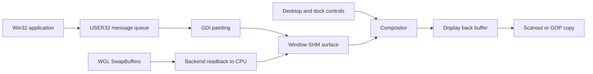

# Win32 graphics and presentation latency

## Original Microsoft runtime contract, 2026-10-08

The user clarified the intended architecture: run the original Microsoft
Direct3D DLLs against compatible Osito-K operating-system and graphics-driver
interfaces. WineD3D, DXVK and a substitute Direct3D implementation are outside
this requirement. Preserve the Microsoft DirectX installer work, general
PE/Win32 correctness fixes, shared-surface lifetime fixes and the concurrent
GUI work. The earlier external WineD3D package is a superseded experiment.

Installation compatibility is the distribution boundary: the repository,
kernel, distributable OS images and packages must contain neither Microsoft
DLLs nor the Microsoft installer. The user already ran the web installer on
P1. Independently supplied binaries may be inspected locally; tests in the
repository build their own small fixture DLLs. Do not add Microsoft binaries
to test assets or to the normal build as a shortcut around installation.

The runtime's graphics-driver boundary must be implemented before claiming
native Direct3D support. Microsoft's D3D9 driver interface provides
`OpenAdapter`, adapter functions and device functions; kernel services manage
allocations, synchronization and submission. See Microsoft's
[D3D driver functions](https://learn.microsoft.com/en-us/windows-hardware/drivers/display/direct3d-functions-implemented-by-user-mode)
and [WDDM architecture](https://learn.microsoft.com/en-us/windows-hardware/drivers/display/windows-vista-and-later-display-driver-model-architecture).
Do not replace missing graphics operations with success stubs or route them
through WineD3D/DXVK. Version and ABI must be explicit when qualifying a runtime;
an exported function name alone does not establish compatible behavior.

Read-only inspection of this development host found Microsoft-signed D3D9
DLLs in both system directories. The PE32 DLL imports adapter/device creation,
allocation, residency, synchronization, rendering and presentation functions
from GDI32's `D3DKMT*` interface, plus composition functions from `win32u.dll`.
At that initial audit the source exposed only two `D3DKMT*` entries, for memory
DC creation and destruction, both unimplemented. The adapter registry below
now supplies four more entries, but there is still no working WDDM device path.
This is a subsystem gap,
not evidence that copying another DLL or adding one loader alias will suffice.
These host DLLs are inspection inputs; no Microsoft system DLL was copied to
the P1 during this review.

Physical evidence is in the ignored local directory
`arch/x86/build/msgwait-20261003/graphics-native-audit/`. P1 remained reachable
by SSH, with Steam console request 6 running on r48. Its saved boot records
identify Intel UHD 630 (`8086:3e9b`) and NVIDIA `10de:1fb9`. The current Intel
code probes firmware scanout and does not implement 3D command submission;
the saved NVIDIA probe reports inaccessible BAR0. Saved display initialization
uses CPU copying to the GOP framebuffer. None of these records establishes
working hardware-accelerated rendering on P1.

A fresh passive BSP sample captured 1,362 ticks, with 1,342 in `cpu_idle_wait`.
This is idle time, not a lock or rendering hotspot. Earlier interactive samples
included WineD3D waits and Win32 context lookups. Neither profile measures all
CPUs or input-to-present latency. Performance qualification must measure that
latency, runnable versus blocked time, resource lifetime/memory, copies and
driver submission separately, with identical workloads before and after a
change. GPU submission alone will not qualify the whole presentation path.

The pending SHM capacity candidate was not deployed. Its host tests pass, and
the old-kernel 80-window probe reproduces exhaustion, but the new QEMU run did
not complete PE32 qualification within its deadline. PE64 rendered successfully;
the overall result remains unqualified. Do not treat that candidate as a
validated physical performance fix. No additional per-revision kernel backup
or source snapshot was made.

Next integration boundaries, in dependency order:

1. Pin the original runtime versions and inspect normal/delay imports and ABI
   layouts; make loader selection explicit, without the former provider route.
2. Define and test adapter/device/resource ownership, GPU address spaces,
   synchronization and submission against the runtime's driver contract.
3. Qualify physical GPU command completion, resource reuse and recovery before
   enabling a Direct3D device or advertising its capabilities.
4. Connect presentation to the compositor using explicit buffer ownership and
   completion, then measure real application latency and memory under load.

### Adapter contract baseline

`win32/d3dkmt_abi.h` defines the initial adapter-discovery ABI independently
of the SDK. Its native-pointer layouts differ between PE32 and PE64; KMT
handles stay 32-bit in both. A 64-bit kernel must marshal the PE32 structures,
not cast their pointers to the PE64 types. Query enum values also have gaps:
`KMTQAITYPE_ADAPTERTYPE` is 15, not the ordinal position in the documentation's
rendered list.

`test/native_d3dkmt_sdk_abi.c` compares all declared structures, field offsets
and query constants with the locally installed Microsoft SDK. Contrary to the
initial search result, this host has `d3dkmthk.h` and `d3dukmdt.h` in the SDK's
`shared/` directory. The comparison passes for x86/x64 with SDK 10.0.26100.0
and MSVC 14.44.35207 headers. These headers are read in place, not redistributed.

`test/native_d3dkmt_pe.c` runs the actual Windows adapter interface. It queries
the adapter count, enumerates adapters, records capabilities, driver version,
DX9 user-mode driver filename and device IDs, opens a second reference by
LUID, and checks both reference independence and rejection after final close.
Missing exports exit with code 2 and `KMT UNAVAILABLE`; that is not a pass.
Optional UMD/device-ID query statuses are recorded without inventing values.

The initial native x86 and x64 probes each passed 75 checks in two enumeration
cycles; adding short/oversized query observations raises this to 77. Windows
rejects both incorrect sizes and a closed handle with `0xC000000D`.
The development host reports NVIDIA `10de:2204`, separate display/render
capabilities and a software adapter. Its DX9 driver filename is `nvldumd.dll`
for PE32 and `nvldumdx.dll` for PE64. This is host evidence, not the P1 GPU
inventory and not a GPU rendering test. No driver DLL was loaded by the probe,
copied to Osito-K or installed. Results and executable hashes are in the ignored
`arch/x86/build/msgwait-20261003/native-d3dkmt/native.json`.

Build the freestanding probes from the repository root:

```sh
bash arch/x86/scripts/build-native-d3dkmt-test.sh build/native-d3dkmt
```

Optional arguments 2 and 3 are the local SDK `Include/<version>` directory and
MSVC `include` directory; supplying both enables the compile-only comparison.
Run `pe32/dxkmt32.exe` and `pe64/dxkmt64.exe` on Windows to collect the native
oracle. The `-empty` executable variant is for a guest with no registered
native adapter; do not run that variant as a Windows graphics acceptance test.

### Kernel adapter registry

`win32/d3dkmt_registry.c` implements process-owned adapter references, copied
driver metadata, boot-stable LUIDs, transactional enumeration and process-exit
cleanup. A removed adapter's outstanding references return `DEVICE_REMOVED`
and remain closable; a replacement adapter never inherits them. Reference
slots use generations and retire rather than wrap. Closing one reference
does not close another reference to the same adapter. Exhausting the table
leaves the enumeration output untouched and allocates no partial set.

`win32/d3dkmt.c` captures PE32/PE64 arguments for `D3DKMTEnumAdapters2`,
`D3DKMTOpenAdapterFromLuid`, `D3DKMTCloseAdapter` and `D3DKMTQueryAdapterInfo`.
These are registered in GDI32; `gdi32_release_process` releases their references.
The query subset covers driver version, adapter type, DX9 UMD filename and
one physical device's identifiers. Unsupported query types and versions fail.
Kernel buffers keep user-memory access outside the registry lock; failed
enumeration copyout rolls back the newly allocated references. User-pointer
validation follows the existing Win32 range helpers; this work does not add
a general VM pinning/copy-fault service.

Production starts with an empty registry. No existing GOP, Intel scanout or
NVK path calls `d3dkmt_register_adapter`, because none qualifies a native
render driver. Driver/device creation, memory allocation, command submission,
fences and presentation are still missing. Successful enumeration of zero
adapters is not Direct3D device support.

`scripts/test-d3dkmt-registry.sh` passes 75,160 checks per configuration with
GCC/Clang, normally and under ASan/UBSan. Coverage includes concurrent reference
use, foreign-process rejection, generation reuse, removal, table exhaustion,
exit cleanup, both argument layouts and copyout rollback. The mock adapter
exists only in the host test; it is never installed in the kernel.

The maintained QEMU runner accepts an optional fifth path argument pointing
to the KMT probe build directory. With the candidate kernel, both PE variants
passed 18 checks for an empty registry and invalid inputs; the ten DLL-loader
regressions also passed, without exceptions/assertions. Evidence is in
`arch/x86/build/msgwait-20261003/d3dkmt-registry-qemu/results.json`.
The same `directx-current/kernel.elf` output was reused, with the GUI included.
That initial candidate was qualified in QEMU; later native diagnostic loads
on P1 include these entries, as recorded below.

The existing `drivers/nvk_backend.c` is not a usable native Direct3D driver:
its command subset fills/copies memory with the CPU and its fence wait returns
success even for values beyond the signaled watermark. Its resource layer
also converts a GPU VRAM offset using the system-RAM `PHYS_TO_VIRT` mapping;
that is not a validated CPU mapping of VRAM. Neither its `ready` flag nor the
Intel firmware-scanout probe qualifies a hardware render adapter. Do not wire
these paths into successful D3DKMT device creation. GPU virtual addresses,
CPU mappings, resource ownership, actual completion and process cleanup need
their own correct implementation before that integration.

### Intel memory discovery

`drivers/intel_ggtt.c` decodes a captured Gen9 client PCI configuration into
separate CPU aperture, GPU virtual, GGTT table-window and firmware-stolen
memory ranges. It checks the documented GMS/GGMS/MSAC encodings, BAR types,
alignment, 39-bit addressing, nonoverlap with low DRAM and consistency of
BGSM/BDSM/TOLUD. Range helpers reject zero-length, overflowing and out-of-range
accesses, including an aperture larger than the configured GPU address space.
PTE lookup addresses the BAR0 window; it never treats a GPU virtual address
or the stolen table's physical address as a CPU pointer.

Definitions follow Intel's Kaby Lake PRM
[registers A-L](https://cdrdv2.intel.com/v1/dl/getContent/723921),
[registers M-Z](https://cdrdv2.intel.com/v1/dl/getContent/723924) and
[memory views](https://cdrdv2.intel.com/v1/dl/getContent/723948).
The host-bridge TOLUD layout is also in the
[8th/9th generation datasheet, volume 2](https://cdrdv2-public.intel.com/337345/8th-gen-core-family-datasheet-vol-2.pdf),
section 3.37. This decoder uses the client 39-bit PTE address format.

`intel_gfx_init` now verifies PCI memory decoding, the supplied BAR0 address
and the result of mapping MMIO before accessing registers. Read-only discovery
leaves the firmware's bus-master setting unchanged. The new memory probe is
initially gated to P1's `8086:3e9b` at segment 0, bus 0, device 2, function 0;
other display IDs retain their scanout probe. It captures configuration without
BAR-sizing writes, logs the validated ranges and samples only the first and
last GOP framebuffer PTEs. It never writes a PTE or dereferences the resulting
backing address. Two samples do not validate the intervening pages or establish
stable ownership of any mapping.

Memory discovery runs independently of scanout detection. P1's saved boot
record has plane A enabled and all three PIPECONF enable bits clear; the
existing scanout probe consequently reports fallback. That record does not
identify the active transcoder, and this change does not program the display.
`memory_valid` is metadata validation, separate from `ready`. Neither flag
registers a D3DKMT render adapter or proves rendering support.

Reproduce the host checks with
`bash arch/x86/scripts/test-intel-ggtt.sh build/intel-ggtt-host`.
The decoder passes 19,718 checks per configuration; the production probe now
passes 1,548 including tiled-fence and DMA observations. Both run with GCC and
Clang, normally and under ASan/UBSan. Inputs are
synthetic: exhaustive register encodings, boundary addresses, ignored PTE bits,
PCI read failures, missing memory decoding, mismatched BARs, mapping failure
and the saved P1 scanout pattern. The probe tests compile the real driver with
fake read-only PCI/MMIO providers; successful privileged initialization remains
outside host-test coverage. No Microsoft binary or replacement runtime is used.

The same candidate booted in QEMU and passed both empty-adapter probes and all
ten loader cases, with no exception/assertion markers. P1 then loaded kernel
SHA-256 `5838d7a18023002e13d7107d62366d8e8cdb9c1662043d23f0ac7cbeafdcd540`
through a temporary hotreload. SSH returned, the shell remained visible and
the memory probe reported GGC `02c1`, BDSM `9b800001`, BGSM `9b000001`, TOLUD
`9f800001` and MSAC `01`: an 8 MiB GGTT table, 4 GiB GPU virtual address space,
256 MiB CPU aperture and 64 MiB firmware data allocation. Both sampled GOP
PTEs were present, mapping the first/last bytes to `9b800000`/`9bfe8fff`.
The scanout probe still reports fallback; it does not identify the active
transcoder. These are physical discovery results, not rendering qualification.

Local evidence is `build/directx-current/p1-native.json`, the accompanying boot
log and `p1-memory-probe.png`. Steam was closed for this load. The USB's default
boot kernel and Microsoft installation were not changed. The fixed candidate
path is reused; only a symbol map was saved for the running kernel, without
another ELF/source backup. Earlier SHM pressure qualification remains incomplete.

Firmware-owned pages are not free allocations. Before allocating or binding
graphics buffers, establish their
ownership against the OS memory map and firmware reservations, CPU/cache and
GPU/IOMMU mappings, invalidation, completion and cleanup. GPU engines and a
compatible user-mode driver interface remain separate required work.

### GGTT binding ownership and recovery

`drivers/intel_ggtt_space.c` implements the native driver's address-window and
binding lifetime mechanics. The caller must first own the window and adapter,
exclude firmware reservations and prepare the correct DMA domain. The module
preserves all present entries during initialization and rechecks each selected
range before writing. An unexpected present mapping is retained and reported
as a changed window. The global first/last pages remain guard pages; bindings
support page alignment and an exclusive address limit for CPU-mappable buffers.

Binding consumes a list of already-owned DMA page addresses, independently of
CPU pointers. It writes Gen9 PTEs, requires the hardware backend to complete
writes/invalidation, and verifies readback. Partial failure restores the whole
range, including a write which may have reached the device despite an error.
If restoration, synchronization or readback cannot be verified, the binding
and its underlying RAM/DMA mappings must remain alive in quarantine. A later
unbind can retry restoration. No quarantined reservation is recycled.

Pins prevent unbinding during use. Unpin is a trusted driver's reference
release after actual completion or cancellation before submission; it does not
manufacture a GPU fence result. Per-space monotonic cookies reject stale
references when binding objects are reused and never wrap. A live object cannot
be copied to create another valid reference. Concurrent operations and callback
reentry return `BUSY` while an operation is in progress; the implementation
neither spins waiting for another caller nor disables interrupts around MMIO.
These are internal C objects with caller-owned storage, not user-visible handles.

The production module is in both x86 build lists. The initial platform probe
did not initialize it on hardware; the opt-in integration below adds real
MMIO callbacks and bounded GT takeover. No success-only hardware callbacks or
D3DKMT resource exports were added. `intel_gfx` reads all 32 CPU-aperture tiled-fence
registers twice and uses the existing read-only DMA diagnostic to capture the
Intel device's remapping unit. Unknown or enabled VT-d/protected-memory state
is not classified as identity DMA. The snapshot does not itself prepare a DMA
domain or permit a later bind without revalidation. Register definitions are
in the Intel PRM's `FENCE` section and the
[Intel VT-d specification](https://cdrdv2-public.intel.com/831418/vt-directed-io-spec.pdf)
(`GSTS.TES`, `PMEN.EPM`, `PMEN.PRS`).

The same `test-intel-ggtt.sh` runner now includes
`test/intel_ggtt_space_host.c`: 34,442 checks per configuration under GCC/Clang,
normally and with ASan/UBSan. Its mock hardware injects partial writes, read
errors, failed invalidation, mismatched readback and callback reentry. Four
threads bind, pin, unpin and unbind independent objects. Tests verify firmware
entries and ignored bits survive, pinned/quarantined ranges remain reserved,
recovery restores original PTEs and no reservation remains after success.
This qualifies software lifetime/rollback behavior, not physical GPU execution.

The platform probe was qualified on P1 with kernel SHA-256
`cd3907237f52a6ea2b3d7abf35b6d046386d35187a3b59f05123a8cc15197041` after
the 12 QEMU loader/adapter cases passed. Its read-only snapshot reports all 32
tiled fences disabled and valid, DRHD `fed90000`, GSTS `0`, PMEN `0` and no
faults for this requester. Thus identity DMA was observed at that instant;
no VT-d or fence control was changed. SSH and the visible shell survived the
temporary hotreload. Evidence is `build/directx-current/p1-native-dmesg.log`
and `p1-dma-probe.png`; the initial memory-probe result is also retained in
`arch/x86/build/msgwait-20261003/graphics-native-audit/intel-ggtt-progress.json`.

A subsequent guard rejects partially overlapping DMA-list and original-PTE
buffers before preflight can corrupt the source list. Its host suite and
kernel build pass; it is included in the physical integration below.

### Native GT takeover and CPU-aperture qualification

`drivers/intel_gt.c` implements a bounded Coffee Lake GT2 takeover through
real MMIO callbacks. It obtains render/media/blitter forcewake, requires an
inactive GuC/DMA scheduler, stops all four command streamers, waits for ring
idle and reset readiness, then performs the GT reset. Display registers are
not written. Every poll has both a clock deadline and an iteration limit.
Before reset, failures restore only request bits acquired by the caller. After
reset, firmware contexts cannot be restored: failures keep forcewake held and
prohibit GGTT binding. Success rechecks idle engines and forcewake and also
keeps wake held until a future driver implements context initialization/RC6.
This is a diagnostic state, not a production power-management policy.

The register sequence follows Intel's KBL PRM
[register volume A-L](https://cdrdv2.intel.com/v1/dl/getContent/723921)
(`GDRST`, forcewake acknowledgements) and
[M-Z](https://cdrdv2.intel.com/v1/dl/getContent/723924)
(`MI_MODE`, `RESET_CTRL`). The Coffee Lake GT2 engine set and serialized reset
sequence were cross-checked against upstream i915. Clearing PCI bus mastering
alone is not accepted as proof of internal GT inactivity.

`drivers/intel_gfx_memory.c` connects the GGTT lifetime manager to aligned,
uncached PTE writes through `GTTMMADR`. Posting reads complete writes; the
device's documented snooping of this UC aperture provides translation
invalidation. This qualification is limited to a stopped GT and CPU-aperture
access. It does not provide GuC, WC-table or command-streamer coherency for a
future submission implementation.

Build with `INTEL_GGTT_DIAGNOSTIC=1` to run the one-shot physical test on
8086:3e9b. The normal build leaves it disabled. It revalidates identity DMA,
disabled tiled fences, PCI memory decoding, both CPU aliases and PAT settings.
Firmware GGTT entries are inventoried and preserved. The selector excludes
the GOP's large pages, the low 64 MiB, the final 2 MiB of CPU aperture and
windows with unknown or changing entries. Present entries inside the chosen
window remain reserved. After GT takeover, it binds its own allocated RAM,
checks aperture reads/writes and guard pages, restores the PTE, then reuses the
same GPU address for a different RAM page. Exact changed-entry restoration and
a whole-table inventory hash must agree before RAM is freed. Failed or
uncertain restoration retains RAM instead of returning it to the allocator.

The host runner includes production GT sequencing with read/write failures,
stalled ACK/idle/reset registers, frozen time and failed rollback, plus the
actual window selector with unknown, changing, full and GOP-overlapping
windows. GCC/Clang normal and ASan/UBSan configurations pass. These mocks
validate sequencing and ownership; physical evidence is recorded separately.

The first physical run (`0f23a729d20ed5bfbc6301aba798e7a93d3f3487affea04a4e3ad04f96fc7fa6`)
completed the four-engine takeover and retained the display and SSH. It
stopped before any PTE mutation when inventory encountered an all-ones entry.
The revised selector preserves such entries and searches a separate verified
window. Evidence: `graphics-native-audit/gt-takeover-first.log` and
`build/directx-current/p1-gt-takeover.png`.

The revised kernel (`1ed0c940f249cc3b3bbcd323817ebfe6cc4978107b92de8093d9455e652d2ffd`)
passed both physical binding rounds on P1 at GPU address `0x0fc00000`.
The complete table contained 530,865 present entries, including 16 unknown
all-ones entries outside the chosen window. The original table was restored,
both guard pages and the inactive test page stayed intact, and all four owned
RAM pages were released. The second run inherited the preceding run's held
forcewake requests; its `wake_held=0` field counts newly acquired requests,
not total active wake domains. This diagnostic session still keeps GT awake.

The same ELF passed all 12 PE32/PE64 loader/adapter QEMU cases, with no
exceptions or assertions. Physical logs likewise have no #PF/#BP or fatal
exception markers, SSH responds and the GOP capture is unchanged after the
test. Evidence: `native-ggtt-window-qemu/results.json`,
`build/directx-current/p1-ggtt-dmesg.log`, `p1-native-ggtt.png`, and
`graphics-native-audit/native-ggtt-progress.json`. The temporary candidate
was loaded by hotreload; the USB default kernel and installed Microsoft files
were not modified. This proves CPU-aperture translation and lifetime cleanup,
not GPU command execution, Direct3D rendering, Braid gameplay or performance.

### Native BCS command execution and retirement

`drivers/intel_bcs.c` adds an internal, one-shot Coffee Lake blitter submission
path. It builds an owned two-page logical context and one-page command ring,
uses an owned global HWSP and empty PML4, and submits a context descriptor
through the four ordered execlist-port writes. The command is `MI_FLUSH_DW`
with a per-process HWSP token; it does not copy or render a surface. It follows
Intel's [command streamer](https://cdrdv2.intel.com/v1/dl/getContent/723951),
[structures](https://cdrdv2.intel.com/v1/dl/getContent/723936) and
[instructions](https://cdrdv2.intel.com/v1/dl/getContent/723916) references,
cross-checked against the upstream i915 Gen9 XCS context layout.

Completion requires the actual GPU-written token, a matching context-complete
CSB event, an idle execlist and the expected head/tail. The engine then stops,
acknowledges reset readiness and completes the BCS reset sequence before any
memory is unpinned. A failed retirement retains the pages and mappings. The
new `intel_gfx_kexec_ready()` check rejects hotreload in that state before WLAN
shutdown or staging: clearing PCI bus mastering alone cannot prove that GT
has dropped internal DMA references. A completed token alone cannot permit
hotreload. This boot-only check will need synchronization when submission
becomes available concurrently with kexec.

Enable both `INTEL_GGTT_DIAGNOSTIC=1` and `INTEL_BCS_DIAGNOSTIC=1` for the
physical qualification. Both remain off by default. Five mapped pages hold the
context, ring, global HWSP and PML4, with physical guard pages outside the
allocation. The existing GGTT test must pass first. After engine retirement,
the diagnostic checks the token, guards, untouched ring/PML4, exact PTE
restoration and the complete GGTT inventory hash before freeing RAM.

The six host suites pass under GCC/Clang, normally and with ASan/UBSan. BCS
coverage includes write-applied-but-reported-failed injections at every I/O
step, delayed/mismatched completion, stale head, frozen time, stalled reset
and failed retirement. These are model tests, not hardware execution. The
window suite also verifies the production kexec gate with outstanding,
completed-but-unretired, retired and never-published DMA references.

Kernel `033d6184e055d78b66966f20a105c204f19b0059086b3c1946b351d7029a027d`
passed all 12 PE32/PE64 loader/adapter QEMU cases and then the physical P1 test:

- Context `0x1001` at GGTT `0x0fc00000` produced matching token
  `0x6f73697441b1e093`, CSB `0x18/0x1001` and head/tail `0x20/0x20`.
- Engine status was clear. Retirement, PTE restoration and guard checks
  passed; no test RAM remained allocated.
- The measured completion-poll interval was 22,831 ns. This excludes setup,
  reset and cleanup and is not a rendering or application benchmark.
- SSH and the GOP shell remained available, the screen pixel hash matched
  the previous run, and collected logs contained no #PF/#BP/fatal markers.

Evidence: `native-bcs-handoff-qemu/results.json`,
`graphics-native-audit/native-bcs-p1.log`, `native-bcs-progress.json`,
`build/directx-current/p1-native-bcs.png` and the `intel-bcs-host` logs.
The temporary ELF includes the shared GUI changes. The USB default kernel
and installed Microsoft files were not changed.

This establishes a real command-submission/completion path on the Intel GPU.
It does not yet supply surface rendering, an original-runtime-compatible UMD,
a D3DKMT render adapter, Braid gameplay or an application performance result.
Next prerequisites include owned per-context GPU page tables for surface
access, actual blitter/render workloads, reusable context/scheduling and power
lifecycle, residency/synchronization and presentation. Forcewake remains held
in this diagnostic; production RC6 and context restore are still pending.

### Per-context GPU memory and physical surface copy

`drivers/intel_ppgtt.c` builds owned Gen9 four-level page tables from sorted
4 KiB DMA mappings. It preflights the exact table capacity, address limits,
duplicate virtual addresses, CPU-buffer overlap and data mappings into the
table arena before modifying any output. Unused entries remain non-present.
The implementation currently accepts the low canonical 47-bit VA half and
39-bit client DMA addresses. It builds offline tables; it is not a live
mapping/residency manager. Callers retain the complete arena and data pages
until the engine is retired. Source leaves in the diagnostic are read-only,
but write-protection enforcement has not yet been qualified on hardware.

The P1 initially rejected the surface test before allocating or submitting:
private PAT low read `0x03030303`, with slot 3 configured write-back. The
builder's data PTEs select slot 3 with PWT|PCD. The new PAT ownership helpers
therefore change only that slot to uncached while all GT engines are stopped,
verify the write, and restore it after BCS retirement. The other slots are
preserved. A write that applied but reports failure still owns a restoration
obligation; an unexpected external change to slot 3 is not overwritten.
This setup follows the Intel memory-view/PAT contract and upstream i915's
Gen8 private-PAT slot selection. Evidence of the stopped initial attempt is
`graphics-native-audit/native-copy-pat-preflight.log`, kernel
`88e59100afe7fc095ef948e13e23d2ffc7926f449f0cfc9fcd5265c9f474709f`.

`intel_bcs_build_copy()` emits a bounded, linear 32bpp `XY_SRC_COPY_BLT` and
then the existing hardware completion token. Pitches are positive byte
strides; checked extents must fit distinct owned surfaces. BCS completion
now checks the caller's validated ring tail, supporting the token-only and
copy programs. No Win32 application can submit arbitrary commands through
this internal diagnostic API.

The final kernel
`1f53e567c5c38d6e07017cb370290b47ac12c82705676e56cfb477886d69979b`
passed the physical P1 test. Eight table pages map two-page source and
destination surfaces at PPGTT addresses `0x1235ff000` and `0x1403ff000`.
These addresses exceed the 4 GiB GGTT range and each crosses a 2 MiB page-table
boundary. The source and destination also use distinct page directories.
Only the context, ring and global HWSP occupy GGTT mappings.

The GPU copied all 851 pixels of a 37-by-23 rectangle with a 256-byte row
stride. CPU verification checked every source/destination dword, unchanged
row padding and trailing storage, both physical guard pages, the unchanged
command ring and PPGTT table hash, and the GPU completion token. The matching
CSB event was `0x18/0x1001`, head/tail were `0x40/0x40`, and engine error was
zero. Engine retirement, private PAT restoration to `0x03030303`, exact GGTT
restoration and freeing of all 18 RAM pages succeeded. The 33,841 ns recorded
completion-poll interval is not an application or rendering benchmark.

Seven host suites pass in GCC/Clang normal and ASan/UBSan configurations.
PPGTT tests walk the actual tables across PT/PD/PDP/PML4 boundaries, exercise
capacity and invalid/overlapping inputs, and inject failures throughout PAT
acquisition/restoration. The same ELF passes all 12 PE32/PE64 QEMU
loader/adapter cases. QEMU provides no Intel hardware evidence. P1 logs show
no #PF/#BP/fatal markers; SSH remains operational and the GOP shell's pixel
hash is unchanged. Evidence: `native-ppgtt-copy-pat-qemu/results.json`,
`graphics-native-audit/native-copy-p1.log`, `native-copy-progress.json`,
`intel-bcs-host/`, and `build/directx-current/p1-native-copy.png`.

This proves native GPU surface copying through owned per-context mappings.
The path remains an opt-in one-shot qualification with polling, held forcewake
and engine reset before resource release. Next work must implement reusable
contexts, submission/fence scheduling and lifecycle without a reset for each
copy, then 3D state/shaders and the original-runtime-compatible UMD/DDIs and
presentation path. The production adapter registry remains empty. Braid,
Direct3D device creation and application performance are not yet qualified.

### Reusable BCS engine session and saved contexts

The native BCS layer now separates `enable`, `submit`, `check`/`wait` and
`close`. Enable programs global HWSP/execlists once. Submit accepts one job
only while idle, keeps references before the first potentially effective
port write, and rejects resubmission after an I/O/timeout failure. Check makes
one bounded observation and requires the new hardware token, matching CSB
completion and expected head/tail. It retains the CSB read position across
jobs, including wrap. The polling wait remains a diagnostic helper; this is
not yet an interrupt-driven OS scheduler. Close performs the stop/reset
retirement once at final shutdown or recovery. The one-shot `intel_bcs_run`
wrapper remains available for isolated qualification.

`intel_bcs_append_copy()` appends a checked copy to an empty, hardware-saved
ring, preserving the saved head/wrap count and engine image. It advances the
tail modulo the ring size and clears engine-restore inhibit for reuse. The
caller must first confirm completion and synchronize CPU caches. Context,
page tables, ring and HWSP remain owned through final engine retirement;
individual job completion is not a global DMA shutdown acknowledgement.
The session API expects serialized caller ownership and does not yet provide
concurrent process handles, job queues, cancellation or per-resource residency.

Kernel `c4b6b222a6c3a2ce0cd5700934210ab63e3b213c452b1c5cb4f256fdcf1f7790`
passed 140 physical copies on P1 while alternating two contexts. Each context
maps the same GPU surface addresses onto its own physical pages and uses
distinct data patterns for each job. Both retain their independently
hardware-saved engine state; no BCS reset occurs between submissions.

Both contexts completed and verified 70 jobs (59,570 pixels each). Each ring
wrapped once, finishing with saved head `0x00200180`, tail `0x00000180` and
control `0xffff0008`. Every job checked the complete source/destination
buffers, padding, guards, ring and page-table hashes, token, saved PML4
pointer and saved head/tail. The final hardware event identified context
`0x1002`; engine error remained zero. Final retirement restored private PAT
and GGTT and released all 36 RAM pages. The GOP shell pixel hash was unchanged,
SSH remained available and collected logs contained no #PF/#BP/fatal markers.

The seven host suites pass with GCC/Clang, normally and with ASan/UBSan.
BCS tests now include a persistent 20-job two-context session, CSB wrap,
early-token/delayed-CSB completion, rejection of a second in-flight submit,
errors on each descriptor-port write, and repeated saved-ring appends across
multiple wraps. Existing timeout/retirement fault injection remains. The
same ELF passes all 12 PE32/PE64 QEMU loader/adapter cases.
Evidence: `native-bcs-context-qemu/results.json`,
`graphics-native-audit/native-context-p1.log`, `native-context-progress.json`,
`intel-bcs-host/` and `build/directx-current/p1-native-context.png`.

This qualifies reusable native blitter contexts and real job completion,
not Direct3D rendering or application latency. Next integration requires an
OS-owned device/context/resource lifecycle, scheduling/completion delivery
and cancellation/recovery, followed by 3D state/shaders, the original-runtime
UMD/DDIs and compositor presentation. The diagnostic retains forcewake and
keeps interrupts masked; production power/IRQ lifecycle remains pending.

### Native BCS queue and deferred context destruction

`intel_bcs_queue.c` adds a kernel queue over the real BCS session,
with eight context bundles and 32 retained job/result slots. Attaching a
bundle associates its pinned context, ring, HWSP, page tables and surfaces
with a kernel owner identity and a nonrepeating context ID. Enqueue captures
the typed copy request and retains its context before returning a fence.
Dispatch follows fence order, including when cancellation frees lower slots.
The prepare callback only validates/encodes/cache-syncs owned memory; the
queue submits and checks completion through the native engine implementation.
No raw user command buffer, replacement graphics runtime or renderer is added.

Cancelling an unsubmitted job records cancellation without hardware access.
Cancelling active work returns busy, because already-issued writes cannot be
undone. Closing a context rejects new work, cancels its queued requests and
lets its active request finish. Completed fences do not authorize context
destruction: all bundles, including the one backing global HWSP, remain owned
until shutdown confirms stop/reset retirement. A failed reset retains them
for recovery. Submission/check failures poison further dispatch and retain
uncertain active work; only confirmed retirement permits its failed/aborted
result and resource release. Results remain readable after context release,
until explicitly consumed; unread results apply backpressure. IDs and fences
stop at exhaustion instead of wrapping onto stale references.

The queue advances one bounded observation or one dispatch per step. Shutdown
runs in thread context because it performs bounded hardware retirement. The
initial qualification below used a serialized caller; concurrent admission
and process-exit notification are described in the following section. This is
the kernel queue/lifetime foundation, not yet an interrupt worker or a live
residency manager. Surface ownership is currently retained
as an immutable context bundle, not independently pageable resource handles.
The diagnostic still uses polling and keeps forcewake held. Production
worker wakeup/completion delivery, IRQ/power, process device/context/resource handles, live
mapping lifetimes and recovery remain, followed by 3D state/shaders,
original-runtime-compatible UMD/DDIs and compositor presentation.

Host coverage uses the production queue and BCS engine with the existing
MMIO model. It checks cross-owner rejection, immutable job capture, FIFO after
slot reuse, queue saturation, unread results, cancellation/close during active
work, early-token/delayed-CSB completion, every I/O failure on submission and
completion, timeout, failed shutdown followed by recovery, preparation failure
and ID/fence exhaustion. The BCS queue checks pass under GCC and Clang, both
normally and with ASan/UBSan. They supplement the existing seven host suites.

Kernel `f982b95d47a6a003299c1b6653de3546f4a82814a1807f0994ee69d5ff4e40ee`
passed all 12 PE32/PE64 QEMU loader/adapter cases and the physical queued-copy
test on P1. The queue submitted/completed 140 copies across two saved contexts
(70 each, 119,140 verified pixels total) and cancelled 72 unsubmitted jobs.
The final jobs close their contexts while active; the test verifies deferred
release both then and after completion but before engine retirement. Both
contexts survive a ring wrap, with no reset between jobs. Final shutdown
restores PAT/GGTT and releases all 36 pages; engine error is zero. The persistent
USB boot kernel remains unchanged. No Steam/Braid or 3D/performance result is
implied. Evidence: `native-bcs-queue-qemu/results.json`,
`graphics-native-audit/native-queue-progress.json`, `native-queue-p1.log`
and `build/directx-current/p1-native-queue.png`.

### Concurrent queue admission and process-exit notification

Queue metadata now uses a short IRQ-safe lock. A separate worker-busy state
serializes engine access, while all preparation callbacks, cache maintenance,
MMIO and stop/reset polling run outside that lock. Competing worker/shutdown
calls return busy; shutdown closes admission immediately and is retried after
the active worker returns. Pending job storage and backing references survive
that interval. Closing a preparing context prevents its later MMIO submission;
it cannot be reused because its CPU preparation may already have changed the
saved ring. Cancelling just a fence after preparation begins returns busy.

The existing `gdi32_release_process` -> `d3dkmt_release_process` teardown path
now notifies registered native BCS queues after dropping the adapter registry
lock. It closes all contexts belonging to that Win32 process, cancels queued
work, blocks late admission for the exited owner, and retains active DMA
references. It never accesses hardware or waits for the worker. The queue
registry pins queue storage until explicit unpublication after successful
engine shutdown; lock order is queue-registry then queue-metadata. Terminal
results abandoned by exited owners are reclaimed on subsequent admission or
worker steps, so they cannot indefinitely exhaust another owner's job slots.
Live owners keep the explicit result-consumption contract.

Host tests run a second thread paused inside preparation, the fourth ELSP
write, completion observation and engine stop. The caller exercises the actual
`d3dkmt_release_process` hook, result access, admission, competing worker calls
and shutdown at each boundary, with and without concurrent shutdown. They
verify no MMIO from exit, retained preparing/active references, suppressed
submission after a preparing context closes, completion after submitted work
closes, recovery, registry lifetime and abandoned-result reclamation. Both
compiler and ASan/UBSan configurations pass. ThreadSanitizer compiled but its
runtime failed before executing tests with an unexpected-memory-mapping error
under WSL; no TSan success is claimed.

Kernel `0d9e6094742305e7799c94ecd16150905589d55b13a4489fc3099ae757b2ec2e`
passed all 12 PE32/PE64 QEMU loader/adapter cases and the P1 native diagnostic.
All 140 copy dispatches ran on AP workers (`ap_steps=140`, `bsp_steps=0`);
completion observation and admission ran on the BSP. The final submitted jobs
use the production D3DKMT exit hook with diagnostic owner IDs to close their
contexts and cancel queued successors. All 140 jobs/119,140 pixels, 72
cancellations and four deferred-release checks passed. Both rings wrapped;
final retirement restored PAT/GGTT and released all 36 pages. SSH remained
available and no exception marker appeared in the collected boot log. This
checks native worker handoff and the exit-notification function, not a Win32
application creating a DDI device and exiting during rendering.
Evidence: `native-bcs-owner-qemu/results.json`,
`graphics-native-audit/native-owner-progress.json`, `native-owner-p1.log`,
`intel-bcs-host/` and `native-d3dkmt/host/`.

This adds the notification and concurrency boundary. Driver-managed allocation
and process admission, independently owned GPU resources, a persistent device
worker with wakeups, IRQ/power lifecycle, and end-to-end process-exit testing
through the eventual UMD/DDI device API remain necessary. The render-adapter
registry remains empty, and no replacement Direct3D runtime is introduced.

### Independently owned GPU buffers and BCS contexts

`intel_gpu_buffer` now owns allocator-provided DMA RAM independently of the
engine or context bundle. It validates the DMA domain and CPU mapping before
access, zeroes complete rounded pages before publication, checks the owner,
and prevents movement/reuse of a live buffer object. A failed initial cache
synchronization cannot grant a pin. Close denies new references and retains
pinned storage; unpin only drops the reference, leaving deferred reclamation
to the owner/retirement worker. Invalid allocator output remains quarantined
without touching or freeing suspect RAM. Allocation, synchronization and
release callbacks run under a nonblocking object claim, without a spinlock or
IRQ-disabled wait across those operations. Contending callers must retry.

`intel_bcs_context` separately owns its saved context/ring and PPGTT arena,
and pins two independently allocated source/destination buffers. A range
planner sizes the four-level PPGTT exactly without allocating per-page input
metadata. The source mapping is read-only, destination writable, and all
unmapped entries are absent. Partial construction retains enough state for
retryable teardown, including failed GGTT rollback. Attached contexts cannot
release mappings or RAM before the queue has confirmed engine retirement.
The global HWSP belongs to the engine rather than either context.

This is still an internal, worker-serialized, immutable-mapping API. The PMM
adapter currently lives in the boot diagnostic; its allocation includes guard
pages, CPU/DMA checks and cache synchronization. Context construction requires
stopped GT/GGTT ownership. Live residency/eviction, a reusable device service,
user handles and quotas, IRQ/power lifecycle, native RCS 3D commands/shaders,
and the original-runtime UMD/DDI contract remain separate work. This does not
advertise a rendering adapter or provide a substitute Direct3D runtime.

The host resource suite exercises byte-sized allocations and page padding,
owner checks, failed allocation/validation/cache/release, callback reentry,
concurrent operations held inside cache synchronization, partial context
construction, GGTT quarantine/retry, ring wrap, and deferred destruction.
Range-builder output is compared with the independently exercised per-page
builder across PT/PD/PDP boundaries and sparse permission changes. All four
GCC/Clang normal and ASan/UBSan configurations pass 390,777 checks per run.
The remaining graphics host suites also pass. Checks count assertions and
mock callback validation, not independent end-to-end scenarios.

Kernel `50060d389529003a2e67dcf0367cb384b4cd889d54a7118e25b060c474738748`
passed the 12 PE32/PE64 loader/adapter cases in QEMU and the P1 hardware run.
The two contexts used 8,192/8,192-byte and 21,105/31,565-byte source/destination
allocations, with respective pitches 256/256 and 512/768 bytes. Both performed
70 copies with one ring wrap: 383,880 copied pixels in total. All 140 dispatches
ran on AP workers. Full rounded surfaces, row padding, source contents, table
and ring hashes, saved engine state, completion tokens and allocation guards
were checked. The final jobs also checked four surface closes deferred while
submitted DMA remained referenced, in addition to 72 queued cancellations and
four deferred context-destruction checks. After final engine retirement,
PAT/GGTT were restored and all 59 allocated pages (including 18 guard pages)
were freed with zero guard failures. The collected log had no exception
markers, SSH stayed available and the captured GOP shell pixels were unchanged.
Evidence: `native-bcs-resource-qemu/results.json`,
`graphics-native-audit/native-resource-progress.json`, `native-resource-p1.log`
and `build/directx-current/p1-native-resource.png`. The kernel was temporarily
hotloaded; the persistent USB boot default remains r48. No Steam/Braid or 3D
performance result is implied by this resource-lifetime qualification.

### Device-scoped allocation handles and deferred process cleanup

`intel_gpu_memory` manages 16 internal device records and 64 stable allocation
slots over the owned-buffer layer. Device and allocation IDs share a monotonic
32-bit namespace; exhausted IDs never wrap. Lookup checks both PID and device,
so another device of the same PID cannot acquire an allocation accidentally.
Caller-private, nonmovable leases pin a buffer before exposing its kernel
pointer; native contexts take an additional pin before releasing that lease.
Neither a CPU pointer nor a raw DMA address is a public resource handle.

The manager reserves rounded surface pages before leaving its metadata lock
to call the allocator. The configurable total limit and per-PID limit include
all devices of the process, allocations in progress and failed reclamation.
Logical allocation/device close immediately blocks subsequent acquisition.
The D3DKMT process-exit notification now closes registered memory managers
as well as native queues, without allocator, cache, free or MMIO operations.
If exit wins while allocation is in progress, creation publishes no handle;
the failed publication remains charged until the worker reclaims its storage.

Collection claims at most one closing allocation and frees outside the short
IRQ-safe lock. Busy pins, failed release and quarantine retain both storage
and quota. The scan rotates past retained objects. Manager storage remains
registered until shutdown and full reclamation, including in-flight callbacks.
The physical diagnostic uses this manager for all four surface allocations,
with diagnostic devices/owners; context tables/state and engine HWSP remain
separately owned driver allocations.

This internal API is not `D3DKMTCreateAllocation`, a DDI device, or a resource
sharing ABI. The future public device entry point must serialize *new* device
admission with NT process liveness/teardown; a PID snapshot alone is insufficient.
After an owner is fully reclaimed the manager intentionally retains no permanent
PID tombstone, so callers cannot use this API to reopen a terminated process.
The current boot diagnostic has private owners and no user device admission.
Driver-private overhead has a separate budget; live residency/eviction,
persistent worker/wakeups, IRQ/power, RCS rendering and UMD/DDIs remain pending.
This follows the separate runtime/driver/resource/allocation responsibilities
in [Microsoft's resource lifecycle contract](https://learn.microsoft.com/en-us/windows-hardware/drivers/display/handling-resource-creation-and-destruction).

Host tests cover per-process quotas across devices, total budget, slot/ID
exhaustion, stale/cross-owner/cross-device handles, lease copy rejection,
failed creation and reclamation, deferred pins, registration lifetime and
process exit. Threaded cases pause inside allocation synchronization and
release, then invoke the actual D3DKMT exit hook and competing manager calls.
All four GCC/Clang normal and ASan/UBSan variants pass 410,186 combined resource
checks; the other graphics suites and 75,160 D3DKMT registry checks per variant
also pass. No ThreadSanitizer success is claimed.

Kernel `b6a279cc4bd8c20ca0b731122a500f6b64d5893c9de02e78d6025e13856119f6`
passes all 12 QEMU loader/adapter cases and the P1 hardware diagnostic using
four managed surface handles on two diagnostic devices. All 140 AP-dispatched
copies/383,880 pixels passed, with 72 cancellations, four deferred context
releases and four deferred surface reclamations following process-exit
notification. Final engine retirement restored PAT/GGTT, freed 59/59 guarded
pages and reported `charged_pages=0 memory_registered=0`. No exception marker
appeared; SSH and captured GOP shell pixels were preserved. The temporary
hotreload includes the shared GUI changes; persistent USB default remains r48.
This proves the native resource manager and exit-hook behavior with diagnostic
owners, not actual Win32 device admission, 3D rendering or application latency.
Evidence: `native-bcs-admission-qemu/results.json`,
`graphics-native-audit/native-admission-progress.json`, `native-admission-p1.log`
and `build/directx-current/p1-native-admission.png`.

### NT process admission boundary

`nt_process_open_gpu_device` now validates an existing NT process and publishes
its internal device under the same BSP IRQ exclusion used by
`nt_process_begin_vm_teardown`. It does not lazily create an unknown owner.
Missing, inactive and VM-closing owners cannot receive a device; outputs are
preserved on rejection. This OS schedules NT tasks on the BSP and uses local
IRQ exclusion for its process table, so the helper explicitly rejects AP
callers before inspecting that table. AP workers continue to operate only on
captured driver objects. No allocator, cache or MMIO operation runs in this
admission boundary.

The common `nt_vm_release_process` entry now calls
`nt_process_begin_vm_teardown` before any subsystem cleanup. That closes the
admission gate for direct cleanup callers as well as the existing Win32 child
and root exit paths. The existing `nt_process_begin_main_cpu_accounting`
reopens the persistent root NT object for its next PE launch. Driver-resource
reclamation remains deferred to the memory manager after its references drain.

This is a kernel-only helper with a stable registered manager and captured
output. The eventual DDI device implementation must derive its PID from the
calling process and use this helper, not the raw memory-manager admission API.
It does not yet expose `D3DKMTCreateDevice` or advertise a rendering adapter.
A future NT scheduler that mutates process state on APs must replace this BSP
exclusion contract before enabling admission there.

The `win32-process-test` diagnostic now creates real NT child objects with
private test tokens, so it can run even after a previous PE's primary token
has been retired. Its graphics section allocates two actual PMM pages through
a private CPU-only test allocator, pins them, executes the common NT VM/GDI
teardown path, rejects reopening both before and after manager reclamation,
then releases the lease and verifies zero outstanding allocations. It also
checks inactive/unknown owners, independent owners, preserved IRQ state and
actual AP rejection. No GPU command or DMA-domain/cache qualification is
claimed for this NT-specific allocator; the Intel BCS diagnostic covers the
hardware separately.

`console launch win32-process-test` hands this argument-free diagnostic to the
idle local prompt through the existing authenticated mailbox. It requires
normal console readiness and retains the existing single-request/quoting
rules; it does not run NT test code inside the SSH service task. The shell
host suite passes 191 checks in all four GCC/Clang and sanitizer variants.
The QEMU loader test exercises this handoff after consecutive PE32/PE64 runs,
as well as a local invocation before those runs.

Kernel `26d5afad5d3692d1f68e41236e6a199f08678590fa1bafc5496b3524ac483913`
passes 14 QEMU cases, including both 22-check NT admission/cleanup runs around
the PE32/PE64 cases and the authenticated console handoff. The P1 passed two
consecutive physical console requests, each with 22 graphics-process checks,
zero failures and actual AP rejection on CPU 1. Both requests returned to the
idle prompt. The separate boot BCS diagnostic still passed 140 AP copies,
383,880 pixels, all guards and 59/59 reclaimed pages; no exception marker
appeared in the collected log. The screenshot shows both process-test PASS
lines and the shell. This is temporary hotreload with the shared GUI included;
the persistent USB default remains r48. These NT tests use real process objects
and common VM cleanup, but do not claim a PE-created DDI device or application
exit during rendering. Evidence: `native-nt-admission-qemu-r2/results.json`,
`graphics-native-audit/native-nt-admission-progress.json`,
`native-nt-admission-p1.log`, `native-nt-admission-shell/` and
`build/directx-current/p1-native-nt-admission.png`.

### Queue notifications and blocking consumers

`intel_bcs_queue_watch` installs one kernel-owned event sink for work, terminal
results, faults, state changes and newly available result slots. Installation
delivers an initial snapshot hint, so already queued work cannot be missed by
a consumer that starts later. `intel_bcs_queue_snapshot` provides a consistent
count of queued, active and terminal jobs plus fault/closing/stopped state.
Result peeks are read-only; notifications do not consume or manufacture a
fence result. Queued cancellations, failed preparation, completion, consumed
results and exited-owner reaping all publish the relevant wake hint.

Callbacks run outside the queue and process-notification registry locks. A
short in-flight reference retains the sink through delivery; unwatch returns
BUSY while a callback is running and leaves it installed. Unpublish requires
both engine retirement and removal of the sink. Process exit collects pinned
notifications under the registry lock and delivers them after releasing it,
so notification code cannot deadlock an unrelated process's queue cleanup.
Shutdown can complete without waiting for a callback, but it cannot authorize
release of that callback's storage. A failed retirement emits a fault hint
without declaring pending work complete or freeing its DMA references.

Events may be concurrent, combined and out of order. They are hints to recheck
predicates, not a FIFO event log or hardware-completion proof. A production
sink must be bounded and IRQ-safe, only signal deferred work, and use a
retained signal or atomic arm/recheck wait protocol. It cannot call the BSP
NT/scheduler tables from an AP, perform GPU MMIO, wait, or mutate the queue.

The host test runs a persistent pthread consumer using retained semaphore
signals and the existing production BCS queue/register model. It processes
128 jobs without resetting the engine, including work published before the
observer/worker starts. It covers queue-full backpressure, result retention,
callback suspension during process exit, concurrent unwatch/unpublish,
independent-owner progress, failed preparation and uncertain MMIO submission.
The deliberate callback suspension is a test injection, not allowed in a
production sink. Physical IRQ delivery and scheduler sleeping are not modeled
by this test. The test is part of `test-intel-ggtt.sh` in all four GCC/Clang and
ASan/UBSan configurations.

The physical boot diagnostic now dispatches both submission and completion
observation through the AP work pool. Its event sink inspects a locked snapshot
and counts result notifications without touching NT state. It still joins
each diagnostic work item and retires the engine before the shell opens;
this is not yet the persistent post-boot GPU device service. That service,
GPU interrupt/watchdog delivery, live residency, RCS 3D/shaders, UMD/DDIs and
presentation remain required before rendering applications can use this path.

Kernel `8dec309c5bb1578f4506dc7fc8d6b30c94f53f22da089b8448a7596581835190`
passes all 14 QEMU cases and the physical P1 diagnostic: 140/140 copies,
383,880 verified pixels, 280 AP work dispatches and no BSP fallback. It emits
638 notifications, including 212 terminal-result notifications (140 completed
copies and 72 cancellations); 140 notifications execute on APs and snapshot
validation reports zero errors. Both contexts and every surface remain pinned
through retirement; all 59 pages are released, quota reaches zero, PAT/GGTT
are restored and the manager is unregistered. SSH and the idle shell return,
and the collected log contains no exception marker. Host wakeup tests pass
15,613 assertions per GCC/Clang normal/ASan+UBSan configuration; their 128
blocking-consumer jobs use the register model, not real GPU interrupts.
Evidence: `native-queue-wakeup-qemu/results.json`,
`graphics-native-audit/native-queue-wakeup-progress.json`,
`native-queue-wakeup-p1.log`, `intel-bcs-host/wakeup-*.log` and the reusable
`build/directx-current/p1-native-current.png` shell capture. The candidate was
hotloaded temporarily with GUI changes included; the USB boot default remains
r48 and the DirectX installation was preserved.

### Retained scheduler signals for the GPU worker

`sched_signal_t` retains wake bits in stable kernel storage. Senders on the
BSP, APs or interrupt paths combine bits atomically; only an empty-to-nonempty
transition requests a BSP scheduler IPI. `smp_wake_bsp` uses vector 32's normal
register-save/IST path, not the AP work vector that only acknowledges an IPI.
The clock already derives elapsed time from TSC, so an extra scheduler IPI
does not manufacture a 10ms tick. AP senders never touch the process table.

`sched_signal_wait` registers the current BSP task under IRQ exclusion, parks
it, and rechecks retained bits before enabling interrupts. The scheduler's
existing sleep sweep checks signal predicates before choosing the next task;
signalled tasks are promoted and cancel their timeout. The wait does not
consume bits. A caller takes old hint bits before rechecking its driver
predicate, then waits only if still incomplete. Zero timeout has no polling deadline; finite
timeouts use the existing 10ms clock and are intended for watchdogs, not frame
completion timing. An external/spurious wake or lack of a runnable peer is
reported as RETRY, not completion. AP calls, IRQ-off calls, scheduler reentry,
active preemption holds and active compatibility exception dispatch are
rejected before parking.

Wait registration lives outside `process_t` to preserve its assembly/debugger
ABI. Every transition out of BLOCKED removes the pointer, decrements the
signal's waiter count and cancels the deadline, including task termination
and slot reuse. Signal storage must remain alive through its senders and
wait calls (or until waiting tasks have been fully reaped); a diagnostic
waiter count alone is not permission to free it.

`sched-signal-test`, also available through the authenticated local-console
mailbox, creates a real kernel consumer and an AP producer. It tests retained
bits sent before the consumer starts, 16 sends after waiter publication,
timeout, rejection from AP/IRQ-off callers, and killing/reaping an indefinite
waiter before sending again. The test explicitly joins its AP and reaps its
own tasks; failed cleanup quarantines its static state. This qualifies the
kernel wake bridge, not a persistent GPU device service or GPU interrupt
handler. The boot BCS diagnostic remains a joined polling diagnostic until
the service is integrated.

Kernel `5ab0aa36b0b5770bff42cc80391989893bbe514ae979a1a333b5154d87eb4154`
passes 16 QEMU cases, including two signal tests around the PE32/PE64/NT
admission sequence. On the P1, two console requests each pass 66 checks and
16 wakes from AP CPU 1, with zero failures or retained waiters; both return to
the idle prompt. The unchanged boot GPU path still completes 140 copies,
280 AP work items and 212 terminal notices, releases 59/59 pages, and restores
PAT/GGTT. No exception marker appears in the collected log. Scheduler host
tests, including 275 signal/lifetime assertions, and the 193-check console
admission suite pass in all four GCC/Clang and ASan/UBSan configurations.
These are kernel task/IPI tests, not hardware GPU IRQ or game-performance
qualification. Evidence: `native-scheduler-signal-qemu/results.json`,
`native-scheduler-signal-host/`,
`graphics-native-audit/native-scheduler-signal-progress.json` and
`native-scheduler-signal-p1.log`. The P1 uses the temporary candidate with GUI
included; its USB boot default and installed Microsoft components are unchanged.

### Persistent native BCS service after boot

`intel_bcs_worker` owns queue stepping and engine retirement in a persistent
native kernel task. The queue's retained wake signal parks that task when no
work is pending. An AP performs each active operation; the BSP joins that
same AP item even if a wait expires. A wait timeout never permits a duplicate
submission or freeing its arguments. Single-CPU systems use the same operation
and cleanup path on the BSP. At that revision, active GPU completion used
bounded polling; the interrupt path below supersedes it for the physical service.

Start requires stable driver-owned storage, a configured queue and pinned
contexts. Enqueue, fence reads/cancellation and process-exit notifications may
run while the service owns stepping. Stop is asynchronous. Failed engine
retirement leaves the task and all DMA/callback pointers quarantined until an
explicit retry succeeds. Reap detaches the observer and joins the native task
before the owner may destroy the queue, contexts or memory. A client must use
its own retained signal and clear the hint before rechecking its fence;
consuming a shared hint after the predicate check can lose a wakeup.

The opt-in `gpu-worker-test` command starts one service after boot, runs 16
two-context batches with a verified parked interval before each, then stops
and reaps it. Source pixels, destination pixels/padding, context state, ring
contents and page guards are checked. Hotreload admission rejects the whole
test and any retained service, including the initial parked interval before
its first DMA submission. Reusing the diagnostic storage requires prior
engine retirement, detached callbacks and complete allocation reclamation.
The authenticated console mailbox accepts this command without arguments.

Kernel `adc14db0cef85e1e1cdfc5645fd3cddd15775099b13cd0aacf5e87808413db24`
passes all 17 QEMU cases, including clean unavailability on the non-Intel
emulated adapter. The worker host suite passes GCC/Clang, with and without
ASan/UBSan: 64 parked/resumed batches, prequeued work, AP-pool backpressure,
start rollback, a deliberately delayed AP across wait timeouts, failed
retirement/retry and automatic fault cleanup. The scheduler suites and
196-check console admission suite pass the same four configurations.

On the P1, the unchanged boot diagnostic completes 140 copies. Two subsequent
console requests each complete 32/32 copies and verify 87,744 copied pixels,
using service PIDs 6 and 7 respectively. Each checks 16 parked intervals,
performs 33 AP operations (32 copies plus retirement), and performs no BSP
engine operation. Each reaps its task, unregisters memory, restores PAT/GGTT
and frees 59/59 pages; no guard, wake or collected exception failures appear.
Both return to the idle console, and the current screenshot shows both PASS
results. The second run verifies restart using the same diagnostic storage.

Evidence: `native-bcs-worker-qemu/results.json`, `intel-bcs-host/worker-*.log`,
`native-bcs-worker-runq/`, and
`graphics-native-audit/native-bcs-worker-progress.json`. This remains an
opt-in native copy service over fixed mappings, not a published render
adapter. Live mappings/residency, GPU IRQ/watchdog/power handling, RCS 3D and
shaders, original-runtime UMD/DDIs and presentation, real PE device-exit
workloads, and measured Braid/Steam rendering performance remain incomplete.
The temporary P1 kernel includes the GUI changes; its persistent USB default
and installed Microsoft components remain unchanged.

### Native BCS MSI delivery and software watchdog

`intel_bcs_irq` connects the owned BCS context-switch/error sources to BSP
MSI vector 43, using the ordinary asynchronous IDT/IST register-save path.
The IRQ handler temporarily disables the graphics master interrupt, acknowledges
only its BCS identity bits, reenables delivery and publishes a retained worker
sequence. Unexpected interrupt categories and MMIO failures disable delivery
and signal a fault. No fence, process table or allocator is changed in the ISR.
The register definitions follow the KBL PRM [GT interrupt registers](https://cdrdv2.intel.com/v1/dl/getContent/723921),
[master control and PCI command](https://cdrdv2.intel.com/v1/dl/getContent/723924),
and [blitter interrupt bits](https://cdrdv2.intel.com/v1/dl/getContent/723936).

The controller uses zeroed stable storage and BSP IRQ exclusion. It refuses an
existing master/MSI/GT0 interrupt owner, malformed or cyclic PCI capabilities,
and unsupported per-vector masking. It preserves the original MSI address,
data, control, command and masks. PCI command/data/control use word writes so
adjacent status bits are not echoed. DMA domain/path and pinned resources are
revalidated before enabling bus mastering. This route is qualified only for
the owned Coffee Lake 8086:3e9b device; it is not a generic PCI IRQ allocator.

The first physical revision exposed a real missing prerequisite: the P1 had
PCI command 0x0002. All 32 copies completed, but zero interrupts arrived and
all 32 required watchdog checks. The KBL PCICMD BME description explicitly
states that clearing bit 2 blocks MSI. The corrected controller leases BME
while active. Shutdown first masks interrupts while keeping BME, then joins
the worker after engine retirement, and only then restores the original PCI
command. Failed containment, retirement or restoration retains state and
blocks hotreload. There is no early DMA-memory release.

In interrupt mode, an AP performs a single submission/completion observation
instead of actively polling. The worker retains an IRQ sequence independently
of queue/AP wake hints, including interrupts delivered before the AP returns.
It checks the actual token, context-save completion and idle ring state before
publishing a completed fence. A 500ms software wait deadline handles a lost
interrupt; incomplete work still fails through the engine timeout/retirement
path. Unrelated wake hints do not restart that wait deadline. The legacy polling
mode remains for the boot diagnostic and register-model comparisons, not the
post-boot physical service. GPU hardware watchdog registers and power management
are not enabled by this change.

Kernel `e70b5430411eb056ac1021f0ff81006088ba351fc74cf0255cf3d28ae73e2e58`
passes 17 QEMU cases, with zero observed fatal exceptions/assertions. The IRQ
host suite passes 7,429 checks in each GCC/Clang normal and ASan/UBSan variant,
including every injected open/ISR/close access failure, 32/64-bit MSI, BME
initially clear/set, capability rejection, unrelated causes and close/retry.
The worker suite also passes four variants: the previous 64 batches plus 17
interrupt-driven jobs and two watchdog cases (real completion and missing
token). These models do not substitute for physical interrupt evidence.

On the P1, both post-boot runs pass 32/32 copies, each with 64 MSI handler calls
and 64 BCS event observations, zero watchdog wakes, and zero IRQ/guard/wake
errors. Each restores PCI/PAT/GGTT, frees 59/59 pages, reaps its task and returns
to the idle console. The two runs use 71 and 74 AP operations, respectively;
extra context-start notifications may require another observation, and no
operation polls for completion in this mode. All IRQs arrived during the
submission/AP-join window in these short physical copies (`irq_waits=0`);
late IRQ sleeping and lost-IRQ behavior are covered by host tests. The boot
path separately retains its 140-copy qualification. SSH and the captured
shell remain operational, with no fatal exception in the collected log.

Evidence is under `native-bcs-irq-bme-qemu/`, `intel-bcs-host/{irq,worker}-*.log`,
and `graphics-native-audit/native-bcs-irq-progress.json`. The first failed
physical IRQ revision is retained as a small log, not a kernel backup. This
qualifies native copy-engine interrupts and a software deadline; live GPU
mappings/residency, power lifecycle, native RCS 3D/shaders, original-runtime
UMD/DDIs/presentation, real PE device-exit workloads and game performance remain
pending. Installed Microsoft components, the persistent USB boot kernel and
the distribution constraint are unchanged; shared GUI changes remain included.

### Surface replacement while the BCS service is active

`intel_bcs_context_rebind` replaces the two owned surface mappings without
restarting the engine or reallocating its GGTT context/ring and PPGTT arena.
The queue serializes this transaction against submission and shutdown. It
requires completed hardware work and no queued references to the affected
context; its new admissions return BUSY during the update. Other contexts may
enqueue, and process exit can still mark a context closing without waiting.
Callbacks, CPU cache maintenance and MMIO execute outside the metadata lock.

Both candidate buffers are pinned before rebuilding the tables. Invalid
inputs or insufficient table capacity leave the mappings unchanged. After CPU
cache synchronization, the exclusively owned BCS receives BTCR bit 0 at
`0x426c`; only hardware clearing the register permits release of the old
surface pins. The preceding completion protocol includes MI_FLUSH_DW, the
matching token, context-save completion and idle head/tail evidence. Private
tables remain BCS-only and forcewake stays held. This follows the pipeline
flush prerequisite in Intel's
[KBL PRM, Blitter TLB Control Register](https://cdrdv2.intel.com/v1/dl/getContent/723921)
(printed page 285). Intel's
[i915 invalidation path](https://github.com/torvalds/linux/blob/v6.6/drivers/gpu/drm/i915/gt/intel_tlb.c)
also waits for the hardware acknowledgement before advancing its sequence.

A cache/MMIO/timeout error after mutation poisons dispatch and retains both
old and candidate pins until engine retirement. Failure to release an old pin
after acknowledged invalidation also retains it for teardown. No successful
fence alone authorizes destruction of context, ring, HWSP or table storage.
The new host fixture exercises repeated grow/shrink updates across 2 MiB
boundaries, actual old-buffer frees, rejected ownership/capacity, each MMIO
failure, failed cache synchronization, delayed or missing acknowledgements,
frozen-clock poll bounds, and concurrent enqueue, close, shutdown and exit.

GCC and Clang, normal and ASan/UBSan, each pass 820,755 rebind checks; the
existing queue, worker, IRQ, memory and mapping suites also pass all four
variants. Clang's function sanitizer retained an unused diagnostic callback
in the GGTT selector fixture, exposing a missing link dependency. Its build
recipe now links the actual context dependencies; all four selector variants
were rerun successfully. No test stub replaces the new mapping operation.

Kernel `8d826d61ecc6e92302446bfb3e46d02899f57cb7c8763a2823885748c0fefb0c`
passes the 17 QEMU loader/KMT/process/signal cases and the physical boot
qualification. Two successive post-boot P1 sessions each complete 32 copies,
30 acknowledged invalidations and 60 old-resource collections before engine
shutdown. Each session receives 64 MSI events, records eight IRQ wait
iterations with no watchdog expiry, verifies 87,744 copied pixels and releases
481/481 cumulatively allocated pages with no guard errors. Both saved contexts
retain their ring/table allocations across 15 surface replacements; the
second session checks teardown followed by fresh allocation and initialization.
The collected logs contain no fatal exception, and the shell/SSH are live.
Evidence: `graphics-native-audit/native-bcs-rebind-progress.json`,
`native-bcs-rebind-qemu/`, and `intel-bcs-host/rebind-*.log` below the existing
`arch/x86/build/msgwait-20261003/` evidence directory. The canonical kernel and
screenshot were reused; no kernel backup or Microsoft binary was added.

This is a bounded surface-replacement primitive for the native copy engine.
It does not yet provide arbitrary resource VA placement, eviction, shared
multi-engine page tables, native 3D rendering, or a runtime-facing DDI.

### Native RCS context and pipeline completion

`intel_cs` now owns the common execlist lifecycle for the copy and render
engines. The BCS entry points preserve their existing API and reject render
states. The controller selects engine-specific registers, reset domain, TLB
control and context extent; submission validates the full 22-page render
context against the global HWSP. Completion still requires the expected
qword token, matching context-save-complete CSB entry and idle head/tail.
Buffers remain owned until verified engine retirement; failed retirement
quarantines them and blocks hotreload.

`intel_rcs` builds the Gen9 render context and appends pipeline flush commands
without overwriting hardware-saved state. Its initial restore-inhibit bit is
cleared for subsequent submissions. Each block issues a null PIPE_CONTROL
before VF invalidation, then a stalled cache flush/invalidation with a qword
post-sync write to the per-process HWSP. The context layout and sequence were
checked against Intel's [KBL command streamer PRM](https://cdrdv2.intel.com/v1/dl/getContent/723951),
[instructions PRM](https://cdrdv2.intel.com/v1/dl/getContent/723916), and the
primary i915 [logical context](https://github.com/torvalds/linux/blob/v6.6/drivers/gpu/drm/i915/gt/intel_lrc.c)
and [flush implementation](https://github.com/torvalds/linux/blob/v6.6/drivers/gpu/drm/i915/gt/gen8_engine_cs.c).

The explicit `gpu-render-test` diagnostic creates owned context, ring, HWSP
and PML4 buffers, runs eight submissions, checks the saved context and CPU
view of the token, retires the engine, then restores every GGTT entry and
releases its 33 allocated pages including guards. It serializes against the
copy diagnostic. This initial render diagnostic uses bounded polling and a
joined task with a BSP fallback; the two recorded physical runs used CPU 0.
It does not yet expose a persistent render worker or RCS interrupts.

The RCS host fixture passes 5,454,774 checks in each GCC/Clang normal and
ASan/UBSan configuration. It covers command encoding, context preservation,
ring wrap, wrong completion evidence, each register failure, stalled stop/reset,
quarantine and retirement retry. Existing copy/queue/resource/IRQ suites pass
with the common controller. Additional GGTT-window checks verify that neither
token completion nor a retired engine with unreleased allocations permits
hotreload. Shell admission passes 199 checks in each configuration.

Kernel `ebe5354d803e001e998f5ed01dcdd13dc4a386a7b968b48557e40fe9a2e64405`
passes all 18 QEMU loader/KMT/process/signal cases, including unavailable
render diagnostics on standard VGA. On the P1, its boot test completes 140
copies. The subsequent RCS / BCS / RCS sequence passes: both render sessions
finish 8/8 submissions and reclaim 33/33 pages; the intervening copy service
finishes 32 copies, 30 live remappings, 64 MSI events and reclaims 481/481
cumulative pages with no watchdog expiry. All three sessions restore their
mappings, report no guard errors and return to the shell. SSH and the captured
screen remain responsive; no fatal exception is present in the collected log.
Evidence: `graphics-native-audit/native-rcs-progress.json`, `native-rcs-qemu/`
and `intel-bcs-host/rcs-*.log` under the existing local evidence directory.

That milestone exercised real RCS pipeline commands and context lifecycle, without
shader execution or pixel rendering. At that point the native adapter remained
unavailable to Direct3D applications; pipeline state/shaders, the original-runtime
UMD/DDI bridge and presentation still required implementation and qualification.
Installed Microsoft components, the persistent USB boot kernel and GUI work
were preserved; the canonical temporary kernel and capture were reused.

### Native textured rectangles on the render engine

`intel_rcs_draw` now packs Gen9 pipeline state, vertices and a SIMD16 pixel
shader into an owned 8 KiB PPGTT batch. It draws an unscaled BGRA8 textured
rectangle with nearest sampling, disabled blending and no depth buffer.
Bounds checks reject invalid dimensions, strides, rectangle coordinates and
overlapping batch/source/destination GPU ranges before changing the output.
Texture coordinates use integer binary32 encoding; no kernel FPU state is
needed. The shader and pipeline reference come from IGT GPU Tools v1.28
[`rendercopy_gen9.c`](https://chromium.googlesource.com/chromiumos/third_party/igt-gpu-tools/+/refs/tags/upstream/v1.28/lib/rendercopy_gen9.c);
its license notices are retained in `drivers/IGT-LICENSE.txt`.

The ring executes this trusted first-level PPGTT batch and returns to a
PIPE_CONTROL completion sequence. Append preserves the hardware-saved render
context and supports wrapping the ring between submissions. Batch/state,
source and destination allocations are independently pinned; source and
batch PTEs are read-only. The diagnostic owns native MOCS slots 0/1 with UC
LLC/eLLC and L3 settings, plus the existing private PAT slot. All originals
are restored only after RCS retirement. Failed writes/readbacks retain
ownership, and pending cache restoration blocks further diagnostics and
hotreload. This remains an exclusive diagnostic, not concurrent engine use.

GCC and Clang, normally and under ASan/UBSan, each pass 26,203 draw checks:
packet boundaries, high GPU addresses, state references, an independent FPU
coordinate oracle, invalid-input immutability, batch ring wrap and every cache
register read/write failure including writes applied before reporting failure.
The unchanged RCS session suite passes 5,454,774 checks in each configuration;
the GGTT-window suite passes 201,763 including cache/PAT hotreload guards.
Reproduce the new checks with `arch/x86/scripts/test-intel-rcs-draw.sh`; the
full native-driver host script also invokes them.

Kernel `f8f4c55bce119879323598fc3fbea82e51aa9ba43f224ce256f7fc73178c8661`
passes all 18 QEMU cases. Its P1 sequence RCS / BCS / RCS also passes. Each
render session completes one initial flush and eight shader draws, checking
6,412 output pixels against an independently computed pattern. Every other
destination word, including row padding and the rounded allocation tail,
retains its sentinel; the complete source remains unchanged. Each run restores
GGTT, MOCS and PAT state and releases 57/57 pages with no guard errors. The
intervening BCS service completes 32 copies, 30 mapping invalidations and 64
MSI events, then releases 481/481 cumulative pages. All return to the shell;
the collected log has no fatal exception. No manual restart was required.

Evidence is in `graphics-native-audit/native-rcs-draw-progress.json`,
`native-rcs-draw-qemu/` and `intel-rcs-draw-host/` below the local evidence
directory. The screen capture shows only diagnostic PASS results: the render
target is deliberately off-screen, so pixel correctness comes from memory
verification after hardware completion. No application acceleration or frame
rate is inferred from this diagnostic.

This establishes actual native shader execution, texturing and rasterization
for one bounded primitive. It is not a complete Direct3D device: general
pipeline states, runtime shader translation, UMD/DDIs, window presentation,
resource residency, persistent RCS dispatch/interrupts and power lifecycle
remain open. The original Microsoft runtime remains the required API provider;
no Microsoft binary, WineD3D or DXVK was added, and the adapter is still not
advertised as a working Direct3D device.

### Runtime-facing kernel device lifetime

`D3DKMTCreateDevice` and `D3DKMTDestroyDevice` are now exported by the GDI
boundary in PE32 and PE64. Their argument sizes and every field offset are
checked against the locally installed Microsoft SDK. The Windows probe passes
95 checks in each architecture, including creation with flags zero, closing
the originating adapter reference, destruction of the surviving device and
rejection of its stale handle. Windows returns no legacy command, allocation
or patch buffers for these flag-zero devices; Osito-K follows that layout.
Legacy/VSync/timeout-disable/test flags remain explicitly unsupported.

The registry separates adapter and device references within its process-owned,
generational handle table. A native driver supplies bounded metadata callbacks
for device admission and logical close. They run outside the registry lock;
the pending reference retains its driver until the callback and any rollback
finish. Process exit during creation suppresses publication and requests a
close. Driver removal hides discovery immediately, but returns busy until all
devices are closed; only a successful unregister permits freeing the provider.
Failed closes retain ownership for deferred retry. Collection rotates between
closing devices so one failure cannot starve another process's cleanup.
Processes with no KMT devices skip the additional close scan.

This contract requires the provider to serialize new-device admission with
process exit, using the `nt_process_open_gpu_device_retained` gate for Intel.
A successful logical close is not permission to free active DMA resources:
the native worker must still prove retirement and release pins. No production
provider is registered yet, and there is not yet a worker calling the new KMT
retry collector. These are explicit integration requirements for the native
driver, not evidence that a Direct3D application can create a working device.

`scripts/test-d3dkmt-registry.sh` runs the existing 75,160 adapter checks and
37,276 device checks with GCC/Clang, both normally and with ASan/UBSan. Tests
cover process isolation, typed/stale handles, exhaustion before callback entry,
failed creation, failed-close retry, reentrant callbacks, concurrent process
exit/removal during creation, four concurrent creator/closer threads, guarded
PE32/PE64 output and unchanged output on failure. All finish with zero live
fixture devices. The affected BCS queue, persistent-worker and GPU-resource
lifetime suites also pass in all four compiler/sanitizer configurations.

Kernel `c55e54d6764317bb9071152d4a9189c197899f12a24bb27c44db760cf6a0a034`
passes the 18-case QEMU suite, including the new exports and invalid-device
paths from both PE architectures. Evidence is in `native-kmt-device-exit-qemu/`,
`native-d3dkmt/native-device.json`, `native-d3dkmt/native-device-{32,64}.log`
under the local evidence directory, and `arch/x86/build/d3dkmt-registry-host/`.
The same kernel was temporarily loaded on P1 and both empty-registry PE probes
passed 22 checks each, then returned to the shell. The boot-time BCS diagnostic
completed 140 jobs, restored mappings/PAT and reclaimed 59/59 pages. SSH stayed
operational and the collected trace had no fatal exception. These physical
checks verify the exports, ABI and unavailable-device behavior; the provider
creation/removal race tests above run on the host with a fixture. No successful
KMT device backed by the P1 render engine has been claimed. Physical evidence
is `graphics-native-audit/native-kmt-device-p1.json` and its sibling logs.
The native GPU's previously verified rectangle renderer remains a separate
backend milestone. UMD device/resource/context DDIs, general shader support and
presentation are still needed to connect the installed original runtime to it.

### Native Intel KMT ownership and process admission

`intel_gpu_kmt` implements the native provider callbacks for kernel devices.
Open uses the NT process admission gate on the BSP and atomically acquires an
external reference to the Intel memory-manager device. This reference keeps
the native cookie valid if process exit and collection race with the pending
KMT publication. Close marks the native device closed, drops that reference
and signals the owner's deferred-cleanup sink. It performs no allocation,
MMIO, GPU wait or physical free. Provider setup requires a published, stable
manager and a bounded IRQ-safe wake callback; it does not register an adapter.

Native device collection and manager unpublication now respect external device
references even when the device has no allocations. Retained zero-page devices
report busy until the owning reference is released; actual resource pins and
quota charges remain independent. A normal device close also no longer blocks
the same live process from opening another device: process-exit admission is
recorded separately. The NT gate continues to reject an exited process after
all native records are reclaimed. QEMU exposed the former conflation of these
two states during the integration test; the corrected run passes.

`scripts/test-intel-gpu-kmt.sh` passes 6,103 provider checks plus the existing
410,186 resource checks under GCC/Clang, normally and with ASan/UBSan. It forces
32 exits between native admission and KMT publication, attempts collection and
manager removal during that interval, verifies rollback without publishing the
cancelled handle, and checks quotas, stale/foreign handles, pinned memory,
allocator-release failures and same-process device replacement. The broader
driver host script includes this suite. All 12 affected BCS/queue/worker/resource
regression configurations pass as well.

The in-OS process test now exercises this actual provider using private real NT
process objects and PMM allocations. Its temporary registry entry advertises
neither rendering nor display capability and is removed before returning.
It passes 35 GPU/process checks, including KMT creation, foreign-process
rejection, closing the originating adapter handle, VM teardown, rejection of
reopening the exited process, delayed reclamation of a pinned two-page allocation
and independent cleanup of a second process. The cleanup sink in this test
records a notification; the test invokes collection explicitly. It does not
claim a production cleanup service, UMD resource ABI or GPU execution by a PE.

Kernel `5165e64a26e8bca9490745ad1d09f0fe55506bc91d64a75ad57b08b97b7f9ef2`
passes all 18 QEMU cases, running the process test before and after PE32/PE64
probes. Evidence is `native-kmt-provider-exit-qemu/` under the local evidence
directory and `arch/x86/build/intel-gpu-kmt-host/`. At this milestone, runtime-facing
resource/context calls still needed retained KMT device lookup and a persistent
native owner that drains notifications, contexts and allocations. Full UMD
DDIs, general pipeline/shader compilation and presentation remain open.

The same kernel passed the 35-check process/GPU-memory test on P1 after a
temporary hotreload. Both PE32/PE64 empty-registry probes then passed 22 checks
each, confirming the diagnostic entry was removed. The boot-time physical BCS
test completed 140 jobs and reclaimed 59/59 pages with no guard faults. All
three requested probes returned to the shell, SSH stayed operational and the
collected trace had no fatal exception. The KMT/process test itself uses PMM
memory without GPU submission; real PE exit with outstanding GPU work remains
unverified. Evidence is `graphics-native-audit/native-kmt-provider-p1.json`
and the sibling process, PE and complete dmesg logs. The persistent USB kernel
and installed Microsoft runtime components were not modified.

### Retained KMT operations across close and process exit

Kernel resource/context operations can now resolve a process-owned KMT device
through `d3dkmt_acquire_device` and hold a private, noncopyable lease. The lease
retains the native cookie, provider callbacks and adapter registration outside
the registry lock. Intel's typed lookup verifies the provider before interpreting
its context, then returns its manager and native device ID to kernel code. The
in-OS test uses this path instead of searching native device records directly.
No native cookie, callback or kernel pointer is returned through the public ABI.

Destroy immediately closes public admission; subsequent acquire/destroy calls
reject the handle. Provider retirement waits for the last kernel operation,
then runs outside the metadata lock. Process exit follows the same rule and
also notifies the GPU memory manager, which independently closes resource
admission. Closing a public handle succeeds without waiting for deferred native
reclamation; failed provider cleanup remains owned for the retry collector.
The collector reports busy if closing devices still have active operations.
Adapter removal cannot release callback storage while any such device remains.

These operation leases are separate from GPU/DMA pins and do not permit
publishing new resources after a concurrent close. Resource/context DDIs must
revalidate admission when committing their results. Every completion and
cancellation path must release its lease; asynchronous work must keep it in a
persistent driver-owned object that survives the client thread. Automatic
recovery of abandoned client-thread stack leases is not implemented.

The registry suite passes 75,160 adapter checks and 38,416 device checks in
four GCC/Clang normal/sanitizer configurations. New tests include multiple
simultaneous leases, immediate handle invalidation, delayed provider failure
and retry, adapter removal, copied/double-release rejection and 32 rounds with
four concurrent holders releasing after close. All finish with no live fixture
devices. Intel's provider suite passes 6,149 checks plus 410,186 native-resource
checks in each configuration, including rejection of a foreign provider whose
context intentionally cannot be dereferenced. All 12 affected GPU lifetime
regression runs pass.

Kernel `1c30b9a9517f6acc12433d954897110ce40fa69c68ff31e6ae7934e4b9dfc0d7`
passes the 18-case QEMU suite. The real NT/PMM test now passes 39 checks before
and after PE32/PE64 probes: it holds an operation across VM teardown, reclaims
the unpinned allocation, proves the empty native device remains retained, then
releases the operation and reclaims that device. Evidence is in
`native-kmt-lease-qemu/` under the local evidence directory and the maintained
host-suite output directories. This qualifies internal operation lifetime;
user-facing allocation/context calls, a persistent native service, general
shaders and presentation are still required for the original runtime path.

The same kernel passed on the physical P1: 39 NT/PMM checks followed by 22
empty-registry checks in each PE architecture. Console requests 1 through 3
returned, SSH remained operational and the complete collected log contains no
exception/assertion marker. Its boot BCS diagnostic completed 140/140 jobs,
reclaimed 59/59 pages, restored its engine and PAT state and left no charged
pages or guard failures. This combines a native hardware boot diagnostic with
an internal KMT lifetime test; it does not demonstrate PE GPU submission or
Direct3D application rendering. Evidence is
`graphics-native-audit/native-kmt-lease-progress.json` and sibling P1 logs.
The update was loaded temporarily; the persistent USB kernel and installed
Microsoft runtime components remain unchanged.

### Native allocation backend and atomic KMT publication

`d3dkmt_register_memory_driver` now associates a native allocation backend with
the device provider. `d3dkmt_create_allocations` reserves the entire batch in
the process-owned KMT namespace before calling the backend. Allocations have
their own type and generation, reference their exact parent device handle,
and retain that device/provider until their native cleanup succeeds. The
registry publishes all handles under the same lock as device admission; a
middle failure, concurrent device close, process exit or adapter removal
rolls back without changing caller outputs. Failed rollback remains owned by
the fair deferred collector. Callbacks run outside the registry lock.

Batch destruction validates every handle and rejects duplicates before
closing any of them. Closing a device or releasing its process closes all
children. Kernel operations can retain individual allocations; closing then
denies further acquisition while those operations keep the native cookie and
parent alive. Device cleanup waits for all children, including failed cleanup
and pending creation. These are internal standalone allocations; resource
grouping, sharing, import of client memory, and PE marshalling are not supplied
by this change. The internal descriptors contain driver-validated sizes and
are not the public `D3DKMT_CREATEALLOCATION` ABI or opaque UMD layout data.

The Intel backend allocates actual manager-owned buffers. Native resource
records gain an external reference atomically with allocation; that reference
prevents the native exit collector from invalidating a cookie before KMT
publication or rollback. Logical close and external reference release only
request deferred collection. GPU pins still independently prevent freeing
the buffer after KMT releases its reference. Allocation failure drops any
unpublished external reference and leaves partial or quarantined backing
charged and owned by the native manager.

The registry allocation suite passes 8,051 checks in each GCC/Clang normal
and ASan/UBSan configuration, including 48 forced publication races, partial
allocation/cleanup failure, duplicate/wrong-owner/wrong-device handles,
capacity exhaustion, stale generations and retirement ordering. Existing
adapter/device suites retain 75,160/38,416 passing checks. Intel's new allocation
suite passes 9,152 checks per configuration, including 32 forced exits after
native allocation and before KMT publication, quota/allocator/cache-sync
failures, and independent KMT-operation/GPU-pin release ordering. Its existing
resource/provider suites retain 410,186/6,149 passing checks. All 12 GPU
lifetime regression configurations pass.

Kernel `f0fae167933356dfa57cf6139bcf8d10169475f69b2cfba0c4e0d9d6d4c8dc10`
passes all 18 QEMU cases. The NT/PMM test now passes 44 checks before and after
the PE probes: it allocates through the Intel KMT backend, retains the
allocation across VM teardown, and confirms native storage survives until
both operation retention and buffer pins are released. This test does not
submit GPU commands or install a permanent rendering adapter. Evidence is in
`native-kmt-allocation-qemu/` and the maintained host-suite output directories.

The same hash passed on P1 with 44 NT/PMM checks and 22 empty-registry PE
checks per architecture. Requests 1, 2 and 3 returned to the idle console;
SSH remained operational. The boot hardware diagnostic completed 140/140 BCS
jobs and reclaimed 59/59 pages with engine/PAT state restored and no charged
pages or guard failures. The complete collected log has no exception or
assertion marker. The qualification receipt is
`graphics-native-audit/native-kmt-allocation-progress.json`. It records the
kernel hash, source hashes and individual host/QEMU/P1 results. This was a
temporary load with the GUI included; no installed Microsoft components or
persistent USB boot kernel were changed.

Allocation callbacks currently require a kernel owner that guarantees return
and rollback. A future asynchronous DDI must retain its operation in a driver
work item across client cancellation; abandoning a client stack during a
pending callback is not supported. No real PE process with outstanding GPU
work is qualified by these tests.

The next runtime-facing work must preserve these ownership rules while
capturing the Windows allocation ABI, translating native UMD private layout
data, and implementing resource groups and context/submission operations.
Microsoft documents the UMD/KMD split and allocation grouping in
[D3DKMTCreateAllocation](https://learn.microsoft.com/en-us/windows-hardware/drivers/ddi/d3dkmthk/nf-d3dkmthk-d3dkmtcreateallocation).

### Runtime allocation ABI and native private buffer descriptions

GDI now exports `D3DKMTCreateAllocation`, `D3DKMTCreateAllocation2`,
`D3DKMTDestroyAllocation` and `D3DKMTDestroyAllocation2`. Both PE architectures
are captured explicitly. Compile-only checks against SDK 10.0.26100.0 compare
every declared field offset and total size, including the distinct INFO/INFO2
arrays and the legacy destroy structure's tail padding. The Windows oracle
passes 99 checks per architecture with the new exports and invalid-device
allocation calls. It does not send Osito private layout data to Windows drivers.

This first public checkpoint covers standalone, owned linear-buffer allocation.
The frontend captures every private blob into bounded kernel storage before any
provider call, rejects overlapping header/output-list ranges, validates output
permissions, and rechecks all output ranges before publication. Only output
handles/global-share/GPU-address fields are written; other caller bytes remain
untouched. A permission change or cancellation after native creation rolls
back all new handles. No GPU virtual address is allocated by these calls;
the INFO2 address output remains zero until a mapping contract is implemented.
At that checkpoint, resource groups, sharing, imported system memory/sections,
primary/stereo surfaces, priority overrides and synchronous destruction return unsupported
instead of silently selecting a different policy.

`intel_gpu_umd_abi.h` specifies a versioned 24-byte private buffer description
with no pointers: driver magic, version, byte size and reserved-zero fields.
Intel's translator accepts only its own validated format and preserves
outputs for invalid or foreign formats. The registry retains the device
around translation and enters the same atomic allocation backend used by
the internal tests. This defines the allocation wire format for the native
UMD; it does not implement or install that UMD or a substitute Direct3D runtime.

Synchronous public allocation calls have a bounded per-kernel-thread scope.
Win32 termination checkpoints and `TerminateThread` defer delivery while
the scope owns capture/rollback storage, then deliver cancellation after all
local cleanup. This handles the normal Win32 cancellation path, not arbitrary
driver faults, direct scheduler task destruction or asynchronous GPU work.
User-buffer capture/publication relies on the current BSP-only Win32 execution
model; callbacks and allocation execute outside the short IRQ exclusions.

Host tests pass 8,687 registry allocation checks per configuration, including
636 checks covering PE32/PE64 legacy/modern calls, write-permission revocation,
cancellation, malformed private data, array boundaries, duplicate handles and
unchanged bytes. Intel's private-format suite adds 231 checks alongside the
existing 9,152 allocation, 6,149 device/provider and 410,186 resource checks.
Both suites run with GCC and Clang, normally and with ASan/UBSan.

Kernel `552c548f083c3b49ac45d448157445690302e2e78e61a88485433d983a85c76b`
passes the 20-case isolated QEMU run, including three rounds of the existing
process-cancellation/peer-stack regression per PE architecture. NT/PMM checks
increase to 48 and the empty-adapter PE probe now performs 30 checks per
architecture, including the allocation exports and invalid arguments. The
full 12-configuration GPU lifetime regression passes when run separately.

The first simultaneous QEMU/host run hit the host worker test's 150 ms signal
wait and the PE32 cancellation test's 10 s child-termination wait. Neither
timeout was increased and no production fix was needed to pass isolation:
the exact same worker binary passed three isolated repetitions, the complete
host regression passed, and the exact same kernel passed all 20 QEMU cases.
Both initial failures remain recorded; isolation is evidence of timing
sensitivity, not proof of a latency guarantee under arbitrary host load.
Use `native-kmt-allocation-api-isolated-qemu/results.json` for qualification;
`native-kmt-allocation-api-qemu/results.json` records the initial failed run.

P1 passed with the same kernel hash: 48 NT/PMM checks and 30 PE checks per
architecture, all three console requests returned, SSH remained operational,
and the collected log contains no exception/assertion marker. Boot BCS again
completed 140/140 jobs, reclaimed 59/59 pages and restored engine/PAT state.
The consolidated receipt is
`graphics-native-audit/native-kmt-allocation-api-progress.json`; it preserves
the timing-failure evidence as well as the successful isolated runs, Windows
oracle and source hashes. Public positive allocation transactions are covered
by the host ABI fixtures and native translation by the NT/PMM test. The PE
tests exercise exports/invalid inputs with no permanent adapter registered;
they do not prove application rendering, GPU submission or Braid performance.
The load was temporary, the GUI was included, and installed Microsoft files
and the persistent USB boot kernel were unchanged.

### Device-local KMT resource groups

The allocation entry points now implement `CreateResource` for owned linear
buffers, including an empty resource, later allocation batches, partial member
removal and whole-group destruction. Microsoft defines the empty-create and
append contract in
[D3DKMT_CREATEALLOCATION](https://learn.microsoft.com/en-us/windows-hardware/drivers/ddi/d3dkmthk/ns-d3dkmthk-_d3dkmt_createallocation).
An explicit destruction list must contain only standalone allocations or
members of one resource. A resource handle instead closes all members and
requires a null list; its count is ignored, following
[D3DKMT_DESTROYALLOCATION](https://learn.microsoft.com/en-us/windows-hardware/drivers/ddi/d3dkmthk/ns-d3dkmthk-_d3dkmt_destroyallocation).

Resources use the same generational, process-owned namespace with a distinct
type and an exact parent device. They cannot alias adapters or allocations.
An empty resource retains its device without allocating native buffer pages.
Pending creation/append retains both the group and device across callbacks.
Group/member handles publish atomically after rechecking close, exit and
adapter removal. Concurrent appends to the same resource return device-busy;
group destruction can cancel the in-progress append.

Failed append cleans up only its new members. Existing members remain valid.
Failed creation closes its unpublished group. Provider cleanup failures and
allocation leases retain the group, device and driver until the last native
cookie retires. Device/process teardown also closes empty groups. The private
allocation wire format, native allocator and deferred collector are unchanged;
group metadata does not execute GPU commands or supply a new native layout.

Both public ABI versions capture PE32/PE64 resource handles explicitly and
publish the resource and allocation outputs together. Cancellation or revoked
output access rolls back the new group or just the appended batch, preserving
older members. Unsupported per-resource private metadata, sharing and imported
memory still fail explicitly. The current BSP-only capture/publication and
synchronous Win32 cancellation limitations remain in force.

The four GCC/Clang normal/ASan+UBSan configurations each pass 14,177 allocation
checks. These include 4,365 group checks with 64 forced create/append races,
1,125 new resource ABI checks and the previous 636 allocation ABI checks.
Coverage includes 128-member destruction across multiple batches, namespace
exhaustion, stale handles, mixed-resource lists, pinned members, failed native
cleanup and partial-publication rollback. No native allocation remains live.
The previous adapter/device and Intel native-provider suites pass unchanged,
as do all 12 GPU lifetime configurations, run before QEMU.

Kernel `f74cc536c3034a598ce4687a6312410c4b067953285a030f06e676421eda462c`
passes all 20 QEMU cases without exception/assertion markers. The NT/PMM test
now performs 54 checks: create empty groups, append a real two-page buffer,
reject foreign handles and append after close, retain pinned memory through
VM exit, then reclaim native storage and the empty group/device. The PE probes
remain 30 checks per architecture against the deliberately empty adapter list.
Their unchanged Windows SDK ABI/oracle artifacts retain the earlier 99-check
results; these are not a Windows validation of Osito's private UMD data.

P1 passed the same kernel: 54 NT/PMM checks and 30 per PE architecture, all
three console requests returned and SSH stayed operational. No exception or
assertion marker appears in the collected log. The independent boot BCS
diagnostic completed 140/140 jobs, reclaimed 59/59 pages and restored its
engine/PAT state. Evidence is consolidated in
`graphics-native-audit/native-kmt-resource-progress.json`, with source hashes,
host output, QEMU results and P1 receipts. The kernel was loaded temporarily;
the persistent USB r48, installed Microsoft files and closed Steam state were
preserved, and the current GUI was included.

The current boundary is still owned linear buffers. Per-resource private
metadata, imported/shared memory, GPU addresses, contexts, native UMD commands,
general rendering and presentation remain necessary before an original runtime
can render applications. This milestone does not establish Braid gameplay or
application performance.

### Exclusive native CPU access before runtime mapping

`intel_gpu_buffer` now grants a single stable CPU-access lease over the entire
owned buffer. Acquisition synchronizes cache before exposing its kernel
pointer. Release requires the owner to stop CPU access first, synchronizes
again, and consumes the lease even on cache IO failure. That failure leaves
the buffer unready, so GPU-capable pins remain rejected until synchronization
succeeds. Busy release retains ownership for retry. Closing retains storage
while CPU access exists; generic sync cannot run during that access.

The current gate excludes every existing pin, including resident context
pins, and prevents new pins until CPU release. This is a conservative full-buffer
policy, not a proof of GPU idle or a per-job fence. Before production rendering
can overlap CPU updates, residency retention must be separated from active
read/write ownership, with the appropriate range/fence policy. Existing trusted
kernel diagnostics retain their explicit engine-quiescence discipline.

The native memory manager keeps its internal CPU-access storage stable during
cache callbacks, which run outside manager locks. Publication rechecks native
close/process exit. Interrupted preparation publishes no caller lease and rolls
back its internal access; if rollback is busy, the closing resource retains it
for its collector. Published CPU holders exclude collection. Their eventual
release removes the CPU pointer before deferred reclamation can proceed.

`intel_gpu_kmt_acquire_cpu` connects this access to a process/device allocation
handle. Its KMT lease captures both device and allocation providers; the Intel
bridge validates both identities before interpreting cookies. CPU access retains
the allocation, resource group, device and driver through logical close or exit.
Release signals cleanup while that driver reference still exists, then drops
KMT ownership. These are private kernel leases: they cannot be abandoned on a
client stack during cancellation.

This implements a prerequisite for
[D3DKMTLock](https://learn.microsoft.com/en-us/windows-hardware/drivers/ddi/d3dkmthk/nf-d3dkmthk-d3dkmtlock),
which exposes CPU access to allocations. It does not yet export Lock/Unlock,
map a user virtual address or implement lock flags, subranges, discard,
renaming, shared access or asynchronous work synchronization. A persistent
VM/driver owner must retain the lease until every process mapping is revoked,
including process teardown, before this pointer can be offered to a runtime.

The host suites pass all four GCC/Clang normal/ASan+UBSan configurations:
48,804 CPU-ownership checks, including 64 forced exit races during acquire or
release cache preparation, and 6,530 native KMT CPU checks. Coverage includes
competing pins, stale/copied leases, foreign provider policy, failed cache
preparation, final cache failure and recovery, preserved page padding, group
close, device close, process exit, adapter removal and complete reclamation.
Previous registry allocation tests and all 12 GPU lifetime regressions pass.

Kernel `22d2e2b354241d3d1bcef737b46cff2ed69e1b067622b0e0f1fc3df5b730ffaa`
passes all 20 isolated QEMU cases with no exception/assertion markers. Its
NT/PMM diagnostic now has 60 checks, including exclusive access to a real
5,000-byte allocation, CPU writes observed after release, and exclusion of
CPU access versus GPU-capable pins in both directions. The diagnostic's sync
callback validates the PMM backing; no GPU accesses that test allocation, so
this is not evidence of real CPU/GPU cache handoff or rendering coherence.

P1 passed the same 60 NT/PMM checks and 30 checks per PE architecture. All three
requests returned to the shell, SSH remained operational, and the collected
log contains no exception/assertion marker. The separate boot BCS diagnostic
still completed 140 jobs, reclaimed 59/59 pages and restored engine/PAT state.
The consolidated receipt is
`graphics-native-audit/native-cpu-access-progress.json`, including 23 source
hashes, host output and QEMU/P1 results. The load was temporary, with the GUI
included, Steam closed, and persistent USB r48 and installed Microsoft files
unchanged. Process-owned VM views, public Lock/Unlock and the full original
runtime-to-GPU rendering path remain incomplete.

### Process-owned CPU views of driver-retained RAM

The NT VM tracker now distinguishes driver-owned CPU views from private
VirtualAlloc reservations and section views. The kernel-only
`nt_vm_map_driver_view` maps a full, page-aligned WB RAM allocation into the
current process's 32-bit or 64-bit CPU address window. These addresses are CPU
VAs. The input is CPU physical RAM, not a GPU VA or a DMA/IOMMU bus address;
the native allocation provider must establish that provenance before using
this interface. All pages remain NX even for a legacy process with DEP off.
Readonly and read/write views are supported, up to 256 MiB.

The caller offers stable, noncopyable view storage and a retained reference to
its backing. Once admitted, the VM owns that reference until its retirement
callback, which runs outside the VM tracker lock and can return ownership to
a persistent driver record. `VirtualQuery` reports committed mapped memory.
Private release, decommit, recommit and protection changes cannot take over
the pages; section unmapping cannot consume the driver reference either.

Explicit retirement and process teardown remove each exact 4 KiB PTE before
reporting safe backing retirement. VM never frees the driver's physical RAM.
An unexpected PTE preserves the foreign mapping and quarantines the backing;
repeated unmap does not retry it. Process teardown returns that reference with
an unsafe result, requiring indefinite backing retention. It never reports
safety merely because a process has exited or a CR3 may have been recycled.
Partial mapping failures roll back their installed prefix; uncertain rollback
retains a tracked, quarantined view. The OOM path has not been fault-injected.

Admission and revocation currently require the BSP, matching existing Win32
execution. IRQ exclusion serializes admission with NT process teardown, and
revocation uses local TLB invalidation. This is not a multiprocessor user-VM
shootdown implementation. The driver must keep its exclusive CPU lease until
safe retirement; the persistent KMT/VM owner and public Lock/Unlock exports
are still pending. The VM contract does not itself acquire a GPU lease,
synchronize GPU work, import memory, or establish CPU/GPU cache coherence.

Kernel `f736e44e8160f95752e1b86eb7a10705686acd6441221fbc9e319ae42c115e60`
passes 22 QEMU cases. The shell admission suite passes 202 checks under GCC
and Clang, both normal and ASan/UBSan builds. The remote console now explicitly
admits `win32-vm-test` without extra arguments; QEMU exercises that SSH launch
and confirms its request returns. The first physical attempt was rejected by
the prior allowlist before execution, which prompted this correction.

In QEMU the NT VM self-test passes 75 checks before PE launches and 72 afterward,
including 29 and 26 driver-view checks respectively. The latter run exercises
closed-root admission; the former also writes through a current-process CPU
VA. Two synthetic owner IDs with real private CR3 roots test separate 32/64
VA windows, mapping queries, protection, normal exit retirement and a
purposefully substituted PTE. These are kernel VM tests, not runtime Lock
calls from real PE processes or a GPU execution test.

P1 passes 72/69 VM checks, including the same 29/26 driver-view checks, plus
60 NT/PMM checks and 30 checks per PE architecture. The three additional QEMU
checks concern an identity reservation in the PE32 VA window, absent on P1. All five remote requests return, with SSH available and no
exception/assertion markers. The independent boot BCS diagnostic completes
140 jobs and returns 59/59 pages. The receipt is
`graphics-native-audit/native-driver-view-progress.json`. Previous native GPU
host results are reused only for their 22 unchanged backend/test sources.
The kernel load is temporary, includes the GUI, and keeps Steam closed.
Installed DirectX and the persistent USB kernel are unchanged.

This adds the VM foundation. Connecting it to persistent native allocation
ownership, exporting Lock/Unlock, providing runtime contexts and the UMD,
and validating original-runtime rendering and Braid remain required.

### Persistent native ownership behind CPU mappings

`intel_gpu_cpu_view` now connects typed KMT allocation references, exclusive
native CPU leases and NT driver views using stable driver-owned records.
An admitted view is never stored on the client's stack. Tickets are monotonic
within an owner lifetime and checked against the process; duplicate access to
an already held allocation is rejected. A view retains its allocation, group,
device and provider through logical close until VM retirement and native CPU
release have both completed.

The allocator has an optional `cpu_physical` certificate. It supplies the
contiguous WB PMM span behind the held CPU lease, separately from the DMA/bus
address. Missing certification returns unsupported. Failed certification,
misalignment, zero and overflowing spans expose no output address. The native
Intel RAM allocator checks its actual upper-half CPU mapping and physical
exclusions before certifying identity DMA. Host tests deliberately use distinct
CPU-physical and DMA domains. No application-supplied physical address reaches
the VM mapper.

Explicit release revokes VM first, then ends native CPU ownership and its
cache preparation. Busy cleanup retains the record for retry; the CPU VA may
already be gone. A final cache error consumes that lease but leaves the buffer
unready for GPU-capable pins. VM-initiated retirement marks persistent cleanup
and signals the owner. Partial-map rollback, process exit during acquisition,
shutdown and foreign/stale tickets follow the same ownership rules. Unsafe VM
retirement quarantines backing indefinitely and prevents owner destruction.

Allocator, VM and KMT callbacks run outside owner metadata locks. Collection
handles at most one closing record. AP collection handles already-retired VM
references; revoking live mappings requires BSP work. Shutdown denies admission
and marks records for that drain. A callback reference keeps the owner alive
through its notification, even if another collector retires the last slot.
Collection reports busy while such a callback is still returning. Notifications
are hints: the draining worker must retry busy work with backoff. Owner storage
can be destroyed only after callers/collectors quiesce and `empty()` succeeds.

This is a kernel backend for the forthcoming
[D3DKMTLock](https://learn.microsoft.com/en-us/windows-hardware/drivers/ddi/d3dkmthk/nf-d3dkmthk-d3dkmtlock)
and Unlock entry points. Those public exports and their cancellation scopes
are not connected yet. Kernel callers currently must provide non-abandonable
synchronous execution. The permanent native adapter/cleanup worker also remains
to be connected; the current NT test uses a temporary non-rendering provider.
No runtime rendering capability is advertised by this change.

All four GCC/Clang normal and ASan/UBSan variants pass 84,251 persistent-owner
checks and 160 forced exit races. These include cache preparation/release,
publication interrupted by VM exit, delayed VM callbacks and a notifier still
using its owner after another thread collects the last record. They run real
native/KMT code with modeled NT admission and VM mapping. The test-only recovery
of deliberately quarantined fixtures happens after their entire modeled VM
domain is destroyed; no production quarantine bypass was added. Existing
native CPU tests pass 48,804 checks and KMT CPU tests 6,610, with the native
resource/provider/allocation tests and all 12 GPU lifetime runs passing too.

Kernel `d8a2102ba8986ddc19cdcd6c4391e5e8fbcf89282d454b88195aaefdd7d7f2e8`
passes all 22 QEMU cases. The new NT/KMT/PMM diagnostic passes 29 checks before
PE launches: both CPU VA windows alias real physical bytes, keep rounded padding
zero, exclude GPU-capable pins and retire correctly through explicit release
or a VM-initiated callback after allocation close. After PE launches, four checks
confirm closed-root admission and empty ownership. These tests do not execute
GPU work against that allocation: their sync callback validates backing only.
Real PE termination with outstanding GPU work and CPU/GPU coherence are still
unverified.

P1 repeats those 29/4 checks, the existing 60 NT/PMM checks, 30 per PE ABI and
72/69 NT VM checks. All six remote requests return to the shell, with no
exception/assertion marker and SSH available. The separate boot BCS diagnostic
completes 140 jobs and reclaims 59/59 pages. The receipt is
`graphics-native-audit/native-cpu-view-owner-progress.json`, with 33 source
hashes and the host/QEMU/P1 evidence. The load remains temporary, includes the
GUI and changes neither the persistent USB kernel nor installed Microsoft files.
Steam remains closed. Public Lock/Unlock, runtime contexts/UMD, rendering,
Braid gameplay and application performance remain pending.

### Public CPU lock boundary and detached cleanup service

The next stage connects `D3DKMTLock` and `D3DKMTUnlock` in GDI32 to the native
CPU-view owner. Both PE32 and PE64 layouts are checked against the installed
Microsoft SDK 10.0.26100.0; SDK headers are build-time oracle inputs only.
The ABI follows Microsoft's
[Lock declaration](https://learn.microsoft.com/en-us/windows-hardware/drivers/ddi/d3dkmthk/ns-d3dkmthk-_d3dkmt_lock),
[flag contract](https://learn.microsoft.com/en-us/windows-hardware/drivers/ddi/d3dukmdt/ns-d3dukmdt-_d3dddicb_lockflags)
and [Unlock list](https://learn.microsoft.com/en-us/windows-hardware/drivers/ddi/d3dkmthk/ns-d3dkmthk-_d3dkmt_unlock).
No Direct3D implementation or Microsoft binary is added.

The supported native contract is a complete linear WB allocation with
`LockEntire | DonotWait`. Read-only mappings deny writes in the NT page tables;
write-only/default access is writable. `DonotEvict` is accepted because this
backing is retained PMM RAM. Busy acquisition returns
`STATUS_GRAPHICS_ALLOCATION_BUSY`. Blocking/nested locks, page lists,
discard/rename, aperture/swizzling and alternate VA are still unsupported.
Reserved fields and invalid flag combinations are rejected. Those limitations
are explicit errors, not successful no-ops or a rendering capability claim.

Capture, publication and rollback run inside the existing KMT cancellation
scope. The caller's output range is checked again immediately before publishing
the mapped VA. Cancellation or revoked write access leaves the output unchanged
and transfers any busy rollback to persistent ownership. Unlock captures a
bounded kernel handle list, verifies every owner/device/allocation and rejects
duplicates before revoking any mapping. A subsequent release/cache error may
consume part of the list; every remaining lease stays with the persistent owner.

`d3dkmt_cpu` starts one detached BSP task in the kernel address space before
admitting its first view. Its records and retained wake signal live independently
of the application. Failed task creation is retryable; a failed wake retries the
same blocked task. Each turn collects at most 64 records. Retryable cleanup uses
a one-tick backoff even if a notification has already been consumed. Idle work
and indefinitely unsafe quarantines do not cause periodic polling. A later safe
VM callback wakes the service again. This worker manages CPU-view retirement;
it does not register a rendering adapter or replace GPU submission/retirement.

Four GCC/Clang normal and ASan/UBSan configurations pass 4,346 new public/service
checks, including both ABIs, rejected publication, cancellation, duplicate or
foreign unlock lists, start/wake failure recovery and 64 deferred two-allocation
batches. They also rerun the 84,251 owner checks and 160 forced exit races.
The service-loop host scheduler is cooperative and modeled; a tail call that
invalidated its `setjmp` frame was removed before all sanitizer runs passed.
Eight adapter/device/allocation host regressions pass, as do SDK layout checks
and negative native Windows Lock/Unlock probes for both architectures.

Kernel `023808444fb60a5e30201d4194ae277267cdc37b3bc9e24aa32694c9bccb01c1`
passes 22 QEMU cases. Both guest PE probes pass 35 checks. The real NT/PMM
diagnostic now passes 35 checks before PE launches, including read-only mapping,
VM revocation before native release, and deferred collection by the detached
task without another application call. The task then returns to an indefinite
wait. Closed-root checks remain four; the existing NT process checks remain 60.
The diagnostic's cache callback only validates RAM: no GPU operates on these
test allocations, so CPU/GPU coherency and actual PE exit with GPU work remain
unverified. Positive public Lock from an actual PE using a permanent physical
adapter is also pending, together with runtime contexts, native UMD/shaders,
presentation, Braid gameplay and measured application performance.

P1 repeats the 35/4 CPU-view checks, 60 NT process checks per run, 35 checks
for each PE ABI, and 72/69 NT VM checks. All six remote requests return to the
shell with SSH operational and no exception/assertion marker. The separate boot
BCS diagnostic completes 140 jobs and reclaims 59/59 pages. The temporary
hotreload includes the shared GUI changes; the persistent USB kernel and
installed Microsoft files are unchanged. Steam remains closed. Evidence and
38 source hashes are recorded in
`graphics-native-audit/native-kmt-cpu-progress.json` and
`build/directx-current/native-kmt-cpu-source.json`.

### Resident mappings and per-job CPU/GPU ownership

Structural BCS mappings now retain buffer residency without excluding idle CPU
access. A separate stable, exclusive GPU-access token spans each attempted job.
CPU ownership, another GPU token and legacy pins deny acquisition. Cache
synchronization runs outside metadata locks under the existing nonblocking
buffer gate. A failed flush leaves the allocation unavailable for GPU execution.
Closing rejects new access and retains the backing until residency, CPU access,
GPU access and all other references are released.

The queue accepts a paired acquire/retire contract. Acquisition precedes
preparation and MMIO; every attempted acquisition, including partial failure,
is retired after no submission, proven completion or successful engine reset.
A busy acquisition releases its partial references and retries the same fence.
Retirement returning busy keeps the job active and its context referenced;
other retirement errors quarantine it. Terminal results are published only
after successful resource release. Exit and shutdown can close admission while
callbacks run, but cannot consume the active job or free its backing. A timeout
or failed reset never authorizes release.

Four GCC/Clang normal and ASan/UBSan public CPU suites pass 1,284 residency/access
checks and 14,656 checks across 64 forced CPU/GPU cache-operation races, plus
the existing public ABI, native owner and deferred-worker tests. Twelve
lifetime runs pass, including 3,091 job-ownership checks and 5,424 checks across
32 forced exits during acquisition/retirement. Twelve additional integration
runs cover rebinding (820,947 checks per variant), blocking queue notifications
and RCS sessions. The lifetime runs preceded addition of the test-only cache
races; those races are covered by all four public CPU suites. Public ABI code
and SDK probe sources are unchanged from the preceding qualification.

Kernel `ecae740f485caf41f30397556bd0fff9db2de56a21413001c3b45e6a76d38d8d`
passes 22 QEMU cases. On P1 the boot diagnostic completes 140 actual BCS copies
and 557 ownership checks: one CPU-held buffer blocks submission, 280 CPU
acquisitions are denied while jobs own the GPU access, and 276 succeed after
retirement while mappings remain resident. The two final jobs exercise process
exit and consequently reject new CPU access. The first GPU-written destination
pixel is read through CPU acquisition before the general verifier performs any
surface cache synchronization. All 59 pages are reclaimed; GGTT/PAT are restored.

Two subsequent interrupt-driven services each complete 32 copies, 64 CPU
handoffs, 30 surface rebindings/invalidation acknowledgements and 60 live
resource collections. Each reclaims 481/481 pages, receives 64 MSI events and
records zero watchdog expiries or guard failures. Both workers are reaped.
The six existing NT/VM and PE32/64 requests also pass, and all eight requests
return to the shell with SSH operational and no exception/assertion marker.
Evidence: `graphics-native-audit/native-gpu-access-progress.json`, with 49 source
hashes in `build/directx-current/native-gpu-access-source.json`.

This proves cache handoff for kernel-owned native BCS buffers. It does not yet
prove positive public Lock from a PE using a permanent physical adapter, actual
PE exit with GPU work, or rendering through Microsoft's runtime. GPU VA and
residency APIs, broader allocation contracts, runtime contexts/submission,
native UMD/general graphics/shaders, presentation/power, base runtime
availability and Braid performance remain pending. The load is temporary,
includes the shared GUI and leaves Steam closed, installed Microsoft files
unchanged and the persistent USB kernel at r48.

### KMT context boundary and retained driver ownership

GDI32 now exports `D3DKMTCreateContext` and `D3DKMTDestroyContext`, following
the Microsoft [creation structure](https://learn.microsoft.com/en-us/windows-hardware/drivers/ddi/d3dkmthk/ns-d3dkmthk-_d3dkmt_createcontext),
[context flags](https://learn.microsoft.com/en-us/windows-hardware/drivers/ddi/d3dukmdt/ns-d3dukmdt-_d3dddi_createcontextflags)
and [destruction structure](https://learn.microsoft.com/en-us/windows-hardware/drivers/ddi/d3dkmthk/ns-d3dkmthk-_d3dkmt_destroycontext).
The 64-byte PE32 and 96-byte PE64 layouts, every field offset and allocation/
patch-list element sizes are checked against the locally installed SDK. These
are OS/driver interfaces; the original Direct3D runtime remains an installed
PE DLL, and no Microsoft binary or substitute renderer is included.

A driver must explicitly register a context provider. Existing memory-only
providers return unsupported. The registry reserves a typed context handle
and a parent-device reference before invoking the provider outside its lock.
It publishes the returned cookie and buffers only if the process/device and
adapter are still admitted. Failed creation leaves outputs unchanged; failed
rollback remains retained for collection. Native providers must validate their
node/engine/private protocol and own actual command buffers and their retirement.
No context or command buffer is synthesized for an incomplete driver.

Context leases preserve the provider, context and parent device across logical
close, process exit and adapter removal. Handles cannot be used as adapters,
devices or allocations, and generations prevent stale reuse. Closing prevents
new acquisition immediately. Last-release cleanup and the bounded collector run
callbacks outside metadata locks; a busy/failed provider close retains ownership.
The device collector also retries context cleanup without starving later slots.
The native close contract transfers memory/VM/GPU retirement to the driver's
worker rather than freeing backing that may still be referenced by execution.

Public calls capture at most 256 private bytes into kernel storage. Creation
runs in the KMT cancellation scope, checks caller outputs again after the
provider returns, validates CPU buffer ranges and PE32 address limits, and rolls
back if publication or cancellation fails. Only output fields are written.
Buffer lengths use bytes for commands and element counts for allocation/patch
lists; arithmetic is widened before multiplying. Reserved flag bits are
rejected, while the provider decides which defined flags it supports.

All four GCC/Clang normal and ASan/UBSan variants pass 8,941 context checks,
including 64 forced close/exit/removal races during provider open/close, handle
exhaustion, retained leases, failed cleanup, canceled publication and PE32/64
output capture. Eight device/allocation regressions and four public CPU suites
also pass. The positive context provider in those tests is modeled host state;
it does not execute GPU commands. SDK layouts and negative context probes on
native Windows pass for both ABIs.

Kernel `cd9826c6aa608815355fc4e5ed37c3b2dd5eef6dbb0b007b07b8b58d27c3ea19`
passes 22 QEMU cases. P1 passes 40 checks per PE ABI, including negative context
calls, alongside the existing NT/VM/CPU-view tests. All six console requests
return, SSH remains operational and no exception/assertion marker is collected.
The independent boot BCS diagnostic still passes 140 copies, 557 ownership
checks and 59/59 pages reclaimed. The load is temporary and includes the GUI;
Steam stays closed and installed Microsoft files and USB r48 remain unchanged.
Evidence: `graphics-native-audit/native-context-progress.json`, with 50 source
hashes in `build/directx-current/native-context-source.json`.

The native Intel context provider, per-process command-buffer mappings and
validated Render/Submit path remain the next integration work. No permanent
native rendering adapter is registered yet. General UMD/shader/presentation,
power and memory contracts, actual PE exit with GPU work, original base runtime
availability, Braid gameplay and measured performance remain pending.

### Native Intel command staging contexts

`intel_gpu_contexts` now supplies the native context callbacks behind the KMT
boundary above. Its versioned private UMD description selects a render/copy
node and bounded command, allocation-list and patch-list capacities. Unsupported
engines/flags/protocols and malformed sizes fail before allocation or output
publication. The provider owns PMM backing through the native memory manager,
holds exclusive CPU access, obtains a certified CPU physical address and maps
that storage into the current process. CPU addresses are not inferred from DMA
addresses. PE32 mappings use the low address window.

These are writable CPU staging buffers, never executable GPU batch buffers.
There is no GPU command address in the returned context. A later Render/Submit
path must capture and validate the command and handle lists into separate
kernel-owned submissions and recheck execution admission. A capture lease only
retains the kernel aliases; it does not authorize GPU execution after close.

Stable records retain the context across logical KMT close, parent-device close,
VM retirement and adapter removal. Native capture leases delay reclamation.
The BSP collector revokes the process view before returning CPU ownership and
handing the hidden allocation back to the native memory collector. If the VM
retires first, a tombstone retains the external KMT cookie until the provider
returns it. Callback tails also retain the manager. Failed or uncertain VM
retirement quarantines the backing; it is not freed or repeatedly polled.

Four GCC/Clang normal and ASan/UBSan variants pass 116,422 native context checks
and 64 forced lifecycle races per variant. They cover publication during close,
callback retirement during collection, copied/stale/foreign leases, exhaustion,
minimum/maximum layouts, rejected descriptions, CPU physical certification,
mapping/cache failures and retained cleanup. The same runs include the existing
native memory, CPU ownership, residency, KMT and persistent CPU-view suites.
Their NT VM interface is modeled; the provider and native ownership code are real.

The kernel adds a separate CPU-only test over actual NT process PTEs and PMM
pages. It checks both address windows, zero padding, process/kernel aliases,
close with a capture in flight, VM-first retirement, cookie reuse and complete
physical reclamation. This diagnostic uses a temporary non-rendering KMT
provider and RAM-only sync callbacks. It does not establish GPU cache coherence
or positive PE calls through GDI32.

Kernel `c8524d275a82bb32e6852a2a063b1045e51307ee6fdbad6fe3b5c81e54b20698`
passes all 22 QEMU cases and six P1 console requests. Both environments pass
45 native context checks, then one closed-root rejection check after the PE
launches, alongside the prior NT/VM/CPU-view tests. P1 also passes 40 negative
KMT checks per PE ABI; its independent boot BCS diagnostic retains 140 copies,
557 ownership checks and 59/59 pages reclaimed. No exception/assertion marker
was collected. The P1 returns to an idle console with SSH operational. This is
a temporary kernel load with GUI included; USB r48 and installed DLLs are
unchanged. Evidence: `graphics-native-audit/native-command-context-progress.json`
and 55 source hashes in `build/directx-current/native-command-context-source.json`.

Permanent BSP driver cleanup ownership, validated Render/Submit, native engine
integration and a permanent rendering adapter remain pending. The native UMD,
general graphics/shaders, presentation/power, original base runtime and actual
Braid rendering/performance remain separate unfinished work. Installed Microsoft
files are unchanged; none are bundled with this implementation.

### Permanent native driver reclamation service

`intel_gpu_service` supplies a permanent detached BSP task with kernel CR3.
Driver-owned memory and command-context managers attach before their KMT
adapter is published. The service retains both until explicit detach succeeds.
It cannot detach an admitted memory manager, live context owner or an owner
currently being collected. The driver first withdraws its KMT adapter and
producers, shuts down its managers and unpublishes fully reclaimed native
memory. A retained or failed detach must preserve the entire owner and its
allocator callbacks.

Context and KMT close/release paths share a stable global wake callback. It
does not dereference a driver pointer, so a late notification after successful
detach cannot access recycled owner storage. Wake bits survive collection and
the scheduler's arm/recheck transition. The task does not inherit application
stack, CR3 or parent lifetime. If startup creates a blocked task but its first
wake fails, a retry wakes that same task rather than creating another collector.

Each service turn retires a bounded number of context records and the current
closed memory candidates. It does not scan all resource slots repeatedly when
there is nothing to free. Collection runs outside the service metadata lock.
Context cleanup blocked on native CPU-release contention has a one-tick retry;
leases, residency and quarantined frees wait for the responsible producer's
notification. Direct native engine/resource producers must notify after dropping
their blocker or requesting recovery; KMT and VM retirement already do so.
An idle service means indefinite sleep with no pending hint/timer retry, not
that every resource is free. No new rendering adapter is registered here.

Four GCC/Clang normal and ASan/UBSan variants pass 36,381 service checks each,
including 64 deferred-close rounds and 32 forced races between collection and
owner detach. They also rerun the native context suite (116,422 checks and 64
lifecycle races) and its native memory/KMT/CPU-view dependencies. Tests preserve
backing while captures hold it, exercise explicit/device/process/VM-first close,
retry busy release without another app hint, reject premature detach, retain
quarantined memory, and safely reuse storage after detach with a late wake.
The host scheduler/VM are modeled; native service and ownership code are real.

The kernel context test now delegates reclamation exclusively to this service.
It forces busy CPU release after logical close, confirms the process mapping is
revoked while PMM remains retained, clears contention without a wake, and waits
for the service's timer retry to reclaim the pages and sleep. Its second run
also verifies that the detached task survives intervening PE root retirement.
This is still CPU staging ownership: validated command capture and Render/Submit
to native engines, permanent adapter publication, the native UMD and actual
Microsoft-runtime rendering remain unfinished.

Kernel `0c24cd8acea1ca118fe135af8f3c5879607f0b53ae7337d9dbc9b5d3eb5e90b2`
passes 22 QEMU cases and six physical P1 console requests. Both environments
pass 49 context/service checks, followed by two closed-root/service-survival
checks after PE launches. Existing NT/VM/CPU-view checks and P1 PE32/64 negative
KMT probes (40 checks each) pass. The independent physical boot diagnostic still
completes 140 BCS jobs, 557 ownership checks and 59/59 pages reclaimed. No
exception/assertion marker is collected. P1 remains idle with SSH operational;
the temporary load includes the GUI and leaves USB r48 and installed DLLs
unchanged. Evidence: `graphics-native-audit/native-context-service-progress.json`,
with 59 source hashes in `build/directx-current/native-context-service-source.json`.

### Native command capture and resource residency

`intel_gpu_capture` now snapshots a bounded command subrange and its allocation/
patch lists through retained kernel aliases of the process staging buffers.
After that copy, it validates and encodes exclusively from private kernel data.
Subsequent process writes cannot change the captured operation. Concurrent
writes can influence which bytes are captured, so every captured field is
validated; the staging memory itself is never executed by the GPU.

The first private Intel UMD packet describes one origin-zero linear 32bpp copy.
Its version, size, opcode, dimensions and pitches are bounded. Two distinct
process/device-owned resources supply source/read and destination/write access.
The [allocation list](https://learn.microsoft.com/en-us/windows-hardware/drivers/ddi/d3dukmdt/ns-d3dukmdt-_d3dddi_allocationlist)
and [patch list](https://learn.microsoft.com/en-us/windows-hardware/drivers/ddi/d3dukmdt/ns-d3dukmdt-_d3dddi_patchlocationlist)
use standard 8-byte and 24-byte elements, with all offsets compared against the
locally installed SDK for PE32 and PE64. This private protocol rejects other
flags, allocation offsets, operations and batching. It accepts zero address placeholders
only; native BCS context mappings supply GPU addresses when constructing the
internal copy descriptor. Resource bounds use requested bytes, not page-rounded
allocation padding. Reversed allocation/patch-list order is normalized by role.

New typed KMT/native residency leases retain the resource, backing and parent
device without granting GPU access or preventing CPU access. The existing queue
must still acquire exclusive GPU ownership for execution and retire it after
completion or proven reset. Captures live in stable driver-owned storage and
retain their context plus both resource leases across logical close. Every
begin, including a failed capture with partial references, requires release;
a busy release preserves ownership for retry. A validated snapshot does not
authorize enqueue after concurrent close/exit/removal. Atomic publication and
a persistent native submission owner remain required integration work.

Four GCC/Clang normal and ASan/UBSan variants pass 35,468 capture checks and 32
forced CPU/close races each, along with the existing native context/service/
memory/KMT/CPU-view suites. Cases include malformed packets/lists, foreign and
stale handles, page-padding overrun, post-capture staging mutation, copied
leases, CPU access during residency, mismatched engine mappings, failed partial
release and retention during device/process close. SDK comparisons pass for
both architectures. The host engine mapping used for descriptor construction
is modeled; these tests do not claim GPU execution through the capture path.

The NT test adds a separate four-page fixture with a real command view and two
owned resources. It checks immutable capture after process writes, requested
resource bounds, CPU access while captured, retention after context/device close,
and complete VM/PMM cleanup by the permanent service. Its allocator validates
test RAM only. Public `D3DKMTRender`/Submit callbacks, native submission admission,
actual captured GPU work, the native UMD and original-runtime rendering remain
pending; this adds no substitute Direct3D runtime or Microsoft binaries.

Kernel `728b14d4698b13ab24cffc2bb40a3e6d681af49043d17b4711312ccaf25833c0`
passes 22 QEMU cases and six P1 console requests. Both environments pass 26
capture checks plus a subsequent closed-root rejection, alongside 49 context/
service checks and two post-PE lifetime checks. P1 also passes 40 negative KMT
checks per PE ABI. The independent physical BCS boot diagnostic retains 140
jobs, 557 ownership checks and 59/59 pages reclaimed; no captured command was
submitted to that engine in this revision. No exception/assertion marker is
collected, and the P1 returns to an idle console with SSH working. This temporary
load includes the GUI and leaves USB r48 and installed DLLs unchanged. Evidence:
`graphics-native-audit/native-command-capture-progress.json`, with 63 source
hashes in `build/directx-current/native-command-capture-source.json`.

### Persistent captured jobs and KMT admission

`drivers/intel_gpu_jobs.{h,c}` keeps up to 16 captured copy jobs in stable native
driver storage. A failed submission leaves its output unchanged and delegates
any partial capture to the permanent cleanup service. Tickets increase without
reuse; a full pool returns busy. Accepted jobs retain their context and both
exact-size resource references independently of the submitting caller.

The KMT registry validates the retained context, parent device, allocations,
provider identity and adapter availability under its metadata lock. Publication
and claim each atomically advance a driver-owned state word under that lock,
serialized with KMT close/process release/removal. No allocation, driver
callback or wake happens under the registry lock. Claim grants ownership of
captured bytes; it does not authorize GPU execution after a concurrent close.
Final admission into the hardware queue remains a separate required transaction.

Cancellation and shutdown retire queued work, but cannot release a claimed
job. Only the trusted executor may return that ownership after proving no
submission, completed execution or acknowledged engine reset. The cleanup
service releases capture references before reporting one completion. Release
contention retains the job for timer retry; an unexpected failure quarantines
it. Callback tails retain the owner even after the last slot becomes empty,
preventing detach/reuse while a notification still accesses driver state.
The service attachment must outlive the job pool, context manager and memory
manager; shutdown and drain jobs before detaching all three.

The host suite `scripts/test-intel-gpu-jobs.sh` passes 41,124 job checks per
GCC/Clang normal/ASan+UBSan variant, including 64 forced callback/shutdown races.
It exercises capacity, FIFO claim, stale/copied leases, immutable captured
commands, context/device/allocation close, adapter removal, process exit,
cancellation, release contention and exactly-once completion. The capture,
service, context and memory regression suites run in each variant. QEMU passes
22 integration cases; its real NT/PMM capture test now has 33 checks plus one
closed-root refusal. The claimed job retains all four PMM pages after logical
close until the test proves no submission and retires the claimed job.

This stage does not attach a GPU executor, submit captured jobs to hardware,
implement public Render/Submit or advertise a permanent rendering adapter.
The original Microsoft runtime path still needs those pieces, the native UMD,
general graphics/shaders and presentation. The web installer's completed
auxiliary-component installation remains separate from both base-runtime
availability and the incomplete runtime-to-driver connection.

Kernel `01a1039ba083795d7fdfb3042398dccbf55eaa38813e656a3a2a7926e48968b0`
was temporarily loaded on P1 after QEMU qualification. All six physical requests
passed: NT VM before/after, process tests with GPUCAP 33+1 and GPUCTX 49+2,
and PE32/PE64 negative KMT probes with 40 checks each. The independent Intel BCS
boot diagnostic still completes 140 jobs and reclaims 59/59 pages; it does not
execute this new captured-job path. No exception/assertion marker was recorded;
the console returned idle after request 6 with SSH working. The GUI remains in
the build, Steam remains closed, and USB r48 and installed Microsoft components
are unchanged. Evidence: `graphics-native-audit/native-job-owner-progress.json`
and 67 source hashes in `build/directx-current/native-job-owner-source.json`.

### Captured KMT work admitted to the native queue

`intel_gpu_jobs_enqueue` now derives the copy from the retained capture and its
owned native engine mappings, reserves a BCS slot, commits KMT admission and
finishes native publication. The reservation is `STAGED`, which neither the
queue worker nor its snapshot advertises as executable work. Its stable state
word is shared with the persistent captured job. KMT admission atomically
changes `CLAIMED` to `SUBMITTED` under the registry lock; KMT close/removal is
serialized there, while job cancellation and native queue close compete with
that same state transition. Finish-stage runs after admission unlocks. No
foreign lock, allocation or driver callback runs under the registry lock.

A reservation rejected before admission never executes. Accepted work may
finish after logical close, retaining its resource and native context backing.
Native close can still cancel a queued accepted job. The state word remains
attached until finish-stage, including on errors; a successful stage must
always be finished before reusing its storage. Native terminal results for
these jobs survive process exit and block queue unpublish until explicitly
consumed by the persistent driver. They are not public user fences.

`intel_gpu_jobs_poll` consumes only a terminal native result, after the existing
BCS acquisition/retirement path proves completion or acknowledged engine reset.
Only then does it transfer capture release to the cleanup service. Manual
retirement cannot bypass an outstanding native reservation. Pending execution,
failed reset and missing results retain ownership. Queue capacity returns busy
without losing the claim, permitting later admission when a slot becomes free.

The submit host suite passes 52,781 bridge checks and 64 forced admission/close
races in each GCC/Clang normal/ASan+UBSan variant. It uses the production KMT,
capture, resource, page-table, context-encoding and queue code with modeled NT
VM, DMA addresses and BCS registers. The queue suite adds 1,029 staged-admission
checks, and existing capture/job/service and BCS access tests also pass. Separate
wakeup, parked-worker/IRQ/watchdog, RCS and mapping-rebind suites pass all four
variants. QEMU passes 22 integration cases with GPUCAP 33+1 and GPUCTX 49+2.

The permanent native executor, its engine/mapping lifecycle, public Render/Submit
and original-runtime rendering remain unfinished. Host integration of captured
jobs is not evidence that physical KMT-captured jobs, PE exit with GPU work or
Braid rendering already work. The Microsoft runtime and installation boundary
remain unchanged.

Kernel `07b1b9582ba3ddf46bc5bddc70ab610c5946f97bd3dc2c16cc60beeead5688fc`
was temporarily loaded on P1 and passed all six NT/VM/PE regression requests.
The physical BCS diagnostic now reserves all six jobs in each of 35 batches,
proves the initial staged batch cannot dispatch, accepts four and rejects two.
It completes 140 actual copies, observes 212 terminal notifications including
two additional ordinary cancellations, and reclaims 59/59 pages with no guard
or notification errors. The diagnostic directly supplies its admission words;
this does not qualify physical submission through the captured KMT job bridge.
The console is idle after request 6, SSH works, and no exception/assertion marker
was recorded. USB r48 and installed DLLs are unchanged. Evidence:
`graphics-native-audit/native-queue-admission-progress.json`, with 70 source
hashes in `build/directx-current/native-queue-admission-source.json`.

### Permanent captured-job executor

`intel_gpu_executor` owns captured native work in a detached, permanent BSP
service using the kernel address space. It borrows up to four stable device
owners, takes persistent job claims and joins each bounded AP operation before
reusing a slot. UP uses the same operation on the BSP. A scheduler timeout
never abandons an AP handle or releases a capture. A device-owned binding
callback selects retained native mappings before the existing atomic native
queue admission. This service does not create or advertise a public adapter.

Queue and job notifications retain global wake bits without borrowing a device
pointer. Idle owners park without polling; CPU/mapping contention retries on a
timer, and interrupt-driven work retains a completion watchdog. A queued job
temporarily held by the cleanup service remains visible in the job snapshot,
preventing a lost wake. Copy batches have a bounded operation budget.

Stop is asynchronous and joins current preparation before shutting down the
queue. The executor retains captured resources until the native queue proves
completion or engine retirement, consumes the result, and hands capture cleanup
to the existing VM-aware service. A failed reset parks with ownership intact;
an explicit stop retries it. Detach requires queue retirement, no operation in
flight, no captured claim, and no jobs or callback tails. Device owners must
disable IRQ producers, then detach before unpublishing the queue or destroying
its mappings. Hotreload now also refuses an attached executor, including a
parked one. The permanent task itself remains available after all owners detach.

The new host suite runs production capture, KMT, resource, context, native queue
and executor code with modeled NT VM/DMA/MMIO. Actual pthread AP operations
exercise delayed binding, stop/PE-exit races, cancellation, full captured-job
capacity, failed AP dispatch, a join timeout, failed hardware reset and explicit
retirement retry. It also checks the UP path and late notifications after owner
storage has been overwritten. Each GCC/Clang normal and ASan+UBSan variant
passes 59,361 executor checks, 64 forced stop/exit races and 297 joined AP
operations, plus the included ownership and captured-submission regressions.

```sh
bash arch/x86/scripts/test-intel-gpu-executor.sh build/directx-current/executor-host
```

The physical device still needs a production owner for engine initialization,
mapping selection/rebind and shutdown. This stage does not qualify captured KMT
work executing on the physical GPU, public Render/Submit, original-runtime
rendering, Braid or application performance. The process diagnostic starts the
permanent task, checks that it parks without an owner, and verifies it survives
the caller's process-root retirement. Those checks do not attach a physical
queue or issue captured GPU work.

Kernel `a40483d5a2d90a22fce09056c076b362794a8a3a2fae67303e1074284af9eb8c`
passed all 22 QEMU cases and was temporarily hotloaded on P1. All six physical
NT VM/process/PE requests passed, including GPUCAP 35+1, GPUCTX 49+2 and the
40-check PE32/PE64 probes. The independent BCS boot diagnostic still completed
140 physical copies and reclaimed 59/59 pages. No exception or assertion marker
was recorded. The console returned idle after request 6 with SSH operational
and Steam closed. GUI changes remain included; the persistent USB r48 kernel
and installed Microsoft files are unchanged. Evidence:
`graphics-native-audit/native-executor-progress.json` and 74 source hashes in
`build/directx-current/native-executor-source.json`. GitNexus returned UNKNOWN
for the new symbols; manual impact tracing covers scheduler service ownership,
native job/queue retention, process diagnostics and the hotreload guard.

### Device-owned BCS session for captured KMT work

`intel_gpu_bcs_owner` now owns the hardware status page, private PAT state,
native context/ring/page tables, queue and executor attachment for a BCS
session. A device task prepares bounded context mappings from typed captures
while the GT is stopped, then enables the engine and publishes the queue.
The captured resource references can be released after preparation because
the native mappings retain their own residency. No application stack owns
the engine session or its DMA backing.

Binding matches the process, native device and staging-context identity. A
prepared context can replace its surfaces through the existing exclusive
queue update and acknowledged TLB invalidation, without allocating a new
structural bundle or resetting the engine. New context identities still need
preparation in a stopped session; dynamic admission, context reclamation and
engine recovery under the production adapter manager remain future work.

Closing first requests executor stop and waits for a successful detach,
including capture cleanup and callback quiescence. It then withdraws the queue,
restores PAT, removes GGTT mappings and releases native residency and owned
RAM. Partial construction, failed reset, failed PAT restoration or failed
unbind retain the owner for retry. The physical port keeps its GGTT mutation
gate closed until native engine retirement is established. An unfinished
owner blocks hotreload even before its executor has attached.

The host suite passes 11,912 owner checks in each GCC/Clang normal and
ASan+UBSan variant, including partial initialization, engine/PAT errors,
running-work reset failure, real context rebind, process closure and full
cleanup. It includes the captured-job/executor suites and their 64 forced
stop/exit races with 297 joined AP operations per variant. Hardware registers,
DMA and NT VM are modeled in these host checks.

```sh
bash arch/x86/scripts/test-intel-gpu-bcs-owner.sh build/directx-current/bcs-owner-contention-fixed
```

The opt-in `intel_gfx_capture` port and `[GPUHW]` process diagnostic use the
physical allocator's PMM/domain checks, guard pages and cache synchronization.
The probe sends private copy commands captured from actual process staging,
changes those staging bytes after submission, holds the destination CPU lease
to deny GPU access, then verifies copied bytes and untouched row/trailing
padding. It also replaces both surfaces while keeping the engine session.
The temporary test adapter advertises no public rendering capability. QEMU
without Intel hardware reports this physical probe unavailable.

The first captured-copy candidate, `d4f26046b3af6f0b6fa62ab155a24b9e3c5458ea20c7b2b3846b33076fe117fd`,
passed 22 QEMU cases and the physical VM preflight, but the process probe
stopped responding on P1. The user confirmed a whole-machine stall and reset
it; no GPUHW result or exception trace was recovered. This candidate is not
physically qualified. Evidence: `graphics-native-audit/native-captured-bcs-p1-failed.json`.

A host reproduction holding the destination CPU lease exceeded 128 executor
self-wakes. The queue emitted WORK when returning the same blocked job to
QUEUED, and STATE on a retirement callback returning BUSY without progress.
Those retry paths now retain work without generating another wake hint;
the executor's one-tick retry lets the CPU owner run. Existing accumulated
external notices, actual close/result transitions and faults remain signaled.
The owner regression holds the lease for 16 retries, then covers completion,
explicit cancellation, executor stop and process exit. A queue-level regression
also covers deferred retirement while running and closing. These tests
establish the local failure and fix; they do not by themselves establish the
cause of the physical stall.

The corrected kernel, `50cf035fae55010e91bddc32c24c4fcdc0c6fd0a6842016d716a18d9b24608e2`,
passes all 22 QEMU cases and six P1 VM/process/PE requests. On P1 the captured
copy probe reports `checks=60 failures=0 copies=4 verified_bytes=4000 clean=1`.
This includes holding/releasing the CPU destination, overwriting submitted
staging, replacing both surfaces in the live session, and full guarded PMM
reclamation. The NMI observer was armed and sampled before the test and then
stopped. SSH and the shell remained usable. No exception/assertion marker was
recorded. The persistent USB kernel and installed Microsoft files were not
changed; the new kernel was loaded temporarily with GUI changes included.

Evidence is `graphics-native-audit/native-captured-bcs-retry-progress.json`
with 79 source hashes. The four final host queue variants also pass the
16,667-check wakeup regression, generic worker/IRQ/watchdog tests, RCS and
live rebind. Two preceding GCC sanitizer worker runs timed out in the
client watchdog wait; the same binary passed on retry. A failure-only state
report was added and the final full matrix passed, but the timing failure's
cause remains unconfirmed (`build/directx-current/bcs-contention-host.json`).
GitNexus returned UNKNOWN; manual scope and impact receipts are retained.

This qualifies the opt-in captured copy path, not a production rendering
adapter: public Render/Submit, dynamic context admission/recovery, real PE
exit with active captured GPU work, the native UMD, original-runtime rendering
and Braid/performance validation remain pending.

### Public KMT Render submission

`D3DKMTRender` is now exported by GDI32 with explicit PE32/PE64 capture and
publication. Its layout is compared at compile time with the locally installed
Microsoft SDK (10.0.26100.0), including every field offset and the 336/368-byte
structure sizes. SDK inputs are not copied into the repository or image.
References: [Render entry point](https://learn.microsoft.com/en-us/windows-hardware/drivers/ddi/d3dkmthk/nf-d3dkmthk-d3dkmtrender),
[structure](https://learn.microsoft.com/en-us/windows-hardware/drivers/ddi/d3dkmthk/ns-d3dkmthk-_d3dkmt_render),
[flags](https://learn.microsoft.com/en-us/windows-hardware/drivers/ddi/d3dkmthk/ns-d3dkmthk-_d3dkmt_renderflags).

The registry retains the context, parent device, fixed staging-buffer
description and optional submit provider through the call. The provider runs
outside registry locks; the native implementation captures and validates the
existing copy protocol into persistent jobs, then leaves execution and cleanup
to the previously qualified services. Logical close/removal still competes
with the separate publication/admission transactions. Return success means
the command was accepted, not that GPU completion has occurred.

Input output-pointers never select command memory: commands/lists come from
the retained context. Output writes are limited to the actual staging
pointers/capacities, GPU command address and per-context pending count.
Bounds, typed handles, PID ownership, reserved data and unsupported modes are
checked. Resize hints return the unchanged capacities. Broadcast, redirected
present, NullRendering, RenderKm, private data and the legacy device-only
context are not implemented. The private copy parser still rejects arbitrary
GPU addresses and unsupported commands; this does not advertise a rendering
adapter or install a substitute runtime.

The submission and return-buffer publication are separate: if the caller
revokes its output mapping or terminates after admission, the accepted job
remains driver-owned through real retirement. An error during publication is
not permission to abandon the job or assume GPU writes were undone. The
pending counter only reads retained QUEUED/CLAIMED captures; preparation and
retirement can mutate other captures outside the job lock.

Host tests cover both ABIs, invalid and unsupported requests, bounded output
writes, output revocation, deferred termination, missing providers, and 32
forced context/device/process/removal races. The native provider tests cover
staging mutation after capture, a full persistent pool, empty context
commands, close/removal and per-context pending counts. Hardware/VM remain
modeled in these host tests. The physical selftest is a separate qualification
of public argument marshalling from the kernel's diagnostic process, not
execution of a Microsoft runtime or an application UMD.

```sh
bash arch/x86/scripts/test-d3dkmt-render.sh build/directx-current/kmt-render-host
bash arch/x86/scripts/test-intel-gpu-render.sh build/directx-current/native-render-host
```

Qualification of kernel `89abb50f712acbb661fa4672c160f1855c0d8c6b4b96e100243f5466f087cc91`:

- GCC and Clang, each normally and with ASan/UBSan: 1,954 public ABI checks
  and 3,322 native provider checks per variant, plus the registry regression
  suites. The SDK layout comparison builds for both PE32 and PE64.
- QEMU: all 22 cases pass, including the new export and invalid Render calls
  from both PE formats. No exception or assertion markers were observed.
- P1: all six console requests return. The physical selftest performs four
  copies through public Render marshalling, alternating 32/64-bit headers,
  with 65 checks, 4,000 bytes verified and all guarded allocations reclaimed.
  The separate PE32/PE64 negative probes each pass 43 checks. These do not
  establish successful GPU submission from an actual PE application.

The host collector initially rejected the successful PE32 log because it
expected uppercase hexadecimal `2B`; the probe prints `2b`. Numeric parsing
fixed the collector, and the remaining requests completed on the same boot.
The temporary kernel includes the shared GUI changes. The persistent USB
kernel and Microsoft files were unchanged. Evidence, including 85 source
hashes: `graphics-native-audit/native-kmt-render-progress.json`, relative to
`arch/x86/build/msgwait-20261003/`. Production adapter registration, native
UMD/runtime integration, graphics presentation and Braid performance remain
unqualified.

### Context activation after engine startup

The native BCS owner can now reserve fixed hardware slots while GT is stopped,
before any application context or surface exists. Each slot owns its state,
ring and empty PPGTT arena independently of application PID. On first captured
work, the joined executor assigns one unused slot to the validated process,
device and logical context, retains its surfaces and builds its private page
tables. Activation allocates no RAM and changes no GGTT entries. No descriptor
for that slot has reached hardware before activation and queue attachment.

Later work uses the existing context and acknowledged surface-rebind path.
Storage allocation ownership remains separate from surface/process ownership;
closing one process cannot free another's resources or the engine's state.
Partial activation failures retain uncertain backing for engine shutdown.
The pool is bounded and slots are assigned once per engine session. Exhaustion
fails work; online slot reclamation/recovery is still required for unrestricted
application lifetimes. This is not yet permanent adapter registration.

The physical diagnostic now starts the executor before creating its first
logical context, closes that context after two copies and creates another
while the engine stays live. It no longer opens hardware from a bootstrap
capture supplied by the test. Host tests cover this path, unchanged GGTT and
allocation counts across activation, separate PID ownership and continued
work after one PID exits, exhaustion, cache/allocation failures and CPU-held
destinations. GCC/Clang normally and with ASan/UBSan pass 21,919 owner checks
and 820,947 surface-rebind checks each. Host hardware/VM models do not prove
physical execution or original-runtime rendering.

Kernel `dca79a0f0c6b37dfa38ba4ea43460b6fb211b89cb871fb5e85a8612a1a29bbba`
passed all 22 QEMU cases and all six physical P1 console requests. The P1 log
confirms engine startup precedes application context creation, two logical
contexts execute four GPU copies, and closing the first context does not stop
the engine. All 65 physical checks pass, 4,000 bytes match, and guarded memory
is fully reclaimed. Both PE negative probes still pass 43 checks. The kernel
diagnostic performs the positive submissions; actual PE GPU clients and the
original Microsoft runtime remain unqualified. SSH and the idle shell were
verified after the watchdog stopped. Evidence (85 source hashes and test
logs): `graphics-native-audit/native-bcs-dynamic-progress.json` beneath
`arch/x86/build/msgwait-20261003/`. This was a temporary load with GUI included;
the persistent USB boot kernel and Microsoft files were unchanged.

### Persistent prototype adapter and real PE clients

`intel_gfx_driver.c` owns the native memory manager, context provider, captured
jobs and collector service independently of a PE caller. `gpu-native on`
opens the physical copy engine before publishing its KMT adapter. Repeated
start preserves that adapter. `gpu-native off` withdraws discovery and new
admission, then drains jobs and hardware before releasing memory. If client
handles or DMA still retain resources, stop returns BUSY in CLOSING state;
the provider storage is not reused. `gpu-native status` reports this lifecycle
and retired-job counts. The remote console admits only these three actions.

Registration is opt-in and advertises only the Prototype bit: no Render or
Display capability, UMD path or Microsoft runtime compatibility is claimed.
Kexec now requires the driver to be fully OFF in addition to the existing
hardware-retirement checks. This also covers retained clients after the copy
engine itself has closed.

The maintained host suite (`scripts/test-intel-gfx-driver.sh` under `arch/x86`)
passes 7,428 driver-lifetime checks with both GCC and Clang, normally and with
ASan/UBSan. It covers repeat start, withdrawal with retained handles, pending
job cancellation, process cleanup, restart and partial initialization failure.
The full QEMU run passes 25 cases, including remote-console start rejection
on unsupported hardware and subsequent status/stop. The first physical launch
exposed the missing console allowlist entry; that path is now included in
QEMU rather than inferred from local-shell dispatch.

Kernel `3c38e946429660d0195c55fbfdab5204d08ad1b4a73c51499686e3b73a323fb0`
passed 13 P1 console requests with the GUI included. Project-owned PE32 and
PE64 clients load public GDI32 KMT exports, create their own devices, contexts
and allocations, then submit captured copy commands to the physical engine.
Three normal client processes completed six copies and verified all 6,000
destination bytes, including row padding. Two further clients exited with a
pending copy and an outstanding CPU view; both jobs retired as cancelled.
The adapter survived successive clients, stopped completely, restarted and
completed another client's work. Kexec was rejected while the driver was ON;
after OFF it reached the expected missing-file error for the same test path.
The final console was idle, SSH responded and the watchdog was stopped.

The PE64 log uses `PE64 process exited`, whereas PE32 uses `PE process exited`.
An initial overly narrow script assertion was corrected after inspecting both
zero exit codes; validation resumed on the same boot without repeating the
successful submissions. Logs and source hashes are indexed by
`graphics-native-audit/native-driver-progress.json`, relative to
`arch/x86/build/msgwait-20261003/`.

These probes launch normal child NT processes because the shell reuses root
PID 1. Reincarnation of that root identity and online reuse of the eight
hardware slots remain unresolved. The exit cases prove cancellation while
CPU ownership blocks execution, not exit during already executing DMA.
Until public fences exist, the bounded tests poll exclusive CPU ownership and
compare bytes; this is not a production completion protocol. Production
recovery, native UMD/runtime integration, general rendering, presentation and
Braid performance remain pending. The temporary load changes neither the
persistent USB kernel nor installed Microsoft files.

### GPU process incarnations across root launches

The native admission path now assigns a nonwrapping internal epoch to each NT
process lifetime. The next shell launch resets only the root's admission epoch
after synchronous VM/GDI teardown has finished; it does not clear old GPU
devices, queue exit marks or outstanding DMA references. The new epoch is
allocated under the same NT exclusion as device admission and VM teardown,
then captured by native devices, logical contexts and hardware queue contexts.
It is never supplied by a PE caller. Existing public PIDs and KMT handles retain
their ABI. Deferred callbacks continue to use their exact retained records.

Old and new generations can coexist. An exited generation cannot open another
device or queue context, and a new generation cannot reopen the old handles.
Their retained pages continue sharing the PID quota. This fixes root PID 1
readmission without resetting the adapter or discarding old resources; it does
not recycle the eight hardware slots or establish a general PID-reuse protocol
for arbitrary delayed exit notifications. The legacy exit notification remains
synchronous, before the next root generation becomes admissible.

The host incarnation suite passes 10,368 additional checks under GCC/Clang,
normally and with ASan/UBSan. It includes a new incarnation arriving while
the modeled GPU still runs the old one's work, old-handle rejection and delayed
memory release. The existing driver, owner, executor and resource suites pass
in the same four runs. QEMU passes all 25 maintained cases.

A physical comparison uses the same project-owned PE probes on both kernels.
On the previous `3c38e946...` kernel, the first root PE32 process verifies two
copies; the next root PE64 process fails device creation. On kernel
`4257b8cf28ab3c776d127d240934d41bbfbda0b818fcf35e8f48900e22a9a926`,
14 console requests pass: four root PE32/PE64 processes verify eight copies
and all 8,000 destination bytes, while two more exit with pending copies blocked
by CPU views. The latter retire as cancelled, and a subsequent root process
still completes its copies. All six clients use PID 1 directly, without the
child-launch workaround. Final stop returns OFF; SSH and the shell respond,
and the watchdog is stopped. Evidence is indexed by
`graphics-native-audit/native-epoch-progress.json` under the local evidence
directory `arch/x86/build/msgwait-20261003/`.

During the baseline experiment the probe also exposed its own incorrect busy
retry: public `D3DKMTLock` translates the driver's internal DEVICE_BUSY into
GRAPHICS_ALLOCATION_BUSY (`0xc01e0102`). The PE probes now retry that public
status. An earlier result-lock failure had no saved numeric status, so its
precise return value is not established. The qualified before/after runs use
the corrected probe, with identical binary hashes on both kernels.

Native UMD/runtime integration, rendering and presentation, public fences,
online hardware-slot reclamation, physical exit during executing DMA and Braid
performance remain pending. This temporary kernel includes the GUI, leaves
the persistent USB boot kernel unchanged and ships no Microsoft binaries.

### Reusing closed logical contexts while the adapter stays online

Closed logical BCS contexts can now relinquish their hardware slot to another
logical context or process incarnation. The fixed hardware context ID, saved
state, ring, table arena and GGTT binding remain allocated throughout the
adapter session. Only the logical identity and private surface mappings change.
This removes the lifetime limit of eight sequential clients without freeing
hardware context storage while the engine can retain references to it.

The queue requires a closed outgoing context, no active DMA, no worker update,
no retained queue references and no unread result for that context. It reserves
a fresh nonwrapping logical ID and records both outgoing and incoming process
exits during the transaction. The native owner pins the new surfaces, rebuilds
the private PPGTT mappings and requires acknowledged BCS TLB invalidation before
dropping old residency. A partial failure retains both owners' buffers and the
old queue identity for cleanup after engine shutdown. Successful replacement
preserves any concurrent incoming exit or global shutdown request.

The host recycling suite passes 15,456 additional checks under GCC/Clang,
normally and with ASan/UBSan, including 24 alternating logical owners on one
hardware slot. Coverage includes unread results, active DMA, both exit races,
shutdown, ID exhaustion, cache/TLB failures and partial old-buffer release.
The existing suites also pass; 16 separate wakeup, worker, RCS and rebind
regression runs pass. QEMU passes all 25 maintained cases. The host hardware
model supplies concurrency and failure coverage; it is not physical rendering
evidence.

Kernel `17d51ebe63c2179e277a2204cb0efcc2a3cda674da9c0c1c0f59ad4a923f65a9`
passes 44 physical console requests on the P1 without restarting the adapter
between clients. Seventeen normal root PE32/PE64 processes and two child
processes complete 38 GPU copies and verify all 38,000 destination bytes.
Two additional root processes exit with pending work blocked by CPU views;
those jobs retire as cancelled and later clients still succeed. The sequence
includes root-to-child, child-to-child and child-to-root ownership transitions.
Final status records 40 retired jobs with two expected cancellations; driver
stop returns OFF, the shell and SSH respond, and the watchdog is stopped.
Evidence is indexed by `graphics-native-audit/native-recycle-progress.json`
under `arch/x86/build/msgwait-20261003/`.

Only closed logical contexts are reusable: eight simultaneously live contexts
still exhaust the pool. The last retired surfaces can remain pinned until
the next reuse or adapter stop, bounded by that pool. Physical PE exit during
executing DMA, full device recovery, native UMD/original-runtime integration,
general rendering and presentation, public synchronization and Braid performance
remain pending. The temporary kernel includes the GUI, leaves the persistent
USB boot kernel unchanged and includes no Microsoft binaries.

### Native D3D9 driver DLL and runtime callback boundary

`lib/intel_d3d9/umd.c` now builds a separate PE32/PE64 `osito-intel9.dll`.
Its only export is `OpenAdapter`; it has no imported DLL dependencies and does
not implement Direct3D runtime factory functions. The build reads the local
Microsoft WDK/SDK headers and compiles the WDDM 1.0 D3D9 DDI, explicitly
returning `DriverVersion=0x000c`. See the [driver build and scope](../arch/x86/lib/intel_d3d9/README.md).

The adapter registry now copies up to 128 bytes of driver-private information
at registration and supports `KMTQAITYPE_UMDRIVERPRIVATE`. Queries require the
exact registered size, a live adapter reference owned by the caller and valid
PE32/PE64 buffers. Unsupported providers, removed references and invalid
sizes fail without publishing partial output. The Intel prototype supplies
its versioned 32-byte identity and copy contract. `OpenAdapter` queries that
contract through the runtime callback and rejects mismatched backends.

The UMD implements device/context creation, allocation of single-level linear
32-bit surfaces, whole-surface Lock/Unlock, equal-size whole-surface Blt and
resource/device/adapter destruction. It passes private layouts and commands
through the standard runtime callbacks. KMT still validates ownership and
assigns GPU addresses. The UMD preserves failed operations for retry, rejects
unsupported flags/layouts, uses nonwrapping identities and runs callbacks
outside its metadata lock. A reentrant device operation returns busy.

The diagnostic client supplies the runtime side of those callbacks. In model
mode it passes 1,547 checks for each ABI on Windows and QEMU, including
callback failures, retry, rejected layouts, reentrancy, stale handles, pixel
contents and untouched row padding. The private adapter-query host suite
passes 8,554,375 checks in each GCC/Clang normal/ASan+UBSan variant; the related
12 KMT device/allocation/context regression variants also pass. QEMU passes
27 maintained cases, including both new DLL clients. The official SDK
compile-only ABI comparison also passes for x86/x64.

On the P1, kernel
`ec9bf94bb7cccd826c1b138c66e8634c0a1bd90b0f797c212e8db7779e62b5fa`
passes ten console requests. Four PE32/PE64 clients load the actual driver DLL
and implement its runtime callbacks through public KMT, completing 12 physical
GPU copies and verifying 5,376 destination bytes including row padding.
The callbacks deliberately fail before selected operations; retry and final
cleanup succeed. Final driver status is OFF with 12 completed jobs and zero
failures, the shell/SSH respond and the watchdog is stopped. The DLL/probe
hashes and complete qualification are recorded in
`graphics-native-audit/native-umd-progress.json` under the local evidence root.

This qualifies the exercised DDI-to-KMT copy boundary. The diagnostic harness
is not the original Microsoft runtime. `GetCaps` returns NOTAVAILABLE and
the prototype still publishes neither a UMD filename nor a render capability.
Original-runtime device creation, general render states/shaders/formats,
presentation, threading, synchronization and Braid performance remain pending.
The GUI is included; the persistent USB kernel and Microsoft installation
files are unchanged. The local WDK reference header is an ignored build input,
not a repository or OS asset.

### Persistent RCS textured copies through the native D3D9 UMD

The diagnostic driver now offers `gpu-native render` alongside the existing
BCS `gpu-native on` mode. The private adapter capability and node must match:
the UMD rejects mismatched pairs and unknown flags. Selecting another engine
while the driver is ON returns BUSY. Stop must finish before changing engines;
simultaneous BCS/RCS scheduling remains a separate requirement.

RCS jobs retain a full 22-page render save image, one ring page and a private
read-only PPGTT mapping for an 8 KiB trusted batch/shader. The existing DDI
whole-surface `Blt` command becomes a native textured rectangle using the fixed
driver shader. The queue preserves the hardware-saved context between jobs,
retains surfaces through completion/retirement, and can retarget a closed
logical context only after acknowledged engine TLB invalidation. Cache policy
and PAT are restored before GGTT mappings and RAM are released.

The first physical attempt exposed a capacity assumption: eight small BCS
contexts fit the owned GGTT window, but eight 23-page RCS contexts did not.
The third reservation failed and cleanup returned the driver to OFF without
submitting GPU work. `intel_ggtt_space_capacity` now counts page-aligned blocks
in the actual ownership bitmap and leaves a page for the engine HWSP. It does
not overwrite firmware entries or turn a capacity snapshot into a reservation;
each bind still rechecks the hardware mappings. The P1 currently admits two
RCS hardware slots or eight BCS slots. Closed logical contexts can reuse them;
oversubscription by simultaneously live contexts is still unsupported.

The RCS owner tests pass 20,572 additional checks in each GCC/Clang normal and
ASan+UBSan variant: 70 draws, ring wrap, surface rebinding, closed-context reuse,
active-work cancellation, failed retirement, failed cache writes and partial
reservations. Sixty-eight host regression variants pass. Four additional GGTT
capacity variants each pass 427,766 checks, including exhaustive fragmentation
against a first-fit allocation oracle. Windows tests both DDI negotiation
modes in PE32/PE64 with 1,561 checks per client; QEMU passes all 29 cases.

P1 kernel
`3b942df5189a3f8d2c41b2b059a393e613b4c57eeacbace071ddeee67b1ae55a`
passes 18 console requests. Four PE32/PE64 UMD clients complete 12 native RCS
textured copies; two more clients complete six BCS copies after a clean engine
change. All 8,064 destination bytes, including untouched row padding, match.
Both attempts to change engine mode while ON are rejected. Each engine stops
with zero failed jobs; final shell/SSH are responsive, driver OFF and watchdog
OFF. Evidence is `graphics-native-audit/native-umd-rcs-progress.json` under the
local evidence root. The GUI is included, the persistent USB kernel remains
unchanged, and no Microsoft files were installed or redistributed by this step.

This qualifies fixed textured copies through the native DDI/KMT path. The
client supplies diagnostic runtime callbacks; the original Microsoft runtime
was not executed. `GetCaps` still returns NOTAVAILABLE and the UMD/render
capability remains unpublished. General D3D shaders/states/formats, compositor
presentation, public synchronization, resource residency/VA/recovery,
simultaneous engines and Braid gameplay/performance remain pending.

### Installation evidence and DLL selection

The physical installer log confirms completion on 2026-10-05 at 20:43:31 with
result 0. The current P1 has `d3dx9_43.dll`, `d3dcompiler_43.dll` and
`xinput1_3.dll` in both `Windows/System32` and `Windows/SysWOW64`. No
`d3d9.dll`, `dxgi.dll` or `d3d11.dll` was found in those directories or their
`System/Windows` counterparts. The later Steam prerequisite retries report
insufficient administrator privilege; those separate retries do not invalidate
the successful web-installer run.

This matches the web installer's documented role: it installs legacy optional
components without replacing the base DirectX runtime. See the
[Microsoft installer description](https://www.microsoft.com/en-us/download/details.aspx?id=35).
The missing base runtime and the unimplemented driver interfaces are distinct
integration requirements. Neither is solved by re-running that web installer.
Evidence: `graphics-native-audit/installation-conclusion.json`, relative to
the local evidence directory `arch/x86/build/msgwait-20261003/`.

The development kernel now leaves `d3d9.dll` and `dxgi.dll` to the installed
PE loader. `winexec_run_ex` no longer registers built-in replacements or ABI
providers for these DLLs. Kernel32 no longer exports substitute
`Direct3DCreate9`/`Direct3DCreate9Ex` factories or opens `d3d9-provider.dll`.
The existing DXGI diagnostic source remains available, but it is no longer a
registered application runtime. Other subsystem shims retain their current
behavior. These changes are included in the temporary native diagnostic
kernels loaded on P1. Its persistent USB boot kernel remains r48.

`native_d3d9_pe.c` verifies file selection with project-owned marker DLLs,
not renderer implementations. The x86/x64 tests cover absent runtimes,
dynamic lookup, static imports from each DLL, and failed required-import
binding. The last case runs with the existing strict import policy, expects
error 127 and checks that no failed module remains published. It does not
change the default compatibility policy for other applications.

Build and run the isolated guest tests from the repository root:

```sh
bash arch/x86/scripts/build-native-d3d9-test.sh build/native-dx-loader
bash arch/x86/scripts/qemu-test-disks.sh run -- \
  python3 arch/x86/scripts/test-native-dx-loader-qemu.py \
  arch/x86/build/boot.efi arch/x86/build/kernel.elf \
  build/native-dx-loader build/native-dx-loader-qemu
```

The output directory must be new. Scratch disks are removed by the existing
test-disk manager; the runner uses the supplied kernel directly and includes
no Microsoft runtime or translation backend. On Windows, run the fixture and
static-import executables beside the generated `fixtures/` DLLs, and the
incomplete-import executable beside the generated `incomplete/` DLLs. The
optional `runtime` executable inspects the host's installed D3D9 exports;
it does not create a graphics device or copy that DLL into a guest image.

Native Windows passed ten checks across both ABIs (five executable variants
each). The isolated guest passed ten cases (including absent DLLs), with no
kernel exception or assertion. This qualifies DLL selection and binding
failure, not a Microsoft D3D device, hardware acceleration, or Steam/Braid
performance. The candidate was built with the concurrent GUI changes included,
without a source snapshot or additional kernel backup.

This review follows Win32 graphics into Osito-K's x86 compositor. It records
source-level costs and saved P1 evidence, then tracks bounded GDI
optimizations. It does not establish the cause or duration of the current Steam
delay. The shared branch also contains independent kernel stabilization work;
integrate the changes described here as individual hunks.

## How pixels reach the screen



USER32 creates a backing SHM surface for each eligible window. Its window DC
points into the same pixels that the compositor reads. `mark_dc_dirty()` and
`EndPaint()` notify `compositor_signal_dirty()`; that notification itself does
not copy pixels. A typical software DIB presentation copies the application
bitmap into the window surface, the compositor copies that surface into the
display back buffer, and the GOP backend copies the full back buffer to display
memory. Other GDI primitives can paint the window surface directly.

Desktop controls execute inside the compositor's input/render cycle. Win32
content also depends on the application's message pump and painting work. The
native Terminal uses a shared surface too; the direct desktop path is not a
property of all native applications.

Primary integration points:

- [USER32](../arch/x86/win32/user32_shim.c): `CreateWindowExA`,
  `user32_acquire_window_dc_surface`, `BeginPaint`, `EndPaint`, message queues.
- [GDI32](../arch/x86/win32/gdi32_shim.c): `BitBlt`, `gdi_stretch_dib`,
  `mark_dc_dirty`, pixel conversion and paint clipping.
- [Compositor](../arch/x86/kernel/compositor.c): `compositor_signal_dirty`,
  `compositor_render_desktop_scene`, `blit_window`, `compositor_thread`.
- [Display](../arch/x86/kernel/display.c): `display_wait_vblank`,
  `display_flip`, `virtio_blit`.
- [WGL](../arch/x86/win32/opengl32_shim.c): `opengl32_swap_buffers`, followed
  through `okGLReadback` in the Mesa/Zink integration.

## Findings from the review

| Finding | Source evidence and consequence | Status |
| --- | --- | --- |
| Paint clipping disabled GDI row copies | `BitBlt` previously required both application and paint clipping to be absent. Even a rectangular `BeginPaint` region selected the per-pixel conversion path. | Optimized for simple RGB32/RGB24 clips and validated below |
| DIB presentation was per-pixel | `gdi_stretch_dib` performed coordinate mapping and pixel conversion even for unscaled images. | Unscaled RGB24/RGB32 row copies implemented and validated below; other formats and scaling retain the general path |
| Notification does not wake composition | `compositor_request_frame` stores a dirty flag; the compositor sleeps for one virtual 100 Hz tick after each iteration. It composes before `display_flip` waits, so content produced during that wait needs another composition. | Pending measurement and pacing design |
| Small updates recompose the desktop | Dirty notification carries a window ID, not a damage rectangle. The scene repaints native chrome and copies all visible managed surfaces, including covered areas. Moving the cursor also requests composition. | Pending damage tracking and occlusion work |
| Layered updates allocate and copy | Every `UpdateLayeredWindow` call with a source DC allocates a new surface, copies the full image, publishes it and releases the previous one. | Staging copies optimized below; reusable storage needs an explicit reader lifetime |
| SHM references could race | Slot selection, handle assignment and reference counts were unsynchronized. Repeated destroy requests could also consume another holder's reference. | Table operations synchronized and creator release made idempotent; compositor frame references added below |
| Surface replacement could invalidate a frame | Rendering read live window descriptors while another thread could replace or destroy their backing allocation. | Metadata snapshots and SHM references now last through completion of each frame's AP jobs |
| Window DCs borrowed replaceable storage | Refreshing a DC's cached pointer did not keep its allocation alive during the subsequent GDI operation. | Window pixel operations now acquire a bounded surface view and retain its SHM reference until the operation returns |
| WGL returns pixels through CPU memory | `opengl32_swap_buffers` reads back the rendered image before notifying USER32. `okGLReadback` maps staging storage after submitting the image copy. | Destination lifetime protected below; backend-specific performance work remains pending |
| Cursor redraw callback was not exported | USER32's weak external `compositor_request_frame` could not resolve the compositor's `static inline` function. Cursor visibility changes could wait for pointer movement or another redraw trigger. | Function exported; linkage and cursor regression checks described below |

`GetMessage` already waits on a per-thread queue event; this review does not
support replacing it with polling. The compositor's sleep also gives ordinary
Win32 tasks CPU time. Removing it without a blocking frame deadline could make
the producer/compositor contention worse.

The display backend matters. GOP performs a full framebuffer copy. The virtio
path separately gates host flushes at three virtual 100 Hz ticks, so QEMU
virtio results cannot be assumed to describe the physical P1. WGL backend
availability and DXGI adapter enumeration likewise do not demonstrate a complete
accelerated presentation path. The reviewed DXGI shim rejects swapchain creation
and the registered D3D9 creation shim reports no device backend.

The displayed desktop FPS counts redraws, and `compositor_get_frames()` counts
loop iterations. Neither is an end-to-end Win32 latency measurement; a mostly
idle desktop intentionally skips composition.

## Saved evidence and its limits

The local saved P1 log
`arch/x86/build/p1-steam-resume-20261002-231059/probe-current-dmesg.log`
contains `Scanout: CPU memcpy (GOP)`, unavailable OpenGL backend messages and
repeated 700 by 440 GDI `SRCCOPY` blits. This establishes the path used in that
recorded session, not the backend or latency of a later boot.

The earlier profile
`arch/x86/build/p1-shadow-postlogin-kprof-20261002-r1/analysis.json`
contains many samples in GUI alpha filling and presentation waits. Its companion
histogram explicitly limits it to BSP timer sampling. It predates the latest
GUI work and is not current all-CPU utilization or frame timing.

The weak cursor callback was checked with `nm` on
`build/gui-terminal-padding-20261004/kernel-build/kernel.elf`. The graphics
review did not contact, restart or deploy to the P1. These ignored local
artifacts may not exist in another checkout.

## First optimization

`BitBlt` can intersect a rectangular paint clip and an optional single
application clip once, then copy the surviving rows for matching native RGB32
or RGB24 formats. Source offsets follow the clipped destination. Empty clips
return without presenting an unchanged image. Clipping arithmetic uses 64-bit
intermediates so extreme coordinates cannot overflow before being bounded.

The clipped RGB32 path retains the previous opaque-alpha behavior, including
when input DIB alpha bytes are zero. Row direction and overlap-safe copies
preserve same-layout self blits. Complex regions, indexed formats, non-native
masks and conversions keep the existing generic path. This does not add DIB
scaling acceleration, change viewport mapping, or solve existing aliasing
between different views of the same storage.

GitNexus upstream analysis for `BitBlt` reported LOW risk, with `PatBlt` and
`StretchBlt_k32` as two direct indexed callers. Exported PE32/PE64 callers and
tests are additional integration boundaries; the graph is not exhaustive.

## BitBlt validation

Validation for this change is recorded in
`build/win32-graphics-20261004/validation.json`, including source hashes and the
exact kernel hash. The isolated x86 kernel and UEFI loader build succeeded.

- Four host variants passed: GCC and Clang, each normally and with ASan/UBSan.
  Each variant performed 13,454,335 checks, including the existing screen-DC
  suite. The new oracle reads a pre-call pixel snapshot, independently of the
  production copying direction and clipping algorithm.
- Coverage includes paint/application clip intersection, empty and disjoint
  regions, nested paint clips, untouched row padding, both DIB row orientations,
  same-layout overlap, alpha coverage, conversion fallback and extreme integer
  coordinates. The host recycles its borrowed-memory DCs directly because
  production DC destruction takes a privileged IRQ lock.
- Four fresh-disk QEMU boots passed with the compositor active: USER32 painting
  completed 85 checks per architecture, and GDI DIB conversion completed 667
  checks per architecture, for both PE32 and PE64. Each fixture returned to the
  shell without a fatal kernel diagnostic.

Host benchmark results are the median of three samples of 30 calls, after three
warm-up calls, using matching native RGB32 surfaces and a paint clip. Both
versions use the same harness and `-O2`; the baseline is the saved pre-change
working-tree source. These are elapsed host `BitBlt` times, not Steam or display
latency, and do not predict an equal speedup on the P1.

| Compiler | Requested blit | Paint region | Before, ms | After, ms |
| --- | --- | --- | ---: | ---: |
| GCC | 700 × 440 | Full | 2.901 | 0.373 |
| GCC | 1920 × 1080 | Full | 18.039 | 2.751 |
| GCC | 1920 × 1080 | 64 × 64 | 13.019 | 0.0048 |
| Clang | 700 × 440 | Full | 2.395 | 0.0617 |
| Clang | 1920 × 1080 | Full | 16.053 | 0.4955 |
| Clang | 1920 × 1080 | 64 × 64 | 11.973 | 0.0014 |

The small-region gain includes avoiding a traversal of the much larger requested
rectangle. Reproduce the host correctness checks from the repository root:

```sh
bash arch/x86/scripts/test-gdi-blt.sh ../../build/gdi-blt-review
```

The output argument above is relative to `arch/x86`, following the existing
GDI host script convention. Set `GDI_BLT_BENCH=1` to include timings and set
`GDI_BLT_BASELINE_SOURCE` to an absolute path to the pre-change GDI source for a
comparison. The first run's baseline lives at
`build/win32-graphics-20261004/before-gdi32_shim.c`.

Build the existing PE fixtures with `build-user32-paint-test.sh` and
`build-gdi-dib-test.sh`. To run each fixture with isolated QEMU disks:

```sh
OSITO_GUI_FIXTURE_DRIVER=arch/x86/scripts/gui-gdi-paint-driver.py \
  bash arch/x86/scripts/qemu-test-disks.sh run -- \
  python3 arch/x86/scripts/test-gui-desktop-qemu.py \
  path/to/boot.efi path/to/kernel.elf build/gdi-qemu-review path/to/fixture.exe
```

Pass the generated `user32_paint_pe32.exe`, `user32_paint_pe64.exe`,
`gdi_dib_pe32.exe` or `gdi_dib_pe64.exe`, preserving its basename. Use a new
output directory for each boot. The original custom-frame scenario remains the
default when the driver override is absent.

## Unscaled DIB presentation

`StretchDIBits` and `SetDIBitsToDevice` now share a row-copy path for positive,
unscaled RGB24/RGB32 rectangles. It clips the source/destination bounds and a
rectangular paint/application region once. Matching formats copy each surviving
row; 24-to-32 and 32-to-24 conversion copies the three color channels directly.
The source and destination can have independent row orientation and pitch.
RGB32 output remains opaque, including when the input's fourth byte is zero.

The return value deliberately retains the existing scanline count before
application/paint clipping. Fully clipped, otherwise valid rows still count and
retain the previous dirty notification. This differs from the empty-clip
`BitBlt` behavior described above. The host suite checks the pixels, reported
rows, window notifications and absence of direct display presentation together.

The fast path requires native RGB32 masks and non-overlapping storage. Complex
regions, indexed/16-bit formats, custom masks, scaling, mirroring and aliases
use the general pixel path. This change does not define new overlap semantics
for DIB input. Viewport and source-scan arithmetic now uses 64-bit intermediates
before clipping, including in the general path, to avoid signed coordinate
overflow. There is no new allocation in the presentation path.

The production scope is `gdi_copy_unscaled_dib`, `gdi_stretch_dib` and coordinate
arithmetic in its two API wrappers. GitNexus reported LOW upstream impact for
the existing functions: the two wrappers and `gdi32_dib_selftest` are the three
indexed affected symbols. It also reported LOW impact for extending the PE
fixture's `mainCRTStartup`. Exported callers remain an integration boundary
beyond the indexed graph.

Validation is recorded in `build/win32-dib-20261004/validation.json` with the
source, baseline, PE and kernel hashes. The isolated kernel/UEFI build succeeded.

- GCC and Clang, normally and with ASan/UBSan, each passed 9,107,299 host checks,
  including the screen-DC regression suite. Expected pixels come from logical
  source colors, independently of the production clipping/copying code.
- Coverage includes both APIs, RGB24/RGB32 conversion, native/custom bitfields,
  RGB565/indexed fallback, four orientation combinations, paint/application
  clips, empty/complex regions, scan ranges, viewport offsets, scaling,
  mirroring, aliases, extreme coordinates, source preservation and row padding.
- Four fresh-disk QEMU boots passed with the compositor active. The expanded
  `gdi_dib_pe.c` completed 2,363 checks each in PE32 and PE64, including both APIs,
  selected DIB sections, RGB24/RGB32 conversion, both row orientations and real
  object destruction. USER32 painting completed 85 checks per architecture.
  Every fixture returned to the shell without a fatal kernel diagnostic.

The host benchmark uses the same harness and saved pre-change working-tree
source at `-O2`, with three samples of 30 calls and five warm-up calls. Warm-up
excludes the first four large-image diagnostic probes in `StretchDIBits`.
Those probes still scan the full input image in the kernel; startup cost is
not represented by these steady-state numbers. Both APIs use native RGB32
surfaces and a paint clip.

| Compiler | API | Requested image | Paint region | Before, ms | After, ms |
| --- | --- | --- | --- | ---: | ---: |
| GCC | StretchDIBits | 700 × 440 | Full | 2.772 | 0.696 |
| GCC | StretchDIBits | 1920 × 1080 | Full | 19.427 | 4.722 |
| GCC | StretchDIBits | 1920 × 1080 | 64 × 64 | 14.346 | 0.0086 |
| GCC | SetDIBitsToDevice | 700 × 440 | Full | 2.916 | 0.727 |
| GCC | SetDIBitsToDevice | 1920 × 1080 | Full | 20.372 | 5.032 |
| GCC | SetDIBitsToDevice | 1920 × 1080 | 64 × 64 | 14.488 | 0.0091 |
| Clang | StretchDIBits | 700 × 440 | Full | 2.847 | 0.0617 |
| Clang | StretchDIBits | 1920 × 1080 | Full | 19.244 | 0.4810 |
| Clang | StretchDIBits | 1920 × 1080 | 64 × 64 | 13.407 | 0.0015 |
| Clang | SetDIBitsToDevice | 700 × 440 | Full | 2.833 | 0.0731 |
| Clang | SetDIBitsToDevice | 1920 × 1080 | Full | 18.708 | 0.4974 |
| Clang | SetDIBitsToDevice | 1920 × 1080 | 64 × 64 | 13.654 | 0.0015 |

These measurements isolate host DIB copying. They do not measure Steam input
latency, compositor scheduling, GOP presentation or the P1. Reproduce correctness
checks from the repository root:

```sh
bash arch/x86/scripts/test-gdi-dib-rows.sh ../../build/gdi-dib-rows-review
```

The output path is relative to `arch/x86`. Set `GDI_DIB_BENCH=1` to include
timings and `GDI_DIB_BASELINE_SOURCE` to an absolute path to the pre-change GDI
source for comparison. This batch's baseline is
`build/win32-dib-20261004/before-gdi32_shim.c`. Build and run the expanded PE
fixtures using the same commands and driver documented above.

## Cursor redraw notification

`compositor_request_frame` is now an externally linked function, allowing
USER32's existing calls from `cursor_change_count` and `cursor_release_counts`
to reach the compositor. A `ShowCursor` count crossing the visible/hidden
threshold can mark a pending frame even when the pointer is stationary.
The function body still performs the same atomic release store. Multiple
notifications coalesce; this does not change the compositor's scheduling,
frame deadline, pointer ownership or per-thread cursor-count semantics.

GitNexus reported HIGH upstream impact because the helper is shared: 17 direct
callers and 27 affected symbols within three levels of the existing index.
The production edit is limited to removing `static inline` and explaining the
external caller. USER32 code and compositor frame pacing are unchanged by this
batch.

The new host regression calls through a weak declaration in a separate
translation unit, matching the linkage boundary that failed in USER32. Before
the fix, six checks failed and `nm` showed an unresolved weak symbol. After the
fix, GCC and Clang, normally and with ASan/UBSan, each passed all 30 checks,
including 22 existing overlay checks. The four focus-regression variants each
passed 48 checks. The x86 kernel/UEFI build succeeded and its ELF contains a
strong global `T compositor_request_frame` symbol.

An isolated QEMU boot passed the USER32 window-model and SendInput selftests,
followed by the existing PE32 subclass fixture, which covers nested
`ShowCursor` calls and cursor-count isolation/release across threads. It
returned to the shell with exit code zero and no fatal kernel diagnostic.
The scratch disk manager removed that boot's images on exit. These checks
verify request delivery and cursor semantics; they do not measure P1 input
latency or change the scheduler's existing wait between frames.

Reproduce the linkage and overlay regression with:

```sh
bash arch/x86/scripts/test-compositor-frame-link.sh build/cursor-link-review
```

The optional output path is relative to the repository root. This batch's
large build and QEMU artifacts live at
`/root/.local/share/osito-k/test-evidence/gui-cursor-redraw-20261004` in WSL,
keeping new images off the nearly full C: drive. The repository-local manifest
is `build/gui-cursor-redraw-20261004/validation.json`.

For the in-OS regression, build `subclass_pe32.exe` with
`build-subclass-test.sh`, then pass it as the desktop QEMU runner's fixture.
Set `OSITO_GUI_SELFTEST=1` and
`OSITO_GUI_FIXTURE_DRIVER=arch/x86/scripts/gui-cursor-count-driver.py` when
invoking the runner under `qemu-test-disks.sh run --`.

## Layered-window staging copies

`gdi32_copy_layered_pixels`, used by `UpdateLayeredWindow`, now copies native
RGB32 rows directly and converts RGB24 rows to RGB32 without invoking the
generic pixel decoder for each pixel. Per-pixel mode retains the source's
fourth byte, including zero coverage and premultiplied RGB values. Opaque mode
sets coverage to 255. Row orientation, pitch, viewport offsets and out-of-bounds
samples retain their previous behavior: transparent black in per-pixel mode,
opaque black otherwise. Source DC paint/application clipping still does not
crop a selected bitmap read.

Custom RGB masks, indexed/16-bit formats and aliased storage use the existing
generic path. No input pointer is retained and the copy itself does not signal
a dirty window or present a frame. USER32 still owns allocation, copying the
complete image, publishing it, and notifying the compositor. GitNexus reported
LOW upstream impact with `UpdateLayeredWindow` as the single indexed caller.
Only the staging-copy function changes in production in this batch.

At the staging-copy review, `compositor_replace_surface` updated the stored
handle/pixels/dimensions and dropped the old mapping, while rendering and AP blit
workers read surface pointers. There is no explicit reader-completion token
returned to USER32 for deciding when an old buffer can be overwritten. Reusing
two allocations by size alone would not establish that the previous reader has
finished. Reusable storage therefore remains pending a design that pins each
rendered generation and retires it after its readers finish, including retained
window DC access. The staging-copy batch makes no lifetime or atomic-publication
claim; the later compositor section below adds frame references.

Four host variants (GCC/Clang, normal and ASan/UBSan) each passed 628,379 checks,
including the screen-DC suite. The independent color oracle covers RGB24,
native/reversed RGB32, RGB565 and indexed input, both row orientations,
per-pixel/opaque mode, source clipping, viewport offsets, extreme coordinates,
aliases, invalid arguments and untouched guards/source bytes. The identical
correctness suite also passes against the saved baseline with both compilers.

Host copy timings below are medians of three samples of 30 calls after three
warm-up calls, using the same harness at `-O2` and a native RGB32 source.
They exclude SHM allocation, publication, compositing and display presentation.
They are not measurements of Steam or the P1; all raw samples are retained.

| Compiler | Image | Coverage mode | Before, ms | After, ms |
| --- | --- | --- | ---: | ---: |
| GCC | 700 × 440 | Opaque | 1.305 | 0.549 |
| GCC | 1920 × 1080 | Opaque | 8.460 | 2.424 |
| GCC | 700 × 440 | Per-pixel | 1.493 | 0.290 |
| GCC | 1920 × 1080 | Per-pixel | 9.242 | 1.948 |
| Clang | 700 × 440 | Opaque | 1.210 | 0.0371 |
| Clang | 1920 × 1080 | Opaque | 8.625 | 0.3450 |
| Clang | 700 × 440 | Per-pixel | 1.448 | 0.0228 |
| Clang | 1920 × 1080 | Per-pixel | 9.859 | 0.2022 |

Reproduce the host checks from the repository root:

```sh
bash arch/x86/scripts/test-gdi-layered-copy.sh ../../build/gdi-layered-copy-review
```

The output is relative to `arch/x86`. Set `GDI_LAYERED_BENCH=1` to include
timings and `GDI_LAYERED_BASELINE_SOURCE` to the absolute pre-change GDI path
for comparison. The saved baseline is
`build/gui-layered-copy-20261004/before-gdi32_shim.c`. Large build/test outputs
are under `/root/.local/share/osito-k/test-evidence/gui-layered-copy-20261004`
in WSL; the local manifest is `build/gui-layered-copy-20261004/validation.json`.

Build the existing PE32/PE64 layered fixtures with `build-layered-window-test.sh`.
Pass each executable to the desktop QEMU runner under `qemu-test-disks.sh run --`
with `OSITO_GUI_FIXTURE_DRIVER=arch/x86/scripts/gui-layered-copy-driver.py`.
The driver runs the ABI contract, then checks 13 composited pixels after the
fixture has destroyed its source DIB/DCs. It covers retained image ownership,
premultiplied alpha, combined global alpha, exact color keys and underlying
content. The visual fixture stays open until the test runner stops its own VM.

Both PE32 and PE64 fixtures passed in separate QEMU boots of kernel SHA-256
`35166101854666b1c44154f11b294bc6a662477aebd995dc7107f57e31a02233`.
Each ABI contract returned to the shell successfully; each visual run matched
all 13 expected RGB values exactly. The serial logs contain no fatal exception
or layered-test failure. Logs and PPM captures are retained in `qemu-pe32` and
`qemu-pe64` under the WSL evidence directory above. Their temporary disk images
were removed by the scratch manager after each VM stopped.

Concurrent font/export additions reached `gdi32_shim.c` after this kernel was
built. They are outside these kernel results. The staging-copy function remains
identical; `tested-gdi32_shim.c` in the local evidence directory combines the
saved baseline with that function and matches the recorded pre-build GDI hash.
The manifest records both versions and the separate concurrent diff.

## Shared-surface lifetime foundation

Safe surface reuse first requires reliable ownership. In
[shm.c](../arch/x86/kernel/shm.c), a short IRQ-preserving spinlock now protects
the region table, handles, reference counts and ownership metadata. A slot is
reserved before allocation and becomes visible after initialization. Allocation
and zeroing, page release, logging and compositor callbacks run outside the
table lock. Failed allocations return their reserved slot.

The creator releases its reference once, even if explicit destruction and
process cleanup overlap. Existing mappings keep a pending region alive; an
additional map can still acquire it while those references exist. The last
unmap detaches a private release record under the lock, then frees its pages
outside the lock. Reusing the table slot cannot redirect that release to the
new allocation. Handles skip zero and live collisions on wrap; reference
overflow and invalid size rounding fail without changing live storage.

`shm_flush_surface` now holds a reference while copying to a direct framebuffer,
including the virtio-only fallback. Metadata queries alone do not pin a
returned physical address; callers must retain their creator or mapping
reference. `shm_init` remains a quiescent initialization operation.

The deterministic baseline reproduced two faults: simultaneous creators
selected one slot (losing an allocation), and a repeated destroy consumed a
still-active mapping. The focused baseline run reported four failed assertions.
The full host suite now passes 45,512 checks in each of four variants:
GCC/Clang, normal and ASan/UBSan. Each variant allocated and released all 6,076
test regions. Tests include synchronized creators, six concurrent mapping and
surface workers, concurrent explicit/process destruction, table exhaustion,
allocation failure, counter limits and destruction during framebuffer copying.
Allocator callbacks query SHM statistics to exercise the rule that allocation
and freeing occur outside the table lock.

ThreadSanitizer was attempted with GCC using both PIE and non-PIE executables.
Its runtime stopped before the tests with `unexpected memory mapping` in WSL.
No ThreadSanitizer result is claimed, and no host address-space settings were
changed.

Reproduce the host checks and build the native syscall fixture:

```sh
bash arch/x86/scripts/test-shm-lifetime.sh build/shm-lifetime-review
bash arch/x86/scripts/build-shm-lifetime-test.sh build/shm-lifetime-fixture
```

Both output paths are relative to the repository root. For QEMU, run the native
fixture through `test-gui-desktop-qemu.py` under `qemu-test-disks.sh run --`,
setting `OSITO_GUI_FIXTURE_DRIVER=arch/x86/scripts/gui-shm-lifetime-driver.py`.
It checks 128 create/map/destroy/unmap cycles through the public syscall ABI,
then returns to the shell. Also run the existing layered PE32/PE64 fixtures
with `gui-layered-copy-driver.py` to check Win32 integration and alpha pixels.
Large artifacts for this batch are in
`/root/.local/share/osito-k/test-evidence/gui-shm-lifetime-20261004` in WSL;
the local manifest is `build/gui-shm-lifetime-20261004/validation.json`.

Three separate QEMU boots passed with kernel SHA-256
`dd59deecfe1ae71d1fabc0358d6fe24f80752de51ae3e146f1947f6aace9f858`:

- The native ELF passed 1,669 checks and returned to the shell, with the desktop
  running. USER32 window-model and SendInput self-tests also passed in this boot.
- The PE32 and PE64 layered contracts both passed and returned to the shell.
  Each visual run then matched all 13 alpha/color-key reference pixels exactly.
- Serial logs contain no fatal exception, double page-free or fixture failure.
  The scratch manager removed all three temporary disk directories after the
  corresponding VM stopped. Captures and logs remain in the evidence directory.

GitNexus reports LOW impact for the edited symbols in its existing graph, but
misses several external/weak call boundaries. Manual tracing includes native
SHM syscalls, terminal setup, USER32 surface creation/replacement, compositor
mappings, Wayland and process cleanup. Production edits in this batch are
confined to `shm.c`. This establishes synchronized SHM references; the next
sections add compositor snapshots and GDI operation references. Buffer reuse
remains separate work. There is no measured Steam latency improvement from this
lifetime change.

## Compositor surface lifetime

The compositor now copies each visible window descriptor and acquires an extra
SHM reference before rendering. The copy contains one coherent set of surface
pointer, dimensions, pitch, position, clip, opacity and stacking metadata.
Sorting, desktop painting and all three fullscreen paths consume these copies.
Replacing a surface or destroying/reusing its window slot cannot redirect an
in-flight frame to a different allocation. Each frame releases its references
after its blitters have joined all AP jobs. Display presentation then reads the
display back buffer, which does not depend on those references.

A short IRQ-preserving lock protects the window registry. Its lock order is
window metadata followed by SHM metadata when acquiring a frame reference.
Replacement and destruction detach the old mapping under the window lock and
unmap it after unlocking. Pixel copying, AP waits, allocation/freeing, logging
and GUI/USER32 callbacks run outside this lock. Alpha hit testing reads the
relevant pixel while holding the registry lock, keeping replacement from
retiring its allocation during the read. Focus, dock and cursor paths copy the
metadata they need before entering callbacks. Creation/replacement also reject
backing allocations too small for the requested dimensions.

This freezes descriptor metadata and allocation lifetime, not pixel contents
written in place by an application. USER32 still publishes geometry and alpha
through separate calls; these changes do not make an entire layered update a
single transaction. Native GUI state and callback ordering have not become a
single synchronized focus model. The following section adds the separate GDI
window DC lifetime contract. No allocations are pooled or overwritten early in
this compositor batch.

The fullscreen test also exposed an independent pitch error. A source matching
the visible display size used one contiguous copy even when the destination
framebuffer had row padding. That shortcut now requires both source and
destination pitches to equal the visible width; otherwise it copies rows.

The new [host suite](../arch/x86/test/compositor_surface_host.c) includes the
production compositor and SHM implementation. A saved baseline fails two
assertions under both GCC and Clang: it releases a still-needed surface and
renders changed metadata instead of the captured frame. The corrected suite
passes with GCC/Clang, normal and ASan/UBSan. It covers:

- Replacement before drawing, destruction followed by reuse of the same slot,
  and 500 replacements from a concurrent producer.
- Forty frame cases spanning desktop opacity, opaque AP copies, direct
  fullscreen, native integer scaling and USER32 sampled scaling, with all eight
  AP rejection masks. Deferred jobs verify their source remains alive until
  completion; output pixels, framebuffer padding and guards are checked.
- Balanced release of all 586 allocations in each complete run, invalid
  handles/backing sizes and callbacks that reenter a registry query to catch
  accidental lock nesting.

Concurrent iteration counts vary: the recorded four runs made 5,506, 8,856,
6,574 and 12,530 checks, respectively, with zero failures. The focus regression
passes 49 checks, cursor/linkage 30, SHM lifetime 45,512 and blitter bands 880
cases in each of their four compiler/sanitizer variants.

The SHM lock no longer includes `smp.h`, whose spin loop emits x86 `pause` even
when compiling these shared sources for WebAssembly. Both local lock helpers
guard that instruction for Emscripten. Clang generates wasm32 objects from the
actual SHM and compositor sources using test-only freestanding declarations;
the saved SHM baseline fails that same check at `pause`. This is a code-generation
check, not a full Emscripten link or browser test: the SDK is unavailable here.

Reproduce the compositor host checks from the repository root:

```sh
bash arch/x86/scripts/test-compositor-surface.sh build/compositor-surface-review
bash arch/x86/scripts/test-gui-compositor-focus.sh build/compositor-focus-review
```

Both output paths are relative to the repository root. Large build and test
outputs are under
`/root/.local/share/osito-k/test-evidence/gui-compositor-lifetime-20261004` in
WSL. The local manifest, source snapshots and batch diffs are in
`build/gui-compositor-lifetime-20261004/validation.json` and its directory.

Three separate QEMU boots passed with kernel SHA-256
`e4aff16fc007bd7c9409a4009137978d0fe556c59e6227109287479531e73d65`:

- The native SHM syscall fixture completed 1,669 checks and returned to the
  shell. USER32 window-model and SendInput self-tests also passed.
- Both layered PE32/PE64 ABI fixtures passed and returned to the shell. Their
  subsequent visual runs matched all 13 alpha/color-key reference pixels
  exactly, after destroying the source DIB/DCs.
- Serial logs contain no fatal exception, double page-free or fixture failure.
  All three scratch disk directories were removed after the VMs stopped;
  serial logs, result records and PPM captures remain in the evidence directory.

The first kernel build encountered a concurrent USER32 edit that called
`kmalloc` without a declaration. QEMU used a frozen copy of USER32 plus a
build-only include declaring the allocator with its actual signature; neither
the shared USER32 source nor its Makefile was edited by this batch. That missing
declaration was subsequently added by the parallel work. The current USER32
source compiles normally and produces identical code, data and relocations to
the tested object; only the ELF source-file symbol differs. The manifest records
both source/object hashes and this comparison. QEMU results still refer to the
specific kernel above, not arbitrary later changes on the shared branch.

GitNexus reports MEDIUM impact for focus selection (15 upstream symbols) and
LOW for the other indexed edits, with depth limited to three. Several new
helpers and external call edges are absent from the existing graph; the manual
review follows window creation/replacement/destruction, rendering, hit testing,
dock tasks and focus callbacks. Production changes are confined to
`compositor.c` and the portable lock helper in `shm.c`.

## GDI window surface references

Each GDI pixel operation on a window DC now owns a surface reference for the
duration of the call. A retained DC follows the current backing allocation on
its next operation; replacing or destroying the window during an operation
cannot free that operation's pixels. The public HDC and PE32/PE64 ABI are
unchanged. Memory DCs and screen DCs retain their existing storage contracts.

The internal [surface API](../arch/x86/include/compositor_surface.h) acquires
the SHM reference and backing dimensions under the compositor registry lock.
Its pitch is in pixels. USER32 then rechecks the window identity and bounds the
client or whole-window view against that allocation. Hidden windows can acquire
a DC too. Release clears the descriptor and drops the reference outside the
registry lock. These descriptors are owned values: acquire into an empty
descriptor and release it once; copying one does not acquire another reference.

GDI copies the window DC's drawing metadata and active paint clip into a local
view. Scoped cleanup releases the reference on normal and error returns. Blits
retain both window endpoints; a self-blit uses one view. Text drawing preserves
`TA_UPDATECP` in the original DC. If the owning API is present but acquisition
fails, drawing fails instead of falling back to a borrowed pointer. This adds
metadata copies and reference operations, with no per-call heap allocation or
extra pixel copy. Headless test shims without the owning API still support their
static borrowed buffers.

This protects allocation lifetime, not immutable pixel contents or all GDI
objects. It does not serialize concurrent use of the same DC, bitmap or selected
object. Win32 callers must serialize use of a DC, as required by Microsoft's
[GetDC contract](https://learn.microsoft.com/en-us/windows/win32/api/winuser/nf-winuser-getdc).
USER32 geometry and layered alpha publication are still separate transactions.
The next section adds the corresponding lifetime contract for DirectDraw and
WGL, which still used borrowed window surfaces at this stage.

The [GDI lifetime host suite](../arch/x86/test/gdi_surface_lifetime_host.c)
interrupts acquisition with replacement or destruction. It exercises 14 pixel
entry points, source-only and self blits, paint clips, text position and early
returns. The saved baseline fails two assertions under both GCC and Clang: it
retires the old storage before drawing and loses the completed pixels. The
corrected suite passes 1,800 checks in each of four variants: GCC/Clang, normal
and ASan/UBSan. All 97 allocations are freed and no operation references remain.

The compositor suite now also checks explicit acquisition, hidden windows,
backing dimensions after geometry changes, destruction while a reference is
held, invalid IDs and repeated release of a cleared descriptor. Its four
variants pass with all 587 allocations released. The existing BitBlt, DIB-row
and layered-copy suites also pass all four variants: 13,454,335, 9,107,299 and
628,379 checks respectively, plus 9,243 screen-DC checks in each run.

Reproduce the new host suite and build its public-API fixtures:

```sh
bash arch/x86/scripts/test-gdi-surface-lifetime.sh build/gdi-surface-review
bash arch/x86/scripts/build-gdi-surface-lifetime-test.sh build/gdi-surface-fixtures
```

For QEMU, pass each `gdi-surface32.exe` / `gdi-surface64.exe` fixture to
`test-gui-desktop-qemu.py` under `qemu-test-disks.sh run --`, setting
`OSITO_GUI_FIXTURE_DRIVER=arch/x86/scripts/gui-gdi-surface-driver.py` and
`OSITO_GUI_SELFTEST=1`. The fixtures retain client and whole-window DCs across
32 resizes and exercise 96 create/grow/paint/destroy cycles, exceeding the SHM
table capacity to expose leaked references.

Four QEMU boots passed with kernel SHA-256
`ca3892926412df386360ce4a53942fa835b7ed9a84926c8d642073d7f048de2e`:

- PE32 and PE64 each completed 1,060 GDI lifetime checks and returned to the
  shell. USER32 window-model and SendInput self-tests passed in both boots.
- The layered PE32 and PE64 contracts also passed in separate boots; each
  visual run matched all 13 expected alpha/color-key pixels exactly.
- Serial logs contain no fatal exception, double page-free or fixture failure.
  All four scratch disk directories were removed after their VMs stopped.

The shared GDI file received concurrent palette and DC-state changes during
validation. An intermediate host compile encountered a duplicate type from
that work; a shared-source kernel build later succeeded. To make this batch's
runtime result reviewable, the tested kernel instead uses the saved GDI baseline
plus only this batch's changes, with frozen compositor and USER32 sources.
Concurrent edits remain in the shared file and are outside these QEMU results.
The final host test resolves `GetPixel` through the export table so a concurrent
private-symbol rename does not break the fixture.

Source snapshots, isolated and concurrent diffs, and the local manifest are in
`build/gui-gdi-surface-20261004/validation.json` and its directory. Large outputs,
logs and captures are under
`/root/.local/share/osito-k/test-evidence/gui-gdi-surface-20261004` in WSL.
GitNexus reports LOW impact for the edited pixel entry points (up to 17 upstream
symbols) and MEDIUM for the brush-lock test seam (24). That seam disables
privileged IRQ instructions only in host tests. The broad `dc_from_handle`
lookup is unchanged; new helpers and weak/exported edges require manual review
beyond the existing graph. No P1 deployment or Steam latency result is included.

## DirectDraw and WGL presentation references

[DirectDraw](../arch/x86/win32/ddraw_shim.c) now acquires the bounded client
surface through USER32 and retains it through conversion, scaling and dirty
notification. The destination HWND is captured once, so changing the process's
cooperative window during presentation cannot redirect the final notification.
Scoped cleanup drops the reference on every return, including invalid views.
The existing 8-bit palette, RGB565 and RGB32 conversion loops are unchanged.

If a DirectDraw process has a target HWND but its surface cannot be acquired,
presentation stops. Previously, a missing window surface selected the display
back buffer or framebuffer and could overwrite the desktop after the window
closed. Windowless callers keep their existing display/framebuffer fallback.
The presentation helper returns `void`; this change does not add a new public
DirectDraw error code or alter surface-lock/source-buffer ownership.

[WGL](../arch/x86/win32/opengl32_shim.c) uses the same owning view when creating
or rebinding a drawable and during `SwapBuffers`. It validates nonempty
dimensions and conversion of the pixel pitch to the backend's signed byte
pitch. Readback and backend-swap failures release the reference without issuing
the bridge's dirty notification. In the current
[Mesa bridge](../arch/x86/lib/opengl/osito_compat/okgl_context.c), `okGLReadback`
waits when mapping the staging resource, copies the rows into the supplied
destination and unmaps before returning. Keeping the reference through that
call therefore covers its CPU writes; the backend does not retain that output
pointer. No additional image copy or heap allocation is introduced here.

The [presentation host suite](../arch/x86/test/win32_present_surface_host.c)
includes the actual SHM implementation and compiles each production shim. A
controlled callback replaces or destroys the window after target selection and
before writing. Freed-region snapshots check completed pixels, client offsets,
row padding and the untouched replacement allocation. DirectDraw also covers
retargeting, 8/16/32-bit sources, negative source pitch, invalid views and both
windowless fallback paths. WGL uses a fake backend to check synchronous writes,
creation/rebinding and readback/swap error returns.

The saved DirectDraw baseline fails 36 of 266 assertions, exposing premature
retirement, lost pixels and fallback/validation failures. WGL fails 17 of 99,
exposing early retirement and lost pixels. Both results reproduce under GCC
and Clang. The corrected suite passes all four compiler/sanitizer variants per
API: DirectDraw makes 1,802 checks and frees all 36 allocations; WGL makes 642
checks and frees all 21. No surface references remain. The final host runs use
the same frozen shim sources as the QEMU kernel.

Reproduce the host checks and build the public-API fixtures:

```sh
bash arch/x86/scripts/test-win32-present-surface.sh build/present-surface-review
bash arch/x86/scripts/build-ddraw-present-surface-test.sh build/present-surface-fixtures
bash arch/x86/scripts/build-wgl-backend-test.sh build/present-surface-fixtures
```

Run `ddraw-surface32.exe`, `pe32/wgl_backend_pe32.exe` and
`pe64/wgl_backend_pe64.exe` through `test-gui-desktop-qemu.py`, under
`qemu-test-disks.sh run --`, with `OSITO_GUI_SELFTEST=1` and
`OSITO_GUI_FIXTURE_DRIVER=arch/x86/scripts/gui-present-surface-driver.py`.
All three separate boots passed with kernel SHA-256
`d2109a850b33b5576f2a2404e0825bc4647f60a95745ae469e638164c4afc791`:

- DirectDraw PE32 completed 1,638 checks across 96 target windows, each resized
  twice while keeping its DCs. It verifies the final client pixel, preserved
  nonclient pixels and presentation after target destruction.
- WGL's no-renderer contract passed for both PE32 and PE64. These VGA boots
  check capability reporting, repeated failed context creation and cleanup;
  they do not exercise a real Mesa/Venus rendering backend.
- All fixtures returned to the shell. USER32 window-model and SendInput
  self-tests passed in every boot, with no fatal exception, double page-free
  or fixture failure in the serial logs. All three scratch directories were
  removed after their VMs stopped.

The local manifest and separate batch/concurrent diffs are under
`build/gui-present-surface-20261004/validation.json` and its directory. Large
artifacts and frozen sources are in
`/root/.local/share/osito-k/test-evidence/gui-present-surface-20261004` in WSL.
Concurrent WGL font/layer exports and GDI work remain in the shared tree. The
tested kernel includes their captured versions; the batch diff isolates this
change's three WGL functions/helper and two DirectDraw functions/helper.
GitNexus reports LOW impact for all five edited functions, with at most seven
upstream symbols. Manual tracing additionally follows COM thunks and backend
callbacks omitted by the graph.

This completes owning window-target access in these presentation paths. It
does not synchronize all DirectDraw state, palette/source buffers, GL contexts
or display-owned buffers, nor establish immutable frame contents. There is no
buffer pool, pacing change, P1 deployment or measured Steam latency gain.

## Next steps

Record timestamps for input arrival, message retrieval, paint completion,
compositor consumption and presentation. Correlate them by thread/window and
surface generation, keeping diagnostics bounded and disabled by default.
Compare median and tail latency for native controls and Win32 at the same
resolution, scale and glass setting. Separate render time, scheduling delay
and scanout time before changing frame pacing.

Following these GDI, cursor and lifetime changes, define explicit reader
completion and writable-buffer ownership before introducing reusable layered
surfaces. Also prioritize damage tracking. Damage propagation
must account for window movement, exposure and the backdrop sampled by glass;
copying only the application's dirty rectangle is not sufficient by itself.
